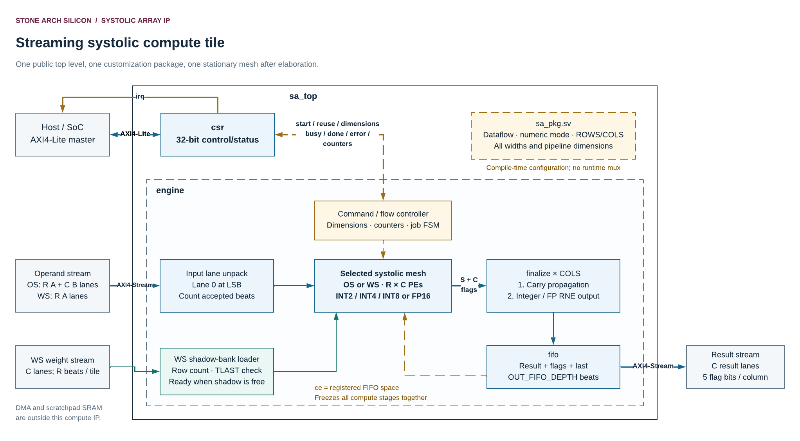
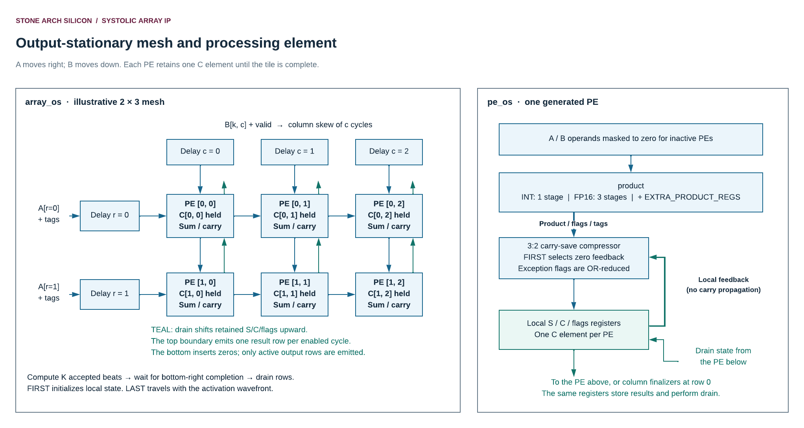
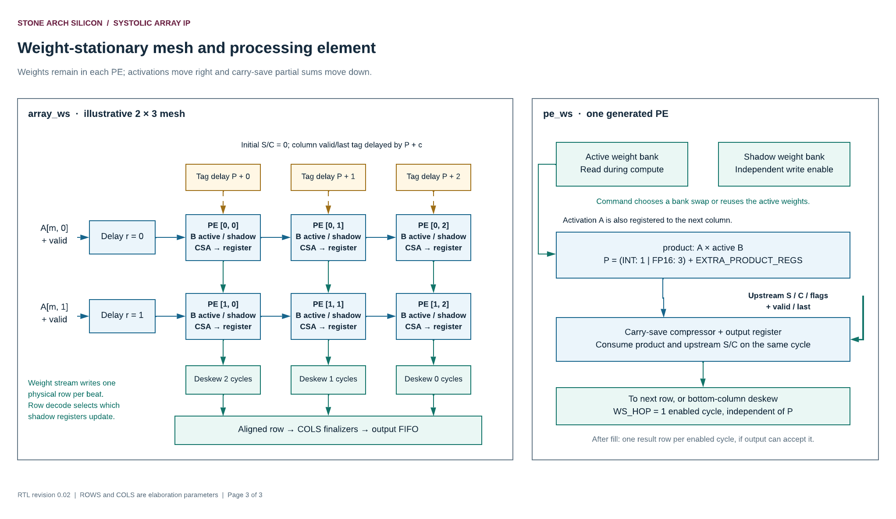
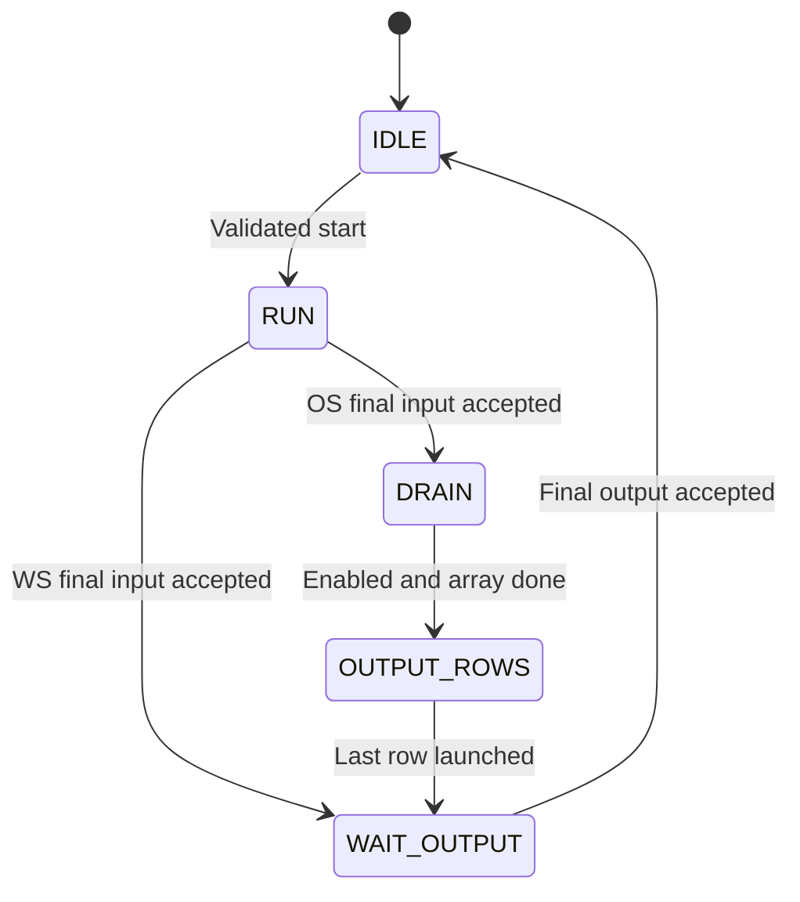

# Stone Arch Silicon Systolic Array IP — Architecture

**Document version:** 1.0 · **Date:** 8 November 2026  
**Design owner:** Stone Arch Silicon · **RTL engineer:** Paulo Dietrich  
**Source baseline:** Delivered short-name RTL in `Systolic_IP_Testbenches.zip`, including the revision 0.04 zero-depth fix in `delay.sv`.

This document explains how the circuit works, from matrix multiplication to individual pipeline registers. It includes the supplied Lucid overview and both mesh diagrams, followed by a section for every RTL source file. The [specification](specification.md) defines externally visible behavior; the [integration guide](integration_guide.md) shows how to connect and operate the block.

You do not need prior systolic-array knowledge. Start at section 1 and follow one operand through the drawings. If you are reviewing RTL, jump to the module directory in section 5.

### Contents

1. [From one dot product to an array](#a1)
2. [Shared arithmetic: pipelines and carry-save sums](#a2)
3. [Output-stationary operation](#a3)
4. [Weight-stationary operation](#a4)
5. [Complete RTL module directory](#a5)
6. [Stalls, validity, reset, and timing](#a6)
7. [ASIC implementation and configuration decisions](#a7)
8. [Verification boundaries and source traceability](#a8)

<a id="a1"></a>
## 1. From one dot product to an array

### 1.1 What the grid is doing

Suppose an accelerator needs `C = A × B`, where A has M rows and K columns, B has K rows and N columns, and C has M rows and N columns. Element `C[m,n]` is the sum of K products: `A[m,k] * B[k,n]` for k from zero through K−1.

A single multiplier and adder could do this by reading pairs one at a time. A systolic array instantiates many processing elements, or PEs, and lets nearby PEs reuse values as they travel through the grid. Reuse reduces repeated delivery of the same values from the array boundary. It does not eliminate the need to feed the boundary at the required rate.

Two maps are useful:

| Dataflow | What PE[r,c] represents | What remains in that PE | What moves |
|---|---|---|---|
| OS | Output element C[r,c] | Its running dot-product sum | A moves right, B moves down; completed sums later drain upward. |
| WS | Reduction term r for output column c | B[r,c] in an active weight register | A moves right; partial sums move down. |

The physical `ROWS` constant therefore means different things in the two maps. OS physical rows bound output rows M. WS physical rows bound reduction length K. `COLS` bounds output columns N in both.

### 1.2 Read the public block diagram



*Figure 1. Export of page 1 of the [user-supplied Lucid diagram](https://lucid.app/lucidchart/3d096fdb-01a2-4301-95d9-660d5201a26d/edit). External memories/DMA are outside the IP boundary.*

Read the drawing as two connected paths:

1. **Control path:** a host writes dimensions into `csr`; `csr` validates START and pulses `engine`; the engine returns busy/completion/error events and counters.
2. **Data path:** packed operands enter `engine`, are unpacked into lanes, traverse the selected mesh, pass through one `finalize` block per column, and enter the result `fifo`.

The FIFO's available-space indication drives the shared compute enable. The WS weight loader has its own handshake so it can load the inactive bank while the data path is busy or paused.

`sa_pkg` is a compile-time definition package. It is not a run-time controller and is not instantiated as a bank of configuration registers. Its dataflow and numeric choices decide which `generate` branches exist after elaboration.

### 1.3 Actual hierarchy and ownership

| Parent | Instance / generated region | Module | Responsibility |
|---|---|---|---|
| `sa_top` | `u_csr` | `csr` | Bus interface, dimension registers, command checks, sticky status. |
| `sa_top` | `u_engine` | `engine` | One-job scheduling and streams. |
| `engine` | `g_os.u_array` **or** `g_ws.u_array` | `array_os` **or** `array_ws` | Exactly one selected PE mesh. |
| Either array | `g_row[r].g_col[c].u_pe` | `pe_os` or `pe_ws` | Arithmetic and local transport at physical position r,c. |
| Every PE | `u_product` | `product` | Selected numeric product pipeline. |
| `product` | `u_extra` | `delay` | Optional transport registers after product formation. |
| `engine` | `g_finalize[c].u_finalize` | `finalize` | Resolve and convert one output column. |
| `engine` | `u_last` | `delay` | Delay output TLAST to match two finalizer stages. |
| `engine` | `u_fifo` | `fifo` | Queue complete result rows and flags. |
| Array boundaries | Named skew/deskew instances | `delay` | Align operands, tags, and completed columns. |

Only one mesh type and one product format are elaborated in a build. The source tree is shared; a run-time selection mux between four complete datapaths is not present.

<a id="a2"></a>
## 2. Shared arithmetic: pipelines and carry-save sums

### 2.1 Why pipeline the multiplication?

A clock period must be long enough for the logic between registers to settle. Combining a multiplication, a wide addition, and a feedback register in one stage can create a long timing path. Here product formation is separated from accumulation.

Integer multiplication has one registered product stage. FP16 product formation has three registered stages: decode, significand multiplication, and signed alignment. The mesh can request another product on every enabled clock even while earlier products remain in flight. **Latency** is the number of stages a product passes through; **throughput** is how often a new product can enter.

`EXTRA_PRODUCT_REGS` adds transport after those stages. It delays product bits, exceptional-value metadata, and FIRST/LAST tags together. It does not subdivide the existing multiplier logic and therefore should not be advertised as an automatic frequency improvement.

### 2.2 What a carry-save accumulator stores

Instead of storing a sum as one fully resolved binary number, the circuit stores two vectors, S and C, with represented value `S+C`. Here C means a carry vector; it is distinct from the output matrix named C.

To add a product P to this representation, a 3:2 compressor computes:

```text
new_S = S XOR C XOR P
new_C = ((S AND C) OR (S AND P) OR (C AND P)) << 1
```

At each bit position, XOR produces the result bit and the majority function produces a carry for the next position. A carry does not need to ripple through the whole word before the next register. The identity is `new_S + new_C = S + C + P`, within the chosen fixed width.

For a small unsigned illustration, adding 5, 3, and 6 in one compressor gives S=0 and C=14. Both represent the correct total 14. S or C alone usually does not look like the final answer. For signed operation the same bitwise identity holds in two's-complement modular arithmetic; the configured width keeps the intended final signed sum in range.

This changes where the wide carry-propagating operation occurs. The PEs repeatedly compress; `finalize` performs the ordinary `S+C` addition once per completed output. There is still a carry-propagating path in the design, but it is outside the repeated PE feedback/reduction step.

### 2.3 Integer and floating products share a reduction interface

Both numeric modes present `ACC_W` product bits and four exceptional-value metadata bits to the PE.

| Mode | Product representation | Accumulator interpretation |
|---|---|---|
| Integer | Signed `INT_W × INT_W` product, sign-extended | Exact signed integer sum. |
| FP16 | Signed integer equal to the exact finite product divided by `2^-48` | Exact fixed-point sum with 48 fractional bits. |

For finite binary16 values, the significand has at most 11 bits, so its product is a 22-bit integer. Exponent alignment places that integer at the correct bit position in a wider accumulator. This avoids normalization and rounding after every PE addition. The tradeoff is a considerably wider carry-save datapath than a conventional small floating accumulator.

For example, default OS FP mode with `MAX_K=1024` uses two 91-bit carry-save vectors per PE; default WS FP with 8 physical rows uses two 84-bit vectors. These widths are not the external result width. FP results can still be 32 bits per column.

### 2.4 Metadata follows the same pipeline

`special_t` is `{nan, invalid, pos_inf, neg_inf}`. A product involving NaN, an invalid combination, or infinity contributes zero to the numeric fixed-point payload and sets metadata instead. PEs combine metadata with bitwise OR.

At the end, `finalize` distinguishes a NaN, one sign of infinity, conflicting infinities, zero, and finite magnitude. It returns result bits plus the public `{NV,DZ,OF,UF,NX}` flags. Internal four-bit metadata and external five-bit flags are different formats with different jobs.

<a id="a3"></a>
## 3. Output-stationary operation



*Figure 2. The drawing's 2 × 3 mesh is illustrative. The generated shape comes from `ROWS` and `COLS`. Teal upward links are the result-drain path, not an extra arithmetic reduction.*

### 3.1 What enters on each beat

An OS input beat k contains one A value for each physical row and one B value for each physical column. It is the pairing of A's column k with B's row k. A complete run contains K accepted input beats.

For PE[r,c], matching values are `A[r,k]` and `B[k,c]`. A travels right one registered hop per column; B travels down one registered hop per row. They need to meet on the same enabled edge.

### 3.2 Why the boundary delays exist

At the left boundary, A row r is delayed by r enabled stages. At the top boundary, B column c is delayed by c enabled stages. From there, A needs c horizontal hops and B needs r vertical hops to reach PE[r,c]. Each path therefore has total transport delay r+c.

Without boundary skew, a lower-row A value could arrive too early for the matching B value. Skew is timing alignment, not a mathematical transpose or a change in values. The producer supplies unskewed complete vectors; the RTL adds the delays.

With the first input at edge zero and no stalls, term k reaches the product input of PE[r,c] at edge `k+r+c`. After product latency P, it is accumulated at edge `k+r+c+P`. A new term can enter that PE on every enabled edge.

### 3.3 FIRST initializes retained state

The engine tags the first accepted input with FIRST and the last with LAST. Both tags travel with A through the boundary skew, PE forwarding, and product pipeline.

On a FIRST-tagged valid product, the PE selects zero for the previous S, C, and exceptional metadata. It then accumulates that first product. Subsequent valid products use the retained state. This makes old payload bits irrelevant and avoids resetting every wide accumulator register when a new job starts.

Bubbles propagate as invalid entries. A PE accumulates only when its product-valid signal is high. A bubble therefore does not accidentally add old operands or repeat the previous product.

### 3.4 Completion and upward drain

Each PE raises `last_done` when its LAST-tagged product is accumulated. The farthest physical PE, `[ROWS-1][COLS-1]`, is the last one reached by the wave. `array_os.done_o` selects that PE's completion indication. The engine waits for it before starting the drain.

The result is already distributed across the array: every active PE owns one C element. Instead of selecting arbitrary rows through a large global multiplexer, the RTL temporarily uses the retained S/C/metadata registers as upward shift chains:

1. The top row is visible to the column finalizers.
2. On an enabled drain edge, each PE copies the state from the PE below it.
3. The bottom boundary supplies zeros.
4. The next output row is now at the top.

The finalizers sample the old top-row state on the same edge that the nonblocking register updates shift the next row upward. That is normal synchronous behavior, not an overwrite race. Only the first M active rows are emitted. Product updates have priority over drain in each PE, and the controller schedules drain only after all products have finished.

### 3.5 OS design consequences

The reuse of accumulator storage avoids a second full array of output registers and a large row-selection network. It also means the implementation cannot begin another OS accumulation while the previous output tile drains. Its throughput includes separate compute, completion wait, and row-drain phases.

Partial tiles zero-mask inactive PEs, but those PEs still carry valid/tag waves and contribute zero-valued state. Waiting for physical bottom-right completion therefore still works. Smaller active dimensions do not turn the physical mesh into a shorter mesh.

<a id="a4"></a>
## 4. Weight-stationary operation



*Figure 3. Two weights are stored per PE: one active and one shadow. The drawing retains its supplied revision 0.02 footer; the reviewed RTL uses the later short-name/controller revision and delay fix identified above.*

### 4.1 Map B onto the grid

In WS, PE[r,c] retains B[r,c]. Physical rows represent reduction terms, so K must fit within `ROWS`. The array can process many A rows using the same B tile; M is limited by `MAX_M`, not by physical row count.

One weight beat writes all columns of one physical row. A row counter selects which row receives the write. A complete bank load is exactly `ROWS` beats, with unused rows/columns zero-filled by the producer. There is no load address in the public stream.

Each PE has `weights[0]` and `weights[1]`. The engine initially selects bank 0 as the active-bank index but marks it invalid. Initial weights load into bank 1. The first successful new-weight START changes the active-bank index to 1 and marks it valid. The next shadow load then writes bank 0.

### 4.2 One A row becomes one output row

A WS input beat contains `A[m,0] … A[m,ROWS-1]`. Lane r enters physical row r after r enabled delay stages. Inside that row, A moves right one stage per column and multiplies the stationary B value in each PE.

The partial sum for output column c starts at zero at the top boundary. It moves downward through the reduction rows. Each PE adds one already-pipelined product using a carry-save compressor and passes the new S/C state downward through one register stage.

### 4.3 Product latency does not multiply by row count

The key alignment is between a PE's local product and the partial sum arriving from above. Let P be product latency. At column c, the top partial-sum valid and LAST tag are delayed by `P+c` stages. A at row r is skewed by r stages, so its product is ready in time for the sum wave at that row.

The result is a **one-enabled-cycle downward hop**, `WS_HOP=1`, regardless of P. An FP16 product needs three product stages, but the partial sum does not wait three new clocks at every physical row. Products are prepared ahead of the corresponding sum wave.

The `pe_ws` simulation assertion checks `pv_i == product_valid` on enabled edges. This checks that both halves of the operation describe the same valid wavefront. Changing only one delay formula or adding a register to one path would break that relationship.

### 4.4 Deskew the columns

Column c starts c cycles later because A travels right. Its bottom result consequently emerges c cycles later than column zero. To return a full result row in one beat, `array_ws` delays column c by `COLS-1-c` stages. Earlier columns wait longer; the last column needs zero delay.

The deskew payload includes S, C, four exceptional bits, and LAST, totaling `2*ACC_W+5` bits. Validity travels alongside it. After deskew, all columns refer to the same activation row and share the same output-valid schedule.

The engine then uses the same per-column finalizers and FIFO as OS. Once filled, the WS mesh can deliver one complete row per enabled cycle while accepting another activation row. Actual delivery still depends on output service.

### 4.5 Reuse, preload, and swap

| Situation | Active bank | Shadow bank | Next action |
|---|---|---|---|
| Just reset | Invalid | Incomplete | Load one complete physical tile. |
| Initial load complete | Invalid | Ready | Start without reuse to activate it. |
| Job running | Stable and readable | Available for writes until complete | Compute and preload may proceed together. |
| Next job uses same B | Kept | Unchanged, even if partly loaded | Start with reuse after previous job completes. |
| Next job uses new B | Swaps with shadow | Must have been complete before START | Start without reuse. |

Weight loading is not gated by compute `ce`. An output stall can freeze arithmetic while shadow writes continue. The loader does stop once the bank is complete, and it stops during the start pulse to prevent a write/swap collision.

Active bank data is not locked to particular active dimensions. Software may reuse it with a smaller or larger legal K/N, but the newly used lanes must contain the intended weights. This is why a full physical tile is loaded and why zero-filling unused entries is a useful integration convention.

<a id="a5"></a>
## 5. Complete RTL module directory

Each subsection gives a module's purpose, caller/callee relationships, full port table, internal signal inventory, and operating sequence. Port directions are relative to the module. `logic` is one bit; named packed types and all widths come from `sa_pkg` unless the module has generic parameters.

| RTL source | Jump to explanation |
|---|---|
| `sa_pkg.sv` | [5.1 Configuration and types](#arch-sa-pkg) |
| `sa_top.sv` | [5.2 Public boundary](#arch-sa-top) |
| `csr.sv` | [5.3 Control/status and bus FSMs](#arch-csr) |
| `engine.sv` | [5.4 Job FSM and stream engine](#arch-engine) |
| `array_os.sv` | [5.5 OS mesh wiring](#arch-array-os) |
| `pe_os.sv` | [5.6 OS PE](#arch-pe-os) |
| `array_ws.sv` | [5.7 WS mesh wiring](#arch-array-ws) |
| `pe_ws.sv` | [5.8 WS PE](#arch-pe-ws) |
| `product.sv` | [5.9 Numeric products](#arch-product) |
| `finalize.sv` | [5.10 Output conversion](#arch-finalize) |
| `delay.sv` | [5.11 Skew and transport](#arch-delay) |
| `fifo.sv` | [5.12 Result buffering](#arch-fifo) |

<a id="arch-sa-pkg"></a>
### 5.1 `sa_pkg.sv`: configuration and types

**Purpose.** Define the hardware configuration once, derive every dependent width, and provide consistent types to all modules. A package has no input/output ports and stores no run-time state.

The user-editable constants are `DATAFLOW`, `NUMERIC_MODE`, `ROWS`, `COLS`, `INT_W`, `MAX_K`, `MAX_M`, `INT_ACC_OVERRIDE`, `FP_RESULT_W`, `EXTRA_PRODUCT_REGS`, and `OUT_FIFO_DEPTH`. The complete defaults, legal values, formulas, and consequences are in [specification section 4](specification.md#s4).

The four selection symbols are `OUTPUT_STATIONARY=0`, `WEIGHT_STATIONARY=1`, `INTEGER_MODE=0`, and `FP16_MODE=1`. These values also appear in BUILD_ID.

| Derived group | Constants | Architectural role |
|---|---|---|
| Arithmetic sizing | `OPERAND_W`, `MAX_TERMS`, `INT_MIN_ACC_W`, `INT_ACC_W`, `FP_ACC_W`, `ACC_W`, `RESULT_W` | Bind product, sum, and result widths to the selected numeric/dataflow capacity. |
| Pipeline | `PRODUCT_LATENCY`, `WS_HOP` | Keep tag/product/sum alignment consistent. |
| Streams | `INPUT_LANES`, `INPUT_W`, `WEIGHT_W`, `OUTPUT_W`, `USER_W` | Define lane counts, byte-rounded data widths, and per-column flags. |
| Control sizing | `CSR_ADDR_W`, `LENGTH_W`, `ROW_COUNT_W`, `COL_COUNT_W` | Size addresses, captured dimensions, and counters. |
| Helpers | `imax`, `idx_width` | Select safe maxima and prevent zero-bit count/index widths. |
| Packed types | `operand_t`, `accum_t`, `result_t`, `special_t` | Share exact bit shapes across module boundaries. |

`special_t.nan`, `.invalid`, `.pos_inf`, and `.neg_inf` occupy bits 3, 2, 1, and 0. The exception OR operation depends on each field being a sticky fact about a dot product. Public NX/UF/OF do not exist until final conversion; they cannot be calculated from individual exact products alone.

No derived constant should be edited by the integrator. In particular, changing only `ACC_W` or `PRODUCT_LATENCY` manually can invalidate numerical range or wavefront alignment.

<a id="arch-sa-top"></a>
### 5.2 `sa_top.sv`: public boundary

**Purpose.** Present one stable interface to the accelerator: AXI4-Lite, operand input, WS weight input, result output, clock/reset, and interrupt. It instantiates `u_csr` and `u_engine`; it contains wiring, not another scheduler.

| Signal | Direction | Type / extent | Purpose and qualification |
|---|---|---|---|
| `clk` | In | `logic` | Rising-edge clock; all state in this module belongs to this clock domain. |
| `rst_n` | In | `logic` | Active-low synchronous reset. Reset behavior and unreset payload state are described in the module contract. |
| `s_axi_awaddr` | In | `logic [CSR_ADDR_W-1:0]` | Local byte address for a write. Retain with AWVALID until AWREADY handshake. |
| `s_axi_awprot` | In | `logic [2:0]` | Write protection attributes; ignored by this implementation. Tie to zero if unused. |
| `s_axi_awvalid` | In | `logic` | Host offers a valid write address. Independent of the write-data channel. |
| `s_axi_awready` | Out | `logic` | IP can accept a write address on this edge. Does not imply that write data has also arrived. |
| `s_axi_wdata` | In | `logic [31:0]` | 32-bit register write value; captured on the write-data handshake. |
| `s_axi_wstrb` | In | `logic [3:0]` | One enable per write-data byte, bit 0 for bits 7:0. COMMAND/STATUS/IRQ use only strobe 0. |
| `s_axi_wvalid` | In | `logic` | Host offers valid write data and strobes. Retain until WREADY handshake. |
| `s_axi_wready` | Out | `logic` | IP can accept write data on this edge, independently of AWREADY. |
| `s_axi_bresp` | Out | `logic [1:0]` | Write response: 00 OKAY or 10 SLVERR. Meaningful while BVALID is high. |
| `s_axi_bvalid` | Out | `logic` | IP offers a write response after address and data are captured and the write is committed. |
| `s_axi_bready` | In | `logic` | Host accepts the pending write response. Low keeps BVALID/BRESP retained. |
| `s_axi_araddr` | In | `logic [CSR_ADDR_W-1:0]` | Local byte address for a read; sampled with ARVALID and ARREADY. |
| `s_axi_arprot` | In | `logic [2:0]` | Read protection attributes; ignored by this implementation. Tie to zero if unused. |
| `s_axi_arvalid` | In | `logic` | Host offers a valid read address; retain it until ARREADY handshake. |
| `s_axi_arready` | Out | `logic` | IP can capture one read address on this edge. |
| `s_axi_rdata` | Out | `logic [31:0]` | Latched 32-bit register read value. Invalid addresses return zero with SLVERR. |
| `s_axi_rresp` | Out | `logic [1:0]` | Read response: 00 OKAY or 10 SLVERR. Meaningful while RVALID is high. |
| `s_axi_rvalid` | Out | `logic` | IP offers read data and response. Remains high until accepted. |
| `s_axi_rready` | In | `logic` | Host accepts pending read data/response. Low retains the response payload. |
| `s_axis_tdata` | In | `logic [INPUT_W-1:0]` | Packed operand vector: OS combines A column and B row; WS carries one A row. Lane zero is least significant. |
| `s_axis_tvalid` | In | `logic` | Producer offers a valid operand beat. Retain beat and TLAST until accepted. |
| `s_axis_tlast` | In | `logic` | Marks the final configured operand beat. Checked against LENGTH; does not override the count. |
| `s_axis_tready` | Out | `logic` | Operand acceptance. High only in RUN with compute enable high. |
| `s_weight_tdata` | In | `logic [WEIGHT_W-1:0]` | Packed B row, one OPERAND_W-bit lane per physical column. Used only by WS. |
| `s_weight_tvalid` | In | `logic` | Producer offers one WS shadow-bank row; keep payload/last stable until accepted. |
| `s_weight_tlast` | In | `logic` | Expected only on weight beat ROWS−1, including when ACTIVE_ROWS is smaller. |
| `s_weight_tready` | Out | `logic` | WS shadow loader can accept a row. Low in OS, for a complete shadow bank, or during start pulse. |
| `m_axis_tdata` | Out | `logic [OUTPUT_W-1:0]` | Packed output row, one RESULT_W-bit lane per physical column. Inactive columns/high padding are zero. |
| `m_axis_tuser` | Out | `logic [USER_W-1:0]` | Five flags per column, lane order matching TDATA: {NV,DZ,OF,UF,NX}. Zero in integer mode. |
| `m_axis_tvalid` | Out | `logic` | IP offers one buffered result row. Data, flags, and last remain stable while stalled. |
| `m_axis_tlast` | Out | `logic` | Final output row of the command. Completion requires its accepted handshake. |
| `m_axis_tready` | In | `logic` | Receiver can accept the offered result row. The receiver must service results during WS input streaming. |
| `irq` | Out | `logic` | Level interrupt: IRQ_ENABLE AND (sticky DONE OR sticky ERROR). |

#### Internal signals

| Signal | Width | Source → destination / meaning |
|---|---:|---|
| `start` | 1 | CSR accepted-command pulse → engine. |
| `reuse_weights` | 1 | CSR command's WS bank choice → engine. |
| `length`, `rows`, `cols` | 32 each | Software configuration → engine start capture. |
| `busy` | 1 | Engine state decode → CSR live status and command validation. |
| `done` | 1 | Engine final-output pulse → CSR sticky DONE. |
| `error` | 1 | Engine framing-error pulse → CSR sticky ERROR. |
| `shadow_ready` | 1 | Loader completeness → CSR status/START checks. |
| `active_weights` | 1 | Active bank validity → CSR status/reuse checks. |
| `cycles`, `input_beats`, `output_beats` | 32 each | Engine counters → read-only CSR values. |

The public `s_` prefixes describe interface roles. Removing those prefixes is not needed to distinguish module inputs from outputs; the declarations and port tables provide direction. The earlier `sasi_` module/file prefixes are absent in this source baseline.

<a id="arch-csr"></a>
### 5.3 `csr.sv`: control/status and the two bus FSMs

**Purpose.** Translate bus transactions into configuration and one-clock command pulses; expose live engine status and retain completion/error events for software. It performs no matrix arithmetic.

| Signal | Direction | Type / extent | Purpose and qualification |
|---|---|---|---|
| `clk` | In | `logic` | Rising-edge clock; all state in this module belongs to this clock domain. |
| `rst_n` | In | `logic` | Active-low synchronous reset. Reset behavior and unreset payload state are described in the module contract. |
| `s_axi_awaddr` | In | `logic [CSR_ADDR_W-1:0]` | Local byte address for a write. Retain with AWVALID until AWREADY handshake. |
| `s_axi_awprot` | In | `logic [2:0]` | Write protection attributes; ignored by this implementation. Tie to zero if unused. |
| `s_axi_awvalid` | In | `logic` | Host offers a valid write address. Independent of the write-data channel. |
| `s_axi_awready` | Out | `logic` | IP can accept a write address on this edge. Does not imply that write data has also arrived. |
| `s_axi_wdata` | In | `logic [31:0]` | 32-bit register write value; captured on the write-data handshake. |
| `s_axi_wstrb` | In | `logic [3:0]` | One enable per write-data byte, bit 0 for bits 7:0. COMMAND/STATUS/IRQ use only strobe 0. |
| `s_axi_wvalid` | In | `logic` | Host offers valid write data and strobes. Retain until WREADY handshake. |
| `s_axi_wready` | Out | `logic` | IP can accept write data on this edge, independently of AWREADY. |
| `s_axi_bresp` | Out | `logic [1:0]` | Write response: 00 OKAY or 10 SLVERR. Meaningful while BVALID is high. |
| `s_axi_bvalid` | Out | `logic` | IP offers a write response after address and data are captured and the write is committed. |
| `s_axi_bready` | In | `logic` | Host accepts the pending write response. Low keeps BVALID/BRESP retained. |
| `s_axi_araddr` | In | `logic [CSR_ADDR_W-1:0]` | Local byte address for a read; sampled with ARVALID and ARREADY. |
| `s_axi_arprot` | In | `logic [2:0]` | Read protection attributes; ignored by this implementation. Tie to zero if unused. |
| `s_axi_arvalid` | In | `logic` | Host offers a valid read address; retain it until ARREADY handshake. |
| `s_axi_arready` | Out | `logic` | IP can capture one read address on this edge. |
| `s_axi_rdata` | Out | `logic [31:0]` | Latched 32-bit register read value. Invalid addresses return zero with SLVERR. |
| `s_axi_rresp` | Out | `logic [1:0]` | Read response: 00 OKAY or 10 SLVERR. Meaningful while RVALID is high. |
| `s_axi_rvalid` | Out | `logic` | IP offers read data and response. Remains high until accepted. |
| `s_axi_rready` | In | `logic` | Host accepts pending read data/response. Low retains the response payload. |
| `busy_i` | In | `logic` | Engine is processing a command, including input waits and pending final output delivery. |
| `done_i` | In | `logic` | One-clock engine pulse acknowledging the final output handshake; sets sticky DONE. |
| `error_i` | In | `logic` | One-clock engine framing-error event; sets sticky ERROR. |
| `shadow_ready_i` | In | `logic` | WS inactive bank has received all physical rows and can be swapped into use. |
| `active_weights_i` | In | `logic` | WS active bank is valid; a reuse command is permitted if the other command checks pass. |
| `cycles_i` | In | `logic [31:0]` | 32-bit count of busy clock edges for the most recent job. |
| `input_beats_i` | In | `logic [31:0]` | 32-bit count of accepted operand-stream beats; excludes weight loads. |
| `output_beats_i` | In | `logic [31:0]` | 32-bit count of accepted result-stream beats. |
| `start_o` | Out | `logic` | One-clock pulse to engine after accepting a valid START. Captured dimensions are stable for this pulse. |
| `reuse_weights_o` | Out | `logic` | Reuse choice associated with start_o. Meaningful to engine when start_o is high. |
| `length_o` | Out | `logic [31:0]` | Software configuration value: K in OS, M in WS. Engine captures it at start. |
| `rows_o` | Out | `logic [31:0]` | Software active-row count: M in OS, K in WS. Engine captures it at start. |
| `cols_o` | Out | `logic [31:0]` | Software active-column count N. Engine captures it at start. |
| `irq_o` | Out | `logic` | Level interrupt from enabled sticky DONE or ERROR; connected to public irq. |

#### Internal registers and combinational signals

| Signal / type | Purpose |
|---|---|
| `write_state_t`, `write_state`, `next_write_state` | Explicit registered and next-state values for write collection/response. |
| `read_state_t`, `read_state`, `next_read_state` | Separate read address/response FSM. |
| `aw_hold` | One buffered write address is waiting to be committed. |
| `w_hold` | One buffered write data/strobe item is waiting. |
| `awaddr_q` | Buffered local write address, `CSR_ADDR_W` bits. |
| `wdata_q`, `wstrb_q` | Buffered 32-bit write data and 4-bit byte strobes. |
| `done_sticky`, `error_sticky` | Persistent software-visible events until W1C/reset; successful START also clears DONE. |
| `irq_enable` | Software interrupt gate bit. |
| `command_ok` | Current idle/pending-start/dimension/bank conditions permit this command. Uses buffered command bit 1 for reuse. |
| `rd_data`, `rd_resp` | Combinational decode of the current read address; latched on read acceptance. |
| `unused_prot` | Reduction of protection inputs to account for unused attributes; no access-control effect. |
| `write_commit` | Write FSM is collecting and both held-channel flags are set. |
| `read_accept` | `s_axi_arvalid && s_axi_arready`. |
| `byte_merge(previous,incoming,strobe)` | Returns a 32-bit value with only strobed bytes replaced. Local `value` and loop index `i` are function temporaries. |

#### Write FSM

| State | Encoding | Outputs / action | Transition |
|---|---|---|---|
| `WRITE_COLLECT` | 0 | AWREADY if address slot empty; WREADY if data slot empty. Capture channels independently. | When `write_commit`, commit one decoded write and enter RESPONSE. |
| `WRITE_RESPONSE` | 1 | BVALID=1 with retained BRESP. No new AW/W accepted. | BREADY returns to COLLECT. |

The state register is an `always_ff` block with synchronous reset to COLLECT. A separate `always_comb` block determines `next_write_state`, and another combinational output block decodes readiness/response validity. Holding registers, register writes, and sticky events are in a separate sequential block.

If address and data are accepted at edge t, `aw_hold` and `w_hold` become set after that edge. The write commits at edge t+1, then BVALID is visible. Even an always-ready host does not get a new write transaction on every clock; this compact control path has intentional collection/response turnover cycles.

#### Read FSM

| State | Encoding | Outputs / action | Transition |
|---|---|---|---|
| `READ_IDLE` | 0 | ARREADY=1. On a handshake, latch decoded data and response. | Address acceptance enters RESPONSE. |
| `READ_RESPONSE` | 1 | RVALID=1; RDATA/RRESP remain latched. | RREADY returns to IDLE. |

Read and write state machines are independent. A delayed write response does not prevent a read. Within a read response, changing live STATUS does not change the already captured RDATA, so it remains stable under backpressure.

#### Command and event priority

`command_ok` rejects a busy engine, a pending `start_o`, zero/out-of-range dimensions, and invalid WS bank requests. When the write commits, accepted START sets `start_o` for one clock and passes the reuse bit. `engine` captures configuration on the next edge while that pulse is high.

The sequential block first applies software writes and clears, then applies `done_i` and `error_i`. Nonblocking assignment priority therefore makes a simultaneous hardware event win over W1C. An invalid read only affects RRESP/RDATA; invalid writes set sticky ERROR. Arithmetic TUSER flags never enter this CSR block.

<a id="arch-engine"></a>
### 5.4 `engine.sv`: job FSM, banks, packing, and backpressure

**Purpose.** Run one accepted job and keep its input waves, array selection, output tags, and external completion consistent. Its children are the selected array, `COLS` finalizers, the two-stage last-tag delay, and the result FIFO.

| Signal | Direction | Type / extent | Purpose and qualification |
|---|---|---|---|
| `clk` | In | `logic` | Rising-edge clock; all state in this module belongs to this clock domain. |
| `rst_n` | In | `logic` | Active-low synchronous reset. Reset behavior and unreset payload state are described in the module contract. |
| `start_i` | In | `logic` | One-clock accepted-command pulse. Must occur only when idle with legal dimensions and valid WS bank conditions. |
| `reuse_weights_i` | In | `logic` | On WS start: 1 keeps the active bank; 0 swaps the complete shadow bank. Ignored for OS computation. |
| `length_i` | In | `logic [31:0]` | 32-bit requested length, K in OS or M in WS; captured on start_i. |
| `rows_i` | In | `logic [31:0]` | 32-bit requested active rows, M in OS or K in WS; captured on start_i. |
| `cols_i` | In | `logic [31:0]` | 32-bit requested active columns N; captured on start_i. |
| `busy_o` | Out | `logic` | High in every non-IDLE job state, including waiting for final result acceptance. |
| `done_o` | Out | `logic` | Engine: one-clock pulse after final output acceptance. See array_os override for the internal completion tag. |
| `error_o` | Out | `logic` | One-clock event on an accepted operand/weight beat with incorrect TLAST; does not abort. |
| `shadow_ready_o` | Out | `logic` | WS shadow tile complete. Cleared by reset or successful non-reuse start. |
| `active_weights_o` | Out | `logic` | WS active tile valid. Set by first successful non-reuse start and retained until reset. |
| `cycles_o` | Out | `logic [31:0]` | Busy-clock counter, including stalls; reset per accepted start and modulo 2^32. |
| `input_beats_o` | Out | `logic [31:0]` | Accepted operand-beat counter; reset per start and modulo 2^32. |
| `output_beats_o` | Out | `logic [31:0]` | Accepted result-beat counter; reset per start and modulo 2^32. |
| `s_axis_tdata` | In | `logic [INPUT_W-1:0]` | Packed operand vector: OS combines A column and B row; WS carries one A row. Lane zero is least significant. |
| `s_axis_tvalid` | In | `logic` | Producer offers a valid operand beat. Retain beat and TLAST until accepted. |
| `s_axis_tlast` | In | `logic` | Marks the final configured operand beat. Checked against LENGTH; does not override the count. |
| `s_axis_tready` | Out | `logic` | Operand acceptance. High only in RUN with compute enable high. |
| `s_weight_tdata` | In | `logic [WEIGHT_W-1:0]` | Packed B row, one OPERAND_W-bit lane per physical column. Used only by WS. |
| `s_weight_tvalid` | In | `logic` | Producer offers one WS shadow-bank row; keep payload/last stable until accepted. |
| `s_weight_tlast` | In | `logic` | Expected only on weight beat ROWS−1, including when ACTIVE_ROWS is smaller. |
| `s_weight_tready` | Out | `logic` | WS shadow loader can accept a row. Low in OS, for a complete shadow bank, or during start pulse. |
| `m_axis_tdata` | Out | `logic [OUTPUT_W-1:0]` | Packed output row, one RESULT_W-bit lane per physical column. Inactive columns/high padding are zero. |
| `m_axis_tuser` | Out | `logic [USER_W-1:0]` | Five flags per column, lane order matching TDATA: {NV,DZ,OF,UF,NX}. Zero in integer mode. |
| `m_axis_tvalid` | Out | `logic` | IP offers one buffered result row. Data, flags, and last remain stable while stalled. |
| `m_axis_tlast` | Out | `logic` | Final output row of the command. Completion requires its accepted handshake. |
| `m_axis_tready` | In | `logic` | Receiver can accept the offered result row. The receiver must service results during WS input streaming. |

#### Internal signal inventory

| Signal / group | Width / extent | Purpose |
|---|---|---|
| `state_t`, `state`, `next_state` | 3-bit state | Explicit current/next job state. |
| `ce` | 1 | Output FIFO input-ready; global compute advance. |
| `input_fire`, `weight_fire`, `output_fire` | 1 each | VALID AND READY for the three streams. Count actual transfers, not offered cycles. |
| `length_q`, `input_count` | `LENGTH_W` each | Captured job length and current accepted operand index. |
| `rows_q`, `cols_q` | Row/column count widths | Captured active dimensions; stable throughout the command. |
| `output_row` | `ROW_COUNT_W` | Current OS drain row index. Advances only on enabled drain edges. |
| `weight_row` | `ROW_COUNT_W` | Current physical shadow-bank load row; advances on weight handshakes. |
| `active_bank` | 1 | Which of the two per-PE weight registers is read. |
| `shadow_ready`, `active_valid` | 1 each | Bank completeness/validity metadata; separate from unreset weight payload. |
| `a[ROWS]` | `operand_t` each | A lanes unpacked from low input fields. |
| `b[COLS]` | `operand_t` each | OS B lanes unpacked after A; tied zero in WS branch. |
| `w[COLS]` | `operand_t` each | Weight lanes unpacked from separate weight input. |
| `raw_sum[COLS]`, `raw_carry[COLS]` | `accum_t` each | Selected array's completed carry-save row. |
| `raw_special[COLS]` | `special_t` each | Row-aligned exceptional metadata. |
| `raw_valid`, `raw_last` | 1 each | Row-valid and final-row indication entering finalizers. |
| `array_done`, `array_drain` | 1 each | OS bottom-right completion and upward-drain request. |
| `ws_valid`, `ws_last` | 1 each | Deskewed WS row tags; tied zero in OS branch. |
| `final_valid[COLS]` | 1 per column | Two-stage finalizer validity. All columns share input validity and ce. |
| `final_data[COLS]` | `result_t` each | Converted/rounded column results. |
| `final_flags[COLS]` | 5 bits each | Converted column arithmetic flags. |
| `final_last`, `last_valid` | 1 each | Last tag and companion validity from `u_last`; FIFO validity uses `final_valid[0]`. `last_valid` is redundant alignment output, not an extra handshake. |
| `packed_data`, `packed_flags` | `OUTPUT_W`, `USER_W` | Lane-zero-low assembled result/flag buses. High data padding is set zero. |

#### Explicit FSM



The diagram shows normal command paths. The actual final-output handshake is a global completion condition; it returns the state to IDLE independent of compute enable. Reset also selects IDLE. START has priority over completion in the next-state expression, but legal integration does not issue START during an active job.

| State | Encoding | BUSY | Operand READY | OS drain | Purpose |
|---|---|---:|---|---:|---|
| `IDLE` | `000` | 0 | 0 | 0 | Await validated command. |
| `RUN` | `001` | 1 | `ce` | 0 | Accept exactly LENGTH operands. WS results may already flow. |
| `DRAIN` | `010` | 1 | 0 | 0 | Wait for remaining OS products to reach bottom-right completion. Despite its name, this state does not yet shift rows. |
| `OUTPUT_ROWS` | `011` | 1 | 0 | 1 | Present top-row OS results and shift one row per enabled edge. |
| `WAIT_OUTPUT` | `100` | 1 | 0 | 0 | Allow pipeline/FIFO to finish delivering the last result. |

The state register, next-state logic, and combinational state-output decode are separate blocks. Dimension capture, counters, bank state, and pulse outputs have a separate sequential owner. Invalid state encodings disable input/drain and select IDLE on the next clock; this is a basic default recovery path, not a fault-tolerance guarantee.

#### Start and stream tags

`start_i` captures all three dimensions, clears input/drain counters, resets job counters, and clears pipeline valid state. OS FIRST is `input_count==0`; internal LAST is `input_count==length_q-1`. WS uses the same count comparison for its final activation tag.

External TLAST is checked only on accepted beats. If it disagrees, `error_o` pulses but the internal count still drives the job. `input_count` stops at its final index instead of rolling over. Input readiness then disappears as the state leaves RUN.

#### Array selection and final packing

In OS, `raw_valid=array_drain` and `raw_last=(output_row==rows_q-1)`. In WS, both come from the deskewed array. Every column has a two-stage `finalize`, while `u_last` delays the row-last bit by two enabled stages.

The FIFO stores `{packed_data, packed_flags, final_last}`. From low to high bits, this is TLAST, USER flags, then TDATA. This internal concatenation is unpacked back into distinct public ports; it is not the layout of result bytes written by an external DMA.

FIFO input validity is `final_valid[0]`. That is safe because every finalizer receives the same valid and ce, and the selected array aligns all columns. A custom modification that lets columns stall independently would need a different row-assembly contract.

#### Banks, counters, and pulses

Weight loading uses `weight_fire` even when `ce=0`. It advances `weight_row` and marks `shadow_ready` on physical row `ROWS-1`; that event also resets the load-row index to zero. Non-reuse START toggles `active_bank`, sets `active_valid`, and clears `shadow_ready`. Reuse START changes none of those bank/load fields.

`cycles_o` increments on every busy clock, including stalled clocks. Input/output counters increment on their handshake events. START resets all three counters with priority over increments. `done_o` and `error_o` normally default low each clock and pulse for events; CSR turns them into sticky state.

The engine contains simulation-only checks for legal package choices, output stability under stalls, legal start timing, completion tied to the final handshake, and stable OS drain position while stopped. These assertions do not become a hardware error-detection block in synthesis.

<a id="arch-array-os"></a>
### 5.5 `array_os.sv`: OS mesh wiring

**Purpose.** Generate the physical OS grid, boundary skews, local connections, and upward result chain. It has no job FSM, FIFO, or public stream READY.

| Signal | Direction | Type / extent | Purpose and qualification |
|---|---|---|---|
| `clk` | In | `logic` | Rising-edge clock; all state in this module belongs to this clock domain. |
| `rst_n` | In | `logic` | Active-low synchronous reset. Reset behavior and unreset payload state are described in the module contract. |
| `clear` | In | `logic` | Synchronous flush of pipeline validity, independent of ce. Does not zero wide payload registers. |
| `ce` | In | `logic` | Compute clock enable. One enabled edge advances transport/arithmetic; zero holds the pipeline, except reset/clear and explicitly independent weight writes. |
| `valid_i` | In | `logic` | A complete paired A/B vector enters on an enabled edge. Corresponds to one accepted OS input beat. |
| `first_i` | In | `logic` | This input beat is reduction term zero; delayed with A to initialize every PE accumulator. |
| `last_i` | In | `logic` | This input beat is the final reduction term; delayed with A to generate per-PE completion. |
| `drain` | In | `logic` | Shift retained S/C/metadata upward one row on each enabled edge, after all products finish. |
| `active_rows` | In | `logic [ROW_COUNT_W-1:0]` | Count of enabled physical rows. OS: output M. WS: reduction K. Captured by the calling engine. |
| `active_cols` | In | `logic [COL_COUNT_W-1:0]` | Count of enabled physical columns, equal to output N. |
| `a_i` | In | `operand_t [ROWS]` | ROWS A operands; element r is A[r,k] before row-r skew. |
| `b_i` | In | `operand_t [COLS]` | COLS B operands; element c is B[k,c] before column-c skew. |
| `sum_o` | Out | `accum_t [COLS]` | Top physical row S vectors, one per column. Current drain row when the controller asserts drain. |
| `carry_o` | Out | `accum_t [COLS]` | Top physical row C vectors, paired with sum_o. Add S+C in finalize. |
| `special_o` | Out | `special_t [COLS]` | Top-row exceptional-value metadata, aligned with the retained S/C state. |
| `done_o` | Out | `logic` | LAST completion from the physical bottom-right PE. Enabled-cycle event; may remain high while ce is low. Not public job completion. |

| Internal signal | Extent | Meaning |
|---|---|---|
| `a`, `av`, `tag` | `[ROWS][COLS+1]` | Horizontal A boundaries, valid bits, and two-bit FIRST/LAST tags. Boundary column 0 is the skew output; column c+1 is PE c's forwarding output. |
| `b`, `bv` | `[ROWS+1][COLS]` | Vertical B boundaries and valid bits. Row 0 is the skew output; row r+1 is PE r's forwarded output. |
| `sums`, `carries`, `flags` | `[ROWS+1][COLS]` | Retained PE state and upward-drain boundary connections. Index ROWS is the bottom zero source. |
| `done` | `[ROWS][COLS]` | Per-PE LAST completion indications; only physical bottom-right is exported. |

Generated `g_a_skew[r].u_skew` has width `OPERAND_W+2` and depth r. It carries `{a_i[r], first_i, last_i}`. Generated `g_b_skew[c].u_skew` has width `OPERAND_W` and depth c. The first row/column therefore uses zero-depth bypasses.

In `g_row[r].g_col[c]`, active selection is `(r<active_rows)&&(c<active_cols)`. The PE writes its retained result to `sums[r][c]` and receives drain state from index r+1. The top outputs always expose index zero; only the engine determines when they are meaningful results.

The extra boundary entries in these arrays are intentional. They make local connections regular and avoid special-case port wiring at every edge. Generate indices r and c are elaboration constants, not hardware counters.

<a id="arch-pe-os"></a>
### 5.6 `pe_os.sv`: one retained-output PE

**Purpose.** Hold one output dot product while forwarding operands to neighbors, then participate in the upward drain.

| Signal | Direction | Type / extent | Purpose and qualification |
|---|---|---|---|
| `clk` | In | `logic` | Rising-edge clock; all state in this module belongs to this clock domain. |
| `rst_n` | In | `logic` | Active-low synchronous reset. Reset behavior and unreset payload state are described in the module contract. |
| `clear` | In | `logic` | Synchronous flush of pipeline validity, independent of ce. Does not zero wide payload registers. |
| `ce` | In | `logic` | Compute clock enable. One enabled edge advances transport/arithmetic; zero holds the pipeline, except reset/clear and explicitly independent weight writes. |
| `active` | In | `logic` | This PE lies inside both active dimensions. If false, both multiplier operands are replaced with zero. |
| `a_i` | In | `operand_t` | Activation arriving from the left boundary or left neighbor. |
| `b_i` | In | `operand_t` | B operand arriving from the top boundary or PE above. |
| `av_i` | In | `logic` | a_i and tag_i are valid on this enabled edge. |
| `bv_i` | In | `logic` | b_i is valid on this enabled edge. Product request uses av_i AND bv_i. |
| `tag_i` | In | `logic [1:0]` | Two-bit product metadata {first,last}: FIRST bit 1, LAST bit 0. Meaningful with the associated valid operand. |
| `a_o` | Out | `operand_t` | a_i forwarded right through one enabled register stage. |
| `b_o` | Out | `operand_t` | b_i forwarded down through one enabled register stage. |
| `av_o` | Out | `logic` | Validity for a_o and tag_o; cleared by reset or clear. |
| `bv_o` | Out | `logic` | Validity for b_o; cleared by reset or clear. |
| `tag_o` | Out | `logic [1:0]` | {first,last} forwarded right with a_o, one enabled stage after tag_i. |
| `drain` | In | `logic` | If no product is being accumulated, copy drain inputs into local result state on an enabled edge. |
| `drain_sum_i` | In | `accum_t` | S vector from the PE below, or zero at the bottom boundary. |
| `drain_carry_i` | In | `accum_t` | C vector from the PE below, or zero at the bottom boundary. |
| `drain_special_i` | In | `special_t` | Four exceptional-value bits from below, or zero at the bottom. |
| `result_sum_o` | Out | `accum_t` | Retained local S vector. Initialized by first valid product rather than wide reset. |
| `result_carry_o` | Out | `accum_t` | Retained local C vector, paired with result_sum_o. |
| `result_special_o` | Out | `special_t` | Retained OR of exceptional-value metadata for this output element. |
| `last_done` | Out | `logic` | Registered indication that a LAST-tagged product was accumulated. Cleared by reset/clear; holds while ce=0. |

| Internal signal | Type | Meaning |
|---|---|---|
| `p` | `accum_t` | Product output from `u_product`. |
| `pf`, `pv`, `pt` | `special_t`, 1 bit, 2 bits | Product exception metadata, validity, and delayed FIRST/LAST tags. |
| `sum_q`, `carry_q` | `accum_t` each | Retained local carry-save vectors. |
| `flags_q` | `special_t` | Retained metadata for this dot product. |
| `x`, `y` | `accum_t` each | Compressor inputs selected as zero on FIRST or the retained vectors otherwise. |
| `sum_next`, `carry_next` | `accum_t` each | Combinational XOR/majority compressor outputs. |
| `flags_next` | `special_t` | Zero-or-previous metadata OR the new product metadata. |

The operand forwarding registers advance whenever ce is high. Their payload does not depend on validity, but `av_o`/`bv_o` control whether downstream logic may use it. Validity clears on reset or clear even if ce is low.

The product request is `av_i && bv_i`; an inactive PE still receives a valid zero product. Both operands are masked, so an unused infinity does not create invalid `0×infinity`. FIRST initializes all retained numeric/metadata state through the compressor inputs.

On an enabled valid product, S/C/flags update. Otherwise, if drain is asserted, they copy the inputs from below. With neither condition, they retain their value. `last_done` registers `pv && pt[0]` on enabled edges; it can remain asserted across a global stall, which is why the controller checks it together with ce.

<a id="arch-array-ws"></a>
### 5.7 `array_ws.sv`: WS mesh wiring

**Purpose.** Connect a banked WS grid, align activation/product/sum timing, and export complete deskewed rows.

| Signal | Direction | Type / extent | Purpose and qualification |
|---|---|---|---|
| `clk` | In | `logic` | Rising-edge clock; all state in this module belongs to this clock domain. |
| `rst_n` | In | `logic` | Active-low synchronous reset. Reset behavior and unreset payload state are described in the module contract. |
| `clear` | In | `logic` | Synchronous flush of pipeline validity, independent of ce. Does not zero wide payload registers. |
| `ce` | In | `logic` | Compute clock enable. One enabled edge advances transport/arithmetic; zero holds the pipeline, except reset/clear and explicitly independent weight writes. |
| `valid_i` | In | `logic` | One complete A activation row enters on an enabled edge; corresponds to one accepted WS operand beat. |
| `last_i` | In | `logic` | This activation vector is the final output row of the job; delayed down the sum wavefront. |
| `active_rows` | In | `logic [ROW_COUNT_W-1:0]` | Count of enabled physical rows. OS: output M. WS: reduction K. Captured by the calling engine. |
| `active_cols` | In | `logic [COL_COUNT_W-1:0]` | Count of enabled physical columns, equal to output N. |
| `a_i` | In | `operand_t [ROWS]` | ROWS activation operands; element r is A[m,r] before row skew. |
| `weight_i` | In | `operand_t [COLS]` | COLS B values for the selected physical weight_row. Each column broadcasts to its selected PE. |
| `weight_we` | In | `logic` | Synchronous weight write enable. Independent of ce; caller must select only the inactive bank. |
| `weight_write_bank` | In | `logic` | Index 0 or 1 of the bank to write when weight_we is high. |
| `weight_active_bank` | In | `logic` | Index 0 or 1 read by the product pipeline. Must remain stable throughout a job. |
| `weight_row` | In | `logic [ROW_COUNT_W-1:0]` | Physical row index receiving the current weight vector; valid range 0 through ROWS−1. |
| `sum_o` | Out | `accum_t [COLS]` | Deskewed bottom-boundary S vectors, one per output column, qualified by valid_o. |
| `carry_o` | Out | `accum_t [COLS]` | Deskewed C vectors aligned with sum_o. |
| `special_o` | Out | `special_t [COLS]` | Deskewed four-bit exceptional-value metadata for each output column. |
| `valid_o` | Out | `logic` | One complete aligned output row is available. Propagates/stalls with ce; not a ready/valid public port. |
| `last_o` | Out | `logic` | Aligned final-output-row tag; meaningful with valid_o. |

| Internal signal | Extent | Meaning |
|---|---|---|
| `a`, `av` | `[ROWS][COLS+1]` | Horizontal activation boundaries and validity. |
| `sums`, `carries`, `flags` | `[ROWS+1][COLS]` | Downward carry-save boundary data and exceptional metadata. Index 0 is the zero-valued top input. |
| `pv`, `last` | `[ROWS+1][COLS]` | Partial-sum validity and final-row tags at each downward boundary. |
| `aligned_valid`, `aligned_last` | `[COLS]` | Tags after each column's result deskew. |

Generated `g_a_skew[r].u_skew` delays A by `r*WS_HOP`. At each column, `g_col_boundary[c].u_tag_skew` delays initial valid/LAST by `PRODUCT_LATENCY+c`. `u_deskew` delays `{sum,carry,special,last}` by `COLS-1-c`.

Each PE's weight enable is `weight_we && (weight_row==r)`. Columns use the corresponding `weight_i[c]`, so one beat writes an entire physical row into the selected bank. No compute skew applies to weight loading.

Top numeric state and metadata are tied zero. The bottom boundary has every reduction term, including masked zeros from inactive physical rows. Exported valid/LAST use the last column's aligned tags. Simulation assertions verify each column's aligned validity agrees with that reference column.

<a id="arch-pe-ws"></a>
### 5.8 `pe_ws.sv`: one retained-weight PE

**Purpose.** Store two B values, multiply incoming A against the active value, and add the product to the downward partial sum in one compression stage.

| Signal | Direction | Type / extent | Purpose and qualification |
|---|---|---|---|
| `clk` | In | `logic` | Rising-edge clock; all state in this module belongs to this clock domain. |
| `rst_n` | In | `logic` | Active-low synchronous reset. Reset behavior and unreset payload state are described in the module contract. |
| `clear` | In | `logic` | Synchronous flush of pipeline validity, independent of ce. Does not zero wide payload registers. |
| `ce` | In | `logic` | Compute clock enable. One enabled edge advances transport/arithmetic; zero holds the pipeline, except reset/clear and explicitly independent weight writes. |
| `active` | In | `logic` | This PE lies inside both active dimensions. If false, both multiplier operands are replaced with zero. |
| `weight_we` | In | `logic` | Synchronous weight write enable. Independent of ce; caller must select only the inactive bank. |
| `weight_write_bank` | In | `logic` | Index 0 or 1 of the bank to write when weight_we is high. |
| `weight_active_bank` | In | `logic` | Index 0 or 1 read by the product pipeline. Must remain stable throughout a job. |
| `weight_i` | In | `operand_t` | One B operand written into weights[weight_write_bank] when weight_we is high. |
| `a_i` | In | `operand_t` | Activation from the left boundary or neighboring PE. |
| `av_i` | In | `logic` | Activation valid; also requests one product from the selected stationary weight. |
| `a_o` | Out | `operand_t` | Activation forwarded right after one enabled stage. |
| `av_o` | Out | `logic` | One-stage forwarded activation validity. |
| `sum_i` | In | `accum_t` | S vector arriving from the PE above, or zero at the top boundary. |
| `carry_i` | In | `accum_t` | C vector arriving with sum_i. |
| `special_i` | In | `special_t` | Upstream exceptional-value metadata to OR with this PE product metadata. |
| `pv_i` | In | `logic` | Upstream partial sum is valid. Must match the local pipelined product validity on enabled edges. |
| `last_i` | In | `logic` | Final output-row tag associated with the upstream partial sum. |
| `sum_o` | Out | `accum_t` | Registered compressed S vector sent downward after one enabled reduction stage. |
| `carry_o` | Out | `accum_t` | Registered compressed C vector sent downward with sum_o. |
| `special_o` | Out | `special_t` | Registered OR of upstream and local product metadata. |
| `pv_o` | Out | `logic` | Registered pv_i AND product_valid; qualifies the downward result. |
| `last_o` | Out | `logic` | Registered last_i associated with the valid downward result. |

| Internal signal | Type | Meaning |
|---|---|---|
| `weights[2]` | Two `operand_t` registers | Physical banks 0 and 1; active/shadow roles come from engine selectors. |
| `product` | `accum_t` | Exact local multiplication result. The signal name matches a module name but is a separate RTL object. |
| `pf` | `special_t` | Local product exceptional metadata. |
| `product_valid` | 1 | Local product is ready to join the upstream partial sum. |
| `unused_tag` | 2 | Product tag output; WS passes constant tag input because the LAST tag follows the sum path instead. |

The weight-write statement is independent of ce and has no local reset/clear gating. Engine-generated enables and bank-valid metadata make that safe in the complete IP. A direct PE-level user must enforce equivalent rules. Reset does not erase the stored weights.

Activation forwarding takes one enabled stage. Product input validity is `av_i`. The reduction output-valid register receives `pv_i && product_valid`; S/C/metadata/LAST update only when both are high and ce is high. The alignment assertion checks that these two valid streams agree on every enabled edge outside reset/clear.

Unlike OS, this PE does not accumulate multiple time-separated terms for one retained output. The upstream partial sum already contains the contributions of previous physical rows. This PE contributes one reduction term and sends the result to the next row.

<a id="arch-product"></a>
### 5.9 `product.sv`: numeric product formation

**Purpose.** Present a uniform product/metadata/tag interface to either PE while elaborating only the selected numeric format.

| Signal | Direction | Type / extent | Purpose and qualification |
|---|---|---|---|
| `clk` | In | `logic` | Rising-edge clock; all state in this module belongs to this clock domain. |
| `rst_n` | In | `logic` | Active-low synchronous reset. Reset behavior and unreset payload state are described in the module contract. |
| `clear` | In | `logic` | Synchronous flush of pipeline validity, independent of ce. Does not zero wide payload registers. |
| `ce` | In | `logic` | Compute clock enable. One enabled edge advances transport/arithmetic; zero holds the pipeline, except reset/clear and explicitly independent weight writes. |
| `valid_i` | In | `logic` | a_i, b_i, and tag_i form one valid multiplication request on an enabled edge. |
| `a_i` | In | `operand_t` | First raw integer or binary16 operand. |
| `b_i` | In | `operand_t` | Second raw integer or binary16 operand. |
| `tag_i` | In | `logic [1:0]` | Two-bit product metadata {first,last}: FIRST bit 1, LAST bit 0. Meaningful with the associated valid operand. |
| `valid_o` | Out | `logic` | Product and metadata valid after PRODUCT_LATENCY enabled stages. |
| `product_o` | Out | `accum_t` | Sign-extended integer product, or exact signed binary16 product in units of 2^-48. Zero for exceptional FP products. |
| `special_o` | Out | `special_t` | Four-bit classification metadata {nan,invalid,pos_inf,neg_inf}, aligned with product_o. |
| `tag_o` | Out | `logic [1:0]` | {first,last} delayed through all product/extra stages, aligned with valid_o. |

#### Shared internal signals

`product` is the selected base pipeline's `ACC_W`-bit result; `special` is its four-bit classification; `valid` qualifies them; `tag` is the two-bit FIRST/LAST metadata. `u_extra` transports `{product,special,tag}` with payload width `ACC_W+6` for `EXTRA_PRODUCT_REGS` stages.

#### Integer generate branch `g_int`

`p` is a signed `2*OPERAND_W` register. With `ce && valid_i`, it captures `$signed(a_i)*$signed(b_i)` and captures `tag_i`. Validity advances each enabled cycle and clears on reset/clear. Combinational sign extension produces the wide common `product`; common `special` is zero.

The multiply expression elaborates at the selected integer operand width. An INT2 build is not an INT8 datapath with only two useful bits, although synthesis ultimately chooses the target-cell implementation.

#### FP generate branch `g_fp`

| Signal | Width | Purpose |
|---|---:|---|
| `az`, `bz` | 1 each | Operand has zero exponent and fraction, ignoring sign. |
| `ai`, `bi` | 1 each | Operand is infinity. |
| `an`, `bn` | 1 each | Operand is NaN. Fraction bit 9 distinguishes quiet/signaling behavior. |
| `decoded` | `special_t` | Current operands' exceptional classification. |
| `ea`, `eb` | 6 each | Effective exponent, using 1 for exponent-zero operands. |
| `ma`, `mb` | 11 each | Captured fraction plus implicit leading one for normal operands. |
| `shift1`, `shift2` | 6 each | Captured alignment shift `ea+eb-2`, carried from decode to multiplication output. |
| `sign1`, `sign2` | 1 each | XOR of operand signs, aligned through the first two stages. |
| `mant_product` | 22 | Product of the two 11-bit significands. |
| `signed_product` | Signed 23 | Positive/negative form of `mant_product` before widening and shift. |
| `v` | 3 | Valid bits for decode, multiply, and alignment stages. |
| `tags[3]` | 2 per stage | FIRST/LAST metadata through the same three stages. |
| `f1`, `f2`, `f3` | `special_t` each | Classification metadata aligned to each stage. |

| Stage | Registered action | What makes its data meaningful? |
|---|---|---|
| 1: decode | Capture `ma`, `mb`, `shift1`, `sign1`, `f1`, `tags[0]`. | Current input valid. |
| 2: significand multiply | Capture `mant_product=ma*mb`, forward shift/sign/metadata/tag. | Previous stage's `v[0]`. |
| 3: sign/align | Widen signed product to ACC_W and shift left; substitute zero numeric payload if metadata is nonzero. | Previous stage's `v[1]`. |

All three valid bits shift with ce. Subnormal values have no implicit leading one and use effective exponent 1, preserving their exact scale. The wide shift creates a product in `2^-48` units. Exceptions use metadata instead of an artificial finite number.

<a id="arch-finalize"></a>
### 5.10 `finalize.sv`: resolve and convert results

**Purpose.** Turn an internal S/C pair into one output lane, with a fixed two-enabled-stage interface. There is one finalizer per physical column, shared by all output rows.

| Signal | Direction | Type / extent | Purpose and qualification |
|---|---|---|---|
| `clk` | In | `logic` | Rising-edge clock; all state in this module belongs to this clock domain. |
| `rst_n` | In | `logic` | Active-low synchronous reset. Reset behavior and unreset payload state are described in the module contract. |
| `clear` | In | `logic` | Synchronous flush of pipeline validity, independent of ce. Does not zero wide payload registers. |
| `ce` | In | `logic` | Compute clock enable. One enabled edge advances transport/arithmetic; zero holds the pipeline, except reset/clear and explicitly independent weight writes. |
| `valid_i` | In | `logic` | S/C/metadata input is a complete dot-product result on this enabled edge. |
| `sum_i` | In | `accum_t` | Input S vector, one part of the carry-save total. |
| `carry_i` | In | `accum_t` | Input C vector; stage one computes sum_i + carry_i. |
| `special_i` | In | `special_t` | Accumulated four-bit exceptional-value metadata for this result. |
| `valid_o` | Out | `logic` | Output data/flags valid after two enabled stages. |
| `data_o` | Out | `result_t` | Resolved signed integer bits or once-rounded binary16/binary32 result. |
| `flags_o` | Out | `logic [4:0]` | Public five-bit result flags {NV,DZ,OF,UF,NX}, aligned with valid_o and data_o. |

#### Stage one

`total_q` captures `sum_i + carry_i`. `special_q` captures metadata, and `v` is the first-stage valid bit. The same sequential block advances `valid_o` from v. Wide payload registers are not cleared; valid bits decide whether their contents matter.

#### Integer stage two

The `g_integer` branch registers `total_q` into `data_o` and sets `flags_o` to zero. The legal width is already the configured integer result width; there is no narrower saturation or scaling step.

#### Floating stage two and `round_exact`

The `g_float` constants are F=10 or 23 fraction bits, E=5 or 8 exponent bits, `BIAS=2^(E-1)-1`, `EMIN=1-BIAS`, and `EMAX=BIAS`. They depend on `FP_RESULT_W`.

`round_exact(value,special)` is a combinational function used to compute the second-stage register input. Its return packs `{status,result_bits}`. A SystemVerilog function here describes combinational logic, not a multi-cycle software subroutine.

| Function signal | Meaning |
|---|---|
| `value`, `special` | Resolved fixed-point total and accumulated exceptional metadata. |
| `sign_bit` | Sign of the resolved total, later overridden for canonical zero/NaN/infinity. |
| `magnitude` | Absolute value of the two's-complement total. |
| `lead` | Index of highest set magnitude bit, found by scanning the ACC_W bits. |
| `exponent` | Unbiased output exponent `lead-48`. |
| `shift_by` | Number of low bits discarded to select the output quantum; clamped for subnormals. |
| `shifted` | Magnitude shifted right or left into the retained-significand position. |
| `guard_bit` | Highest discarded bit; identifies half-ULP threshold. |
| `sticky_bit` | OR of all lower discarded bits. |
| `inexact_bit` | Guard OR sticky; indicates discarded nonzero information. |
| `rounded` | Retained significand plus nearest-even rounding increment, with an extra carry bit. |
| `exponent_bits`, `fraction_bits` | Encoded output fields. |
| `status` | Five public flags; DZ remains zero. |
| `result_bits` | Final concatenation of sign, exponent, and fraction. |
| Loop index `i` | Combinational scan index for leading and discarded bits; not a clocked iterator. |

The increment condition is `guard_bit && (sticky_bit || shifted[0])`. This rounds values above halfway upward and exact halfway values toward an even retained least-significant bit. A significand carry can increment the exponent. Subnormal packing checks whether rounding reached the minimum normal value before setting underflow.

Special-value precedence is NaN/conflicting infinities, then one-sign infinity, then exact zero, then finite rounding. Canonical NaN sets only the top fraction bit and sign zero. Exact zero sets sign zero. The detailed externally visible cases are in [specification section 9](specification.md#s9).

Carry propagation, magnitude/leading-bit detection, shifting, and rounding can be substantial timing paths in a large FP build. The two stages separate S+C from conversion, but conversion is not additionally pipelined inside this RTL.

<a id="arch-delay"></a>
### 5.11 `delay.sv`: enabled transport and bypass

**Purpose.** Provide identical payload/valid delay rules everywhere the mesh needs timing alignment. Generic parameters are `W` (payload bits, default 1) and `DEPTH` (enabled stages, default 1).

| Signal | Direction | Type / extent | Purpose and qualification |
|---|---|---|---|
| `clk` | In | `logic` | Rising-edge clock; all state in this module belongs to this clock domain. |
| `rst_n` | In | `logic` | For DEPTH>0, active-low synchronous valid reset. Does not mask the DEPTH=0 bypass. |
| `clear` | In | `logic` | For DEPTH>0, synchronously clears valid bits. No effect on the DEPTH=0 combinational bypass. |
| `ce` | In | `logic` | For DEPTH>0, advances the register chain. No effect on the DEPTH=0 combinational bypass. |
| `valid_i` | In | `logic` | Validity accompanying data_i; bubbles propagate like data through the enabled stages. |
| `data_i` | In | `logic [W-1:0]` | W-bit transport payload. Captured on every enabled edge for DEPTH>0, whether valid or not. |
| `valid_o` | Out | `logic` | Input validity delayed by DEPTH enabled stages; direct valid_i for DEPTH=0. |
| `data_o` | Out | `logic [W-1:0]` | Payload after DEPTH enabled stages; direct data_i for DEPTH=0. Ignore when valid_o=0. |

`STORAGE_DEPTH=(DEPTH>0)?DEPTH:1` keeps declarations legal for elaborators that inspect array bounds before removing an unused generate branch. This is the delivered revision 0.04 fix. It does not add a stage when DEPTH is zero.

| Branch / signal | Behavior |
|---|---|
| `g_wire`, DEPTH=0 | `data_o=data_i` and `valid_o=valid_i`. No registers, latency, enable gating, or reset masking. |
| `g_regs.v` | `STORAGE_DEPTH` valid bits; reset/clear to zero, otherwise shift on ce. |
| `g_regs.d` | `STORAGE_DEPTH` W-bit payload registers; shift on ce, no payload reset. |
| Loop index `i` | Replicates shifts from one stage to the next for positive DEPTH. |

Holding ce low freezes positive-depth data and validity together. Clearing validity does not prevent irrelevant payload updates if ce is high; consumers must honor valid. The zero-depth branch is deliberately a pure connection, so the surrounding controller must suppress inappropriate input validity during clear/reset.

<a id="arch-fifo"></a>
### 5.12 `fifo.sv`: elastic result buffering

**Purpose.** Store finished rows while the receiver pauses, with input-ready based only on registered occupancy. Parameters are `W`, `DEPTH`, `PW`, and `CW`; engine sets W and DEPTH and uses the derived pointer/count defaults.

| Signal | Direction | Type / extent | Purpose and qualification |
|---|---|---|---|
| `clk` | In | `logic` | Rising-edge clock; all state in this module belongs to this clock domain. |
| `rst_n` | In | `logic` | Active-low synchronous pointer/count reset; invalidates all items without resetting memory payload. |
| `s_valid` | In | `logic` | Producer offers a FIFO input item. A write occurs only with s_ready. |
| `s_ready` | Out | `logic` | FIFO is not full, based solely on registered count. Independent of current m_ready. |
| `s_data` | In | `logic [W-1:0]` | Complete W-bit FIFO input payload; retain while s_valid is high and s_ready is low. |
| `m_valid` | Out | `logic` | FIFO contains at least one item and offers the oldest one. |
| `m_ready` | In | `logic` | Consumer accepts the oldest item when m_valid is also high. |
| `m_data` | Out | `logic [W-1:0]` | Oldest W-bit FIFO item. Meaningful only with m_valid; retained while stalled. |

| Internal signal / parameter | Meaning |
|---|---|
| `PW` | Pointer width, at least one bit; default ceiling-log2 of DEPTH. |
| `CW` | Occupancy width, ceiling-log2 of DEPTH+1. |
| `mem[DEPTH]` | W-bit payload storage for complete rows/flags/last. No reset. |
| `wr`, `rd` | Write and read pointers. Reset to zero. |
| `count` | Number of valid stored items, reset to zero. |
| `push` | `s_valid && s_ready`. |
| `pop` | `m_valid && m_ready`. |

Input-ready is `count<DEPTH`; output-valid is `count!=0`; output data is `mem[rd]`. The read is combinational from the current slot, and occupancy determines whether the value is meaningful. There is no empty-FIFO bypass from input to output.

| Push | Pop | Occupancy action | Pointer action |
|---:|---:|---|---|
| 0 | 0 | Hold | Both hold. |
| 1 | 0 | Increment | Write pointer advances. |
| 0 | 1 | Decrement | Read pointer advances. |
| 1 | 1 | Hold | Both advance; one old item leaves and one new item enters. |

Pointers explicitly wrap at DEPTH−1, so a depth such as 3 is legal. A full FIFO cannot push even if it pops on that same edge. This property is what lets `s_ready` safely drive the compute enable without a direct combinational dependence on the external receiver.

The sequential memory-write statement is outside the pointer/count reset branch, so a reset edge may change irrelevant memory bits if push was high. Count still resets to zero, making all old content invalid. System reset sequencing holds producer VALID low.

<a id="a6"></a>
## 6. Stalls, validity, reset, and timing

### 6.1 One global compute enable

The entire arithmetic path must experience the same enabled edges. If an operand-skew delay advanced while its matching product or sum stopped, values would meet the wrong partners. The current architecture applies the FIFO-space-derived ce to every such path.

| State/path | Pauses when ce=0? | Why |
|---|---|---|
| Input boundary skew and PE operand forwarding | Yes | Preserve operand pairing. |
| Product pipeline and optional extra stages | Yes | Preserve product/metadata/tag relationship. |
| OS accumulators/drain position | Yes | Prevent lost or repeated output rows. |
| WS partial sums and column deskew | Yes | Preserve row and column alignment. |
| Finalizers and output-last delay | Yes | Keep data, flags, and TLAST together. |
| FIFO output handshakes | No | Receiver must be able to free space while compute is stopped. |
| WS shadow writes | No | Independent bank/data path; can preload during a compute stall. |
| CSR transactions | No | Host can inspect status and service interrupts while compute is stalled. |
| Busy-clock counter | No | Measures wall-clock busy duration, including stalls. |

### 6.2 Valid bits are part of the data path

An unreset payload register can be X in four-state simulation. That is allowed when its validity is zero. Initializing every register to zero in a testbench can hide a missing-valid bug. The delivered architecture uses valid clearing, FIRST initialization, and zero boundary sums to prevent stale payload from becoming a valid result.

The zero-depth `delay` case is an exception to registered valid clearing: it simply forwards its input validity. Callers already gate input admission and clear downstream registers around START/reset. A direct reuse of `delay` should preserve that distinction.

### 6.3 Exact edge walkthrough: same matrix, 3 × 2 INT8 hardware

Use the integration guide's example with M=2, N=2, K=3, `ROWS=3`, `COLS=2`, and P=1. Both flows use the same physical dimensions, although OS's third output row is inactive. No input bubbles or output stalls occur. Edge zero is the first accepted operand beat, after START; weights are already loaded for WS.

| Edge | OS event | WS event |
|---:|---|---|
| 0 | Accept k=0; PE[0,0] captures its first product. | Accept A row 0; top-left product captured. |
| 1 | Accept k=1; top-left first product is accumulated. | Accept A row 1; row-0 sum hop for output row 0 occurs. |
| 2 | Accept final k=2; engine leaves RUN for DRAIN. | Middle-row sum hop for output row 0. |
| 3 | Top-left last product accumulates; wave continues. | Bottom of column 0 produces output row 0 partial-sum total. |
| 4 | Remaining physical PEs continue. | Column 1 completes row 0; column 0 deskew aligns it. |
| 5 | Physical bottom-right captures final product. | Finalizer stage 1 captures output row 0. |
| 6 | Bottom-right accumulates it and raises completion. | Finalizer stage 2 registers output row 0; stage 1 takes row 1. |
| 7 | Engine observes completion and enters OUTPUT_ROWS. | FIFO accepts output row 0. |
| 8 | Finalizer stage 1 takes OS row 0; drain shifts upward. | Receiver accepts WS row 0; FIFO accepts row 1. |
| 9 | Finalizer stage 2 takes row 0; stage 1 takes row 1. | Receiver accepts final WS row 1; engine becomes idle. |
| 10 | FIFO accepts OS row 0. | CSR can now latch the WS done pulse into sticky DONE. |
| 11 | Receiver accepts OS row 0; FIFO accepts row 1. | WS job already complete. |
| 12 | Receiver accepts final OS row 1; engine becomes idle. | — |
| 13 | CSR can latch the OS done pulse into sticky DONE. | — |

“Captures” describes the register update after the named rising edge. “Receiver accepts” describes the valid/ready values sampled at that edge. Keeping those conventions separate avoids a one-clock mistake when reading waveforms.

### 6.4 General timing derivation

For OS, the last physical PE accumulates its last term at edge:

```text
(K-1) + (R-1) + (C-1) + P = K+R+C+P-3
```

The controller observes that registered completion on the next edge. The following edge begins finalizer sampling/drain, then conversion, FIFO enqueue, and external transfer follow. First accepted output is at `K+R+C+P+2`; M outputs make the last one `K+R+C+P+M+1`.

For WS, first product/reduction propagation and deskew produce an aligned bottom row at edge `R+C+P-2`. Two finalizer stages, FIFO enqueue, and external transfer place the first accepted output at `R+C+P+2`. M consecutive rows make the last `M+R+C+P+1`.

These edge distances assume ce remains high and data/receiver service are continuous. A paused pipeline must be analyzed in enabled edges; external completion still depends on actual output handshakes. Use measured simulation counters for a stalled system instead of applying the ideal formulas blindly.

<a id="a7"></a>
## 7. ASIC implementation and configuration decisions

### 7.1 Where the architecture seeks performance

| Choice | Intended benefit | Cost or limit |
|---|---|---|
| Neighbor-to-neighbor operand movement | Local reuse and registered transport. | Boundaries and global controls still need adequate bandwidth/fanout planning. |
| Separate product stages | Remove multiplication from the carry-save recurrence. | More pipeline registers and fill latency. |
| Carry-save accumulation/reduction | Avoid a wide carry-propagating add at every recurrent PE step. | Two wide vectors and a final conversion stage. |
| OS local upward drain | Reuse result storage and local links. | Compute and drain are serialized. |
| WS precomputed products and one-hop sum steps | Multiplier latency does not repeat at every row. | Precise operand/tag skew is mandatory. |
| Two WS weight banks | Hide some reload time behind computation; reuse weights across jobs. | Double weight-register storage. |
| Shared column finalizers | Convert one output row in parallel with only COLS finalizers. | Finalizer timing/area and row-output bandwidth can limit the system. |
| Occupancy-based enable | Removes direct READY-to-array combinational path. | One recovery bubble after a full FIFO pop. |
| Valid-only payload reset | Avoid a very wide data-reset network. | Integration/verification must respect validity rather than assume zero payload. |

These are architectural motivations. No statement here establishes a measured advantage in a particular process. A faster local recurrence can coexist with a different critical path in rounding, control fanout, routing, or interfaces.

### 7.2 Physical-design responsibilities

The RTL has no FPGA DSP/BRAM primitive, hardcoded standard-cell instance, internally generated clock, asynchronous data reset, or internal tri-state bus. The multipliers, shifts, adders, and registers must be mapped in the chosen ASIC flow.

Clock-tree synthesis, reset/control buffering, placement, routing, DFT/scan insertion, power intent, timing constraints, and technology-library setup remain system responsibilities. Clock enables are RTL enables; any integrated clock-gating transformation belongs to a qualified synthesis/implementation flow.

Useful implementation investigations include:

1. Whether the integer multiplier or FP alignment stage meets the target period.
2. Whether the finalizer's S+C stage or leading-bit/rounding stage is critical.
3. How ce, clear, active dimensions, and weight-bank controls distribute across the mesh.
4. Whether flop-based skew/deskew/FIFO storage is acceptable for the intended tile size.
5. Whether several modest tiles give better routing and utilization than one large mesh for the actual workload.

The current core does not automatically partition itself or insert additional physical pipeline boundaries. Changing those boundaries requires updating alignment and verification, not merely modifying an SDC clock target.

### 7.3 One source IP, specialized builds

Maintain **one source IP with package-selected specializations**, rather than four separately maintained source trees for OS integer, OS FP16, WS integer, and WS FP16. Shared control, transport, arithmetic rules, tests, and documentation then stay consistent. Compile-time selection removes unused branches from each generated circuit.

That recommendation does not mean instantiating a universal run-time-switchable datapath. Each build has its own selected array, numeric format, widths, and latency. Product/finalizer modules use compile-time generate choices.

There is a practical qualification: the current top imports the global package and has no per-instance configuration parameters. Multiple `sa_top` instances in the same straightforward compilation share that package configuration. If one SoC needs, for example, OS INT8 and WS FP16 simultaneously, the IP build/packaging flow must create isolated namespaced specializations or otherwise establish separate elaboration/library boundaries supported by the tools. That capability is not already exposed through per-instance top parameters. Keep this packaging work inside the IP provider's flow so end users still customize only a package.

### 7.4 Choosing OS or WS for a workload

OS is a natural fit when K can be long and the output tile fits the physical M×N dimensions. WS is a natural fit when K fits physical rows and many activation rows can reuse one B tile. Actual performance also depends on input/output bandwidth, command overhead, shapes, and the frequency each specialization can achieve.

Neither choice is universally best. Map the expected matrix shapes to both, count useful versus masked PEs, include any external reduction needed across K tiles, and compare measured implementations under the same conditions. Integer versus FP16 is an accuracy/storage/arithmetic decision as well as a speed/area decision.

<a id="a8"></a>
## 8. Verification boundaries and source traceability

The supplied `sa_tb` exercises the complete public IP against exact Python-generated results. `csr_tb` isolates the two bus FSMs and register behavior. `arithmetic_tb` exercises product formation, OS accumulation, and final conversion; it does not independently prove WS wavefront alignment. `delay_tb` checks enabled transport and the combinational bypass. The [integration guide](integration_guide.md#g10) gives commands and a configuration-oriented validation sequence.

Simulation assertions in the RTL cover selected alignment and handshake invariants. They are useful checks, not a complete proof of correctness. No CDC bridge is present to verify internally; any added crossing must be verified at the system level. No physical timing or power result follows from functional simulation.

The port catalog in these documents was checked against all 218 declarations in the 11 module headers. Package settings, CSR offsets, state transitions, numeric examples, and packed vectors were reviewed against the supplied source. The figures are exports of the user's three-page Lucid document, with the illustrative-size/footer qualifications above.

For this documentation, the exact 3 × 2 worked example was also run through `sa_top` using the supplied `sa_tb` with Verilator 5.032 and assertions enabled. Each case passed result/flag checks and was repeated after reset. The measured first-input-to-final-output edge distances matched the documented values:

| Example build | Expected distance | Observed distance | Result |
|---|---:|---:|---|
| OS INT8 | 12 | 12 | PASS |
| OS FP16 → FP32 | 14 | 14 | PASS |
| WS INT8 | 9 | 9 | PASS |
| WS FP16 → FP32 | 11 | 11 | PASS |

The INT2/INT4 packed examples and FP16/FP32 expected encodings were separately checked with the Python reference/packing functions. The integration connection template passed RTL elaboration/lint. These focused documentation checks do not replace the full configuration regression or a university VCS run, and no RTL was modified to make the examples pass.

For a module-by-module normative contract, see [specification section 12](specification.md#s12). For the exact file compile order and a runnable first-job workflow, continue with [integration_guide.md](integration_guide.md).
