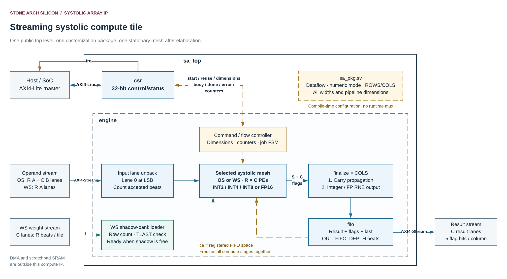

# Stone Arch Silicon Systolic Array IP — Integration Guide

**Document version:** 1.0 · **Date:** 8 November 2026  
**Design owner:** Stone Arch Silicon · **RTL engineer:** Paulo Dietrich  
**Public module:** `sa_top` · **Only hardware customization file:** `rtl/sa_pkg.sv`

This guide takes you from the delivered files to a working matrix multiplication inside an accelerator. It assumes you know basic clocks and binary numbers but may be new to systolic arrays, streaming interfaces, or AXI4-Lite.

The [specification](specification.md) is the detailed interface/numeric reference. The [architecture](architecture.md) explains every RTL module and signal, with the supplied Lucid diagrams. This guide uses the same delivered source baseline: short module names, explicit controller FSMs, and the zero-depth delay fix.

### Contents

1. [What you need to connect](#g1)
2. [Files and compile order](#g2)
3. [Choose and configure the hardware](#g3)
4. [Wire the IP into your accelerator](#g4)
5. [Prepare packed matrices and memory adapters](#g5)
6. [First complete OS job](#g6)
7. [First complete WS job and weight reuse](#g7)
8. [INT2, INT4, and FP16 examples](#g8)
9. [Larger matrices, scheduling, and software](#g9)
10. [Run the supplied testbenches with Synopsys VCS](#g10)
11. [Verify the system integration](#g11)
12. [Debugging reference](#g12)
13. [Prepare an ASIC implementation](#g13)
14. [Integration handoff checklist](#g14)

<a id="g1"></a>
## 1. What you need to connect

The IP computes `C[M,N] = A[M,K] × B[K,N]`. A and B are input matrices; C is the output. A dot product multiplies corresponding A/B values and adds them. The array performs many such operations in parallel.

The complete block has five connection groups:

| Connection | Typical owner in your accelerator | Your responsibility |
|---|---|---|
| `clk`, `rst_n` | Clock/reset controller | Supply one clock and coordinated synchronous active-low reset. |
| `s_axi_*` | CPU control bus or hardware register master | Program dimensions, issue START, inspect responses/status/counters. |
| `s_axis_*` | Scratchpad reader, DMA adapter, or operand feeder | Produce correctly packed A/B vectors in the selected dataflow order. |
| `s_weight_*` | Weight-buffer reader or second DMA adapter | In WS, load full physical B tiles into the shadow bank. |
| `m_axis_*`, `irq` | Result-buffer writer and interrupt controller | Accept rows/flags, handle completion/errors, and make results visible to consumers. |



*The memories and DMA shown outside the boundary are supplied by the surrounding accelerator. The IP does not fetch data from a memory address by itself.*

For a first simulation, the supplied testbench acts as the control host, input producer, and output receiver. You do not need to implement a DMA before checking the arithmetic. For an ASIC, connect equivalent real hardware interfaces.

**Fastest first check:** leave the default package unchanged and run the `sa_tb` commands in [section 10.2](#g10). Then return to the small worked examples when you are ready to understand every transferred bit.

<a id="g2"></a>
## 2. Files and compile order

Use the RTL and tests from the latest delivered `Systolic_IP_Testbenches.zip`. Copy this documentation's `docs` directory beside them. The documentation archive itself contains guides and diagram images; it is not another replacement RTL release.

| Path | Role |
|---|---|
| `rtl/sa_pkg.sv` | All user hardware choices, derived widths, and types. Compile first. |
| `rtl/files.f` | RTL compile-order list for the complete IP. |
| `rtl/sa_top.sv` | Top module to instantiate in the accelerator or select for synthesis. |
| Other `rtl/*.sv` | Controller, arrays, PEs, arithmetic, delay, and FIFO implementations. |
| `tb/sa_tb.sv` | Complete public-IP testbench. |
| `tb/csr_tb.sv` | AXI4-Lite/control tests. |
| `tb/arithmetic_tb.sv` | FP product/accumulation/rounding tests. |
| `tb/delay_tb.sv` | Delay, stall, reset/clear, and bypass tests. |
| `tools/reference.py` | Independent exact matrix reference and full-IP vector generator. |
| `tools/generate_arithmetic.py` | FP arithmetic vector generator; imports `reference.py`. |
| `docs/*.md`, `docs/images/*.png` | These guides and the supplied diagram exports. |

The complete file order is:

```text
rtl/sa_pkg.sv
rtl/delay.sv
rtl/product.sv
rtl/pe_os.sv
rtl/array_os.sv
rtl/pe_ws.sv
rtl/array_ws.sv
rtl/finalize.sv
rtl/fifo.sv
rtl/engine.sv
rtl/csr.sv
rtl/sa_top.sv
```

Run compilation commands from the project root so paths in `rtl/files.f` resolve. Use one selected testbench as simulation top per executable. The hardware top is `sa_top`; the full simulation top is `sa_tb`. Do not select a testbench as the synthesis top.

There is no need to rename modules with a project prefix or edit each PE separately. The supplied module names are already short. Do not compile both an older renamed source tree and this source tree into the same design library.

<a id="g3"></a>
## 3. Choose and configure the hardware

### 3.1 Choose the dataflow from the job shape

| Question | OS | WS |
|---|---|---|
| What must fit physical rows? | M, output rows | K, reduction terms |
| What must fit physical columns? | N | N |
| Can a job have a long K? | Yes, up to MAX_K | Only up to ROWS |
| Can a job have many A/output rows? | Up to ROWS | Up to MAX_M |
| How is B supplied? | Repeatedly as part of input beats | Loaded into two banks of PE weight registers |
| When is reuse especially useful? | A/B reuse within one tile | Same B tile applied to many A rows or jobs |

This is a mapping decision. The best system choice depends on matrix shapes and available bandwidth, as well as mapped timing/area. A larger mesh does not automatically improve useful application throughput.

### 3.2 Choose arithmetic

Use integer mode when tensors have been quantized to signed 2-, 4-, or 8-bit values and the surrounding accelerator handles scaling. Use FP16 mode when inputs use binary16 encodings and the required arithmetic contract accepts exact accumulation with one final rounding.

| Desired build | `DATAFLOW` | `NUMERIC_MODE` | Other important setting |
|---|---|---|---|
| OS INT8 | `OUTPUT_STATIONARY` | `INTEGER_MODE` | `INT_W=8` |
| OS INT4 / INT2 | `OUTPUT_STATIONARY` | `INTEGER_MODE` | `INT_W=4` / `2` |
| WS INT8 / INT4 / INT2 | `WEIGHT_STATIONARY` | `INTEGER_MODE` | `INT_W=8` / `4` / `2` |
| OS FP16 → FP32 | `OUTPUT_STATIONARY` | `FP16_MODE` | `FP_RESULT_W=32` |
| WS FP16 → FP32 | `WEIGHT_STATIONARY` | `FP16_MODE` | `FP_RESULT_W=32` |
| Either FP flow → FP16 | Choose flow | `FP16_MODE` | `FP_RESULT_W=16` |

FP16 mode still requires a legal `INT_W` setting because configuration assertions check it. Likewise, keep `FP_RESULT_W` equal to 16 or 32 even in an integer build.

### 3.3 Configuration for the worked examples

For sections 6–8, edit only the USER CONFIGURATION values in `rtl/sa_pkg.sv` to the following. Preserve the rest of the package, including type definitions and derived constants.

```systemverilog
localparam int DATAFLOW           = OUTPUT_STATIONARY;
localparam int NUMERIC_MODE       = INTEGER_MODE;
localparam int ROWS               = 3;
localparam int COLS               = 2;
localparam int INT_W              = 8;
localparam int MAX_K              = 16;
localparam int MAX_M              = 16;
localparam int INT_ACC_OVERRIDE   = 0;
localparam int FP_RESULT_W        = 32;
localparam int EXTRA_PRODUCT_REGS = 0;
localparam int OUT_FIFO_DEPTH     = 4;
```

For the WS example, change only DATAFLOW to `WEIGHT_STATIONARY` and rebuild. For FP examples, change NUMERIC_MODE and optionally FP_RESULT_W, then rebuild. For integer-width examples, change INT_W and rebuild.

| Example configuration | Operand input | Weight input | Result data | Result flags |
|---|---:|---:|---:|---:|
| 3 × 2 OS INT8 | 40 bits | 16 bits, unused | 64 bits | 10 bits |
| 3 × 2 WS INT8 | 24 bits | 16 bits | 64 bits | 10 bits |
| 3 × 2 OS INT4 | 24 bits | 8 bits, unused | 64 bits | 10 bits |
| 3 × 2 WS INT4 | 16 bits | 8 bits | 64 bits | 10 bits |
| 3 × 2 OS FP16 → FP32 | 80 bits | 32 bits, unused | 64 bits | 10 bits |
| 3 × 2 WS FP16 → FP32 | 48 bits | 32 bits | 64 bits | 10 bits |

The weights port is still declared in OS even though it is not used. FP16 result output would be 32 bits total for these two columns. The 3 × 2 example is intentionally small; default delivered hardware is 8 × 8.

### 3.4 Changes that require a rebuild

Any package change requires regenerated vectors and recompiled RTL. It may also require different stream widths, DMA descriptors, software packing, and ASIC timing constraints. A run-time write to LENGTH or active dimensions requires none of those rebuilds, provided the value is legal for the existing hardware.

A single compilation uses one global `sa_pkg`. Two ordinary `sa_top` instances share that configuration. Simultaneous different specializations need an IP-provider packaging/namespacing solution, as explained in [architecture section 7.3](architecture.md#a7); they are not selected by a per-instance `#(...)` override on the current top.

<a id="g4"></a>
## 4. Wire the IP into your accelerator

### 4.1 Clock and reset first

Connect every interface to the same `clk` domain or insert an appropriate bus/stream clock-domain bridge externally. Do not wire an asynchronous stream directly into the IP or synchronize each bit of a data bus independently.

The public reset is synchronous and active low. Keep it asserted across rising clock edges, keep producer VALID signals low during reset, and coordinate reset of connected queues/masters. On release, clear/initialize the surrounding DMA state before issuing transactions. WS active/shadow validity is lost on reset even though old weight bits may still physically exist.

### 4.2 Complete named-port connection template

The following is a connection template inside your accelerator's parent module. Signals named `ctrl_*` belong to your control master/interconnect, `operand_*` to your operand feeder, `weight_*` to your weight feeder, and `result_*` to your result receiver. Declare those signals using the widths below or the module-header table in the specification. Their producers/consumers are external logic; this snippet does not implement a DMA.

```systemverilog
import sa_pkg::*;

sa_top u_matrix_tile (
    .clk             (accel_clk),
    .rst_n           (accel_rst_n),

    // AXI4-Lite control: address and data channels are independent.
    .s_axi_awaddr    (ctrl_awaddr),
    .s_axi_awprot    (ctrl_awprot),
    .s_axi_awvalid   (ctrl_awvalid),
    .s_axi_awready   (ctrl_awready),
    .s_axi_wdata     (ctrl_wdata),
    .s_axi_wstrb     (ctrl_wstrb),
    .s_axi_wvalid    (ctrl_wvalid),
    .s_axi_wready    (ctrl_wready),
    .s_axi_bresp     (ctrl_bresp),
    .s_axi_bvalid    (ctrl_bvalid),
    .s_axi_bready    (ctrl_bready),
    .s_axi_araddr    (ctrl_araddr),
    .s_axi_arprot    (ctrl_arprot),
    .s_axi_arvalid   (ctrl_arvalid),
    .s_axi_arready   (ctrl_arready),
    .s_axi_rdata     (ctrl_rdata),
    .s_axi_rresp     (ctrl_rresp),
    .s_axi_rvalid    (ctrl_rvalid),
    .s_axi_rready    (ctrl_rready),

    // One complete operand vector per accepted beat.
    .s_axis_tdata    (operand_data),
    .s_axis_tvalid   (operand_valid),
    .s_axis_tlast    (operand_last),
    .s_axis_tready   (operand_ready),

    // WS shadow-bank input; tie VALID low in an OS-only wrapper.
    .s_weight_tdata  (weight_data),
    .s_weight_tvalid (weight_valid),
    .s_weight_tlast  (weight_last),
    .s_weight_tready (weight_ready),

    // Results and flags must be accepted together.
    .m_axis_tdata    (result_data),
    .m_axis_tuser    (result_flags),
    .m_axis_tvalid   (result_valid),
    .m_axis_tlast    (result_last),
    .m_axis_tready   (result_ready),
    .irq            (matrix_irq)
);
```

| Parent signal(s) | Declaration width | Driven by |
|---|---|---|
| `accel_clk`, `accel_rst_n` | 1 each | Clock/reset controller. |
| `ctrl_awaddr`, `ctrl_araddr` | `CSR_ADDR_W` each | Control master/interconnect. |
| `ctrl_awprot`, `ctrl_arprot` | 3 each | Control master; zero if unused. |
| `ctrl_wdata` | 32 | Control master. |
| `ctrl_wstrb` | 4 | Control master; `4'hF` for full-register writes. |
| `ctrl_awvalid`, `ctrl_wvalid`, `ctrl_bready`, `ctrl_arvalid`, `ctrl_rready` | 1 each | Control master. |
| `ctrl_awready`, `ctrl_wready`, `ctrl_bvalid`, `ctrl_arready`, `ctrl_rvalid` | 1 each | IP. |
| `ctrl_bresp`, `ctrl_rresp` | 2 each | IP. |
| `ctrl_rdata` | 32 | IP. |
| `operand_data`, `operand_valid`, `operand_last` | `INPUT_W`, 1, 1 | Operand feeder. |
| `operand_ready` | 1 | IP. |
| `weight_data`, `weight_valid`, `weight_last` | `WEIGHT_W`, 1, 1 | Weight feeder, or constants in OS. |
| `weight_ready` | 1 | IP. |
| `result_data`, `result_flags`, `result_valid`, `result_last` | `OUTPUT_W`, `USER_W`, 1, 1 | IP. |
| `result_ready` | 1 | Result receiver. |
| `matrix_irq` | 1 | IP. |

In an OS-only parent, drive `weight_valid=0`, `weight_last=0`, and `weight_data='0`. Do not wait for weight_ready in OS because it stays low. If interrupts are unused, leave IRQ_ENABLE at zero and use polling; the irq output can be left unconnected intentionally.

### 4.3 Control bus connection

Map a local register window into the SoC address space. The absolute base address is your system's choice. The IP sees 12-bit byte offsets such as `0x008`, not the full CPU address. Ensure the interconnect selects this block and supplies the correct local offset rather than aliasing unrelated system addresses.

The control master must handle independent AW and W handshakes and must accept/check BRESP and RRESP. Holding AWVALID until WREADY, or requiring AWREADY and WREADY to coincide, is not a correct substitute for separate channel tracking. For an APB-based system, use a qualified APB-to-AXI4-Lite bridge or create and verify an intentional alternative control wrapper; APB is not a selectable port mode in the current package.

### 4.4 Result receiver connection

Capture TDATA, TUSER, and TLAST only when `result_valid && result_ready`. If a downstream result buffer has no room, lower READY; the IP retains the pending beat. Never use TDATA changes alone as an indication of a new result.

With FP mode, choose how to store TUSER. Possibilities include a separate flags SRAM, a wider internal result record, or a receiver that ORs flags into a job-status register. The IP itself only supplies per-result flags. A DMA that ignores TUSER loses that information unless an adapter captures it.

<a id="g5"></a>
## 5. Prepare packed matrices and memory adapters

### 5.1 A logical beat is one complete vector

Lane zero occupies the least-significant bits. Lane i occupies `[i*W +: W]`. W is `OPERAND_W` for inputs or `RESULT_W` for outputs. The entire stream data bus is rounded up to a byte, and only the high end may contain padding.

For a 3 × 2 OS INT8 build, the five input lanes from low to high are:

| Bits | Field |
|---|---|
| 7:0 | A[0,k] |
| 15:8 | A[1,k] |
| 23:16 | A[2,k] |
| 31:24 | B[k,0] |
| 39:32 | B[k,1] |

Hexadecimal text prints the highest bits first, so a word appears visually in the reverse order of a lane-zero-first list. This is a common source of otherwise plausible but incorrect results.

### 5.2 Small packing helpers

This Python example is explanatory host code using only the standard library. It works for arbitrary bit-lane widths and does not assume one operand per byte. Check operand range before packing; masking encodes two's complement but does not perform numeric quantization.

```python
import struct


def pack_lanes(values, width):
    mask = (1 << width) - 1
    return sum((value & mask) << (lane * width)
               for lane, value in enumerate(values))


def unpack_signed(word, lane, width):
    raw = (word >> (lane * width)) & ((1 << width) - 1)
    return raw - (1 << width) if raw & (1 << (width - 1)) else raw


def fp16_bits(value):
    return int.from_bytes(struct.pack(">e", value), "big")


os_word = pack_lanes([1, 4, 0, 2, 1], 8)
assert os_word == 0x0102000401

# This byte layout assumes byte 0 maps to stream bits 7:0.
dma_bytes = os_word.to_bytes(5, "little")
assert dma_bytes == bytes([0x01, 0x04, 0x00, 0x02, 0x01])

assert unpack_signed(0xFFFFFFF500000010, 0, 32) == 16
assert unpack_signed(0xFFFFFFF500000010, 1, 32) == -11
assert fp16_bits(1.0) == 0x3C00
```

The little-endian byte conversion above is a chosen adapter convention, not an additional bus signal. Confirm that your DMA maps the first byte to bits 7:0. Some software buffers, serializers, or bus-width adapters may use another convention.

For an unusual legal integer accumulator width, result lanes can cross byte boundaries. Use `RESULT_W` from the package/capability register rather than assuming each column is a 32-bit C `int`.

### 5.3 Memory layout is not automatically the stream layout

Most software stores A and B in row-major order. OS needs an A column and B row per beat; WS needs A rows and a stationary B tile. Your memory subsystem may gather/repack, bank the scratchpad appropriately, or store prepacked stream buffers.

For row-major full matrices with dimensions `M_total × K_total` and `K_total × N_total`, the element indices for a tile at output origin `(m0,n0)` and reduction origin k0 are:

| Stream field | Element index in original row-major storage |
|---|---|
| OS A lane r at local step k | `(m0+r)*K_total + (k0+k)` |
| OS B lane c at local step k | `(k0+k)*N_total + (n0+c)` |
| WS weight lane c at physical load row r | `(k0+r)*N_total + (n0+c)` |
| WS A lane r at local activation row m | `(m0+m)*K_total + (k0+r)` |
| Output column c at local row m | `(m0+m)*N_total + (n0+c)` |

These are **element indices**, not byte addresses. Subbyte INT2/INT4 tensors require bit extraction or prepacking. For inactive/out-of-bounds tile lanes, insert zero rather than reading outside the matrix. If a framework stores weights transposed as `[N,K]`, transpose/address them externally into the B convention above.

### 5.4 DMA lengths and width conversion

For an adapter that stores every full logical beat contiguously:

```text
OS input bytes = K * (INPUT_W / 8)
WS input bytes = M * (INPUT_W / 8)
WS weight bytes per load = ROWS * (WEIGHT_W / 8)
Output data bytes = M * (OUTPUT_W / 8)
```

Output flag storage is additional and depends on the adapter. The IP has no TKEEP, so do not shorten the final logical beat to the number of active columns. Preserve physical lane padding and TLAST at the logical-vector boundary.

A generic DMA may not support widths such as 24, 40, or 80 bits, or may attach TLAST only at a whole-descriptor boundary. Add a serializer/assembler or choose a system-facing width converter that reconstructs the IP's complete vectors correctly. One narrow bus beat is not necessarily one IP beat. Count configured LENGTH in accepted **IP vectors**, not memory words.

<a id="g6"></a>
## 6. First complete OS job

### 6.1 Hardware and matrix

Use the 3 × 2 INT8 package settings in section 3.3, with `DATAFLOW=OUTPUT_STATIONARY`. The desired operation is:

```text
A rows: [ 1, -2,  3]    B rows: [ 2,  1]
        [ 4,  0, -1]            [-1,  3]
                               [ 4, -2]

C rows: [16, -11]
        [ 4,   6]
```

Here M=2, N=2, K=3. The physical third OS row is inactive. It is still present in the input bus and receives zero in each A lane.

### 6.2 Bring-up and register sequence

The operations below mean complete AXI4-Lite transactions, including response handshakes. Full writes use WSTRB=`4'hF`. All offsets are relative to your assigned base address.

| Step | Operation | Expected result / reason |
|---:|---|---|
| 1 | Apply and release reset. | STATUS becomes 0; engine idle. |
| 2 | Read `0x018`, `0x01C`, `0x020`, `0x024`, `0x02C`. | OS integer ID `0x53410000`, rows 3, cols 2, operand bits 8, result bits 32. |
| 3 | Prepare a receiver for two 64-bit result beats and their flags. | Receiver is ready before data starts. |
| 4 | Write `0x004 = 0x6`. | Clear prior DONE/ERROR. |
| 5 | Write `0x008 = 3`. | LENGTH=K. |
| 6 | Write `0x00C = 2`. | ACTIVE_ROWS=M. |
| 7 | Write `0x010 = 2`. | ACTIVE_COLS=N. |
| 8 | Optionally write `0x014 = 1`. | Enable level IRQ. Polling also works with it left zero. |
| 9 | Write `0x000 = 1`; require OKAY response. | START accepted. A rejected command must not be treated as a running job. |
| 10 | Send the three operand beats below. | Advance each only on VALID/READY. |
| 11 | Receive two results; wait for final result acceptance and sticky DONE. | Check results, flags, and error status. |

### 6.3 Exact input beats

Lane lists below are low-to-high. The bus is 40 bits.

| Accepted beat k | Lane list `[A0,A1,A2,B0,B1]` | `s_axis_tdata` | TLAST |
|---:|---|---|---:|
| 0 | `[1, 4, 0, 2, 1]` | `40'h0102000401` | 0 |
| 1 | `[-2, 0, 0, -1, 3]` | `40'h03FF0000FE` | 0 |
| 2 | `[3, -1, 0, 4, -2]` | `40'hFE0400FF03` | 1 |

If READY falls while beat 1 is offered, retain `03FF0000FE`, TLAST=0, and VALID=1 until its handshake. Do not move to beat 2 just because another clock passed.

### 6.4 Exact results and final status

The output is 64 bits: column 0 in bits 31:0 and column 1 in bits 63:32. All ten TUSER bits are zero.

| Output row m | Signed column values | `m_axis_tdata` | `m_axis_tuser` | TLAST |
|---:|---|---|---|---:|
| 0 | `[16, -11]` | `64'hFFFFFFF500000010` | `10'h000` | 0 |
| 1 | `[4, 6]` | `64'h0000000600000004` | `10'h000` | 1 |

After final acceptance and CSR event capture, STATUS should be `0x2` if there were no errors. INPUT_BEATS should be 3 and OUTPUT_BEATS should be 2. IRQ is high if enabled. Write `STATUS=0x2` to acknowledge DONE, or `0x6` to clear both sticky status bits after recording them.

With uninterrupted input/output service, the first result is accepted at edge 11 and the last at edge 12, measured from first input edge 0. BUSY_CYCLES may be larger because it also counts any waiting after START. Do not use a fixed software delay as a replacement for the handshake/completion protocol.

<a id="g7"></a>
## 7. First complete WS job and weight reuse

### 7.1 Rebuild for WS

Change `DATAFLOW` to `WEIGHT_STATIONARY` in the same package and rebuild. Keep ROWS=3, COLS=2, INT_W=8, and the other example settings. The math is still M=2, N=2, K=3, but register meanings and input layout change.

The weight stream is 16 bits and the activation stream is 24 bits. BUILD_ID becomes `0x53410001`.

### 7.2 Load the complete shadow tile

After reset, ACTIVE_WEIGHTS=0. Send these three physical weight rows. You may do this before or after dimension programming, provided loading finishes before a non-reuse START.

| Physical row r | B values `[column 0,column 1]` | `s_weight_tdata` | TLAST |
|---:|---|---|---:|
| 0 | `[2, 1]` | `16'h0102` | 0 |
| 1 | `[-1, 3]` | `16'h03FF` | 0 |
| 2 | `[4, -2]` | `16'hFE04` | 1 |

Wait for the handshakes, not merely three clock cycles. After the final accepted weight row, STATUS bit 3 becomes one. With no other events, STATUS is `0x8`. The loader lowers weight-ready until the bank is activated. Do not send another tile into the stopped interface and assume it was accepted.

If K were only 2 on this same hardware, the load would still contain three physical rows; the third would normally be zeros and would carry TLAST. K does not change the weight-load frame size.

### 7.3 Configure and launch

| Write | Value | Meaning |
|---|---:|---|
| STATUS `0x004` | `0x6` | Clear prior DONE/ERROR without affecting bank readiness. |
| LENGTH `0x008` | 2 | M, number of A/output rows. |
| ACTIVE_ROWS `0x00C` | 3 | K, number of reduction rows. |
| ACTIVE_COLS `0x010` | 2 | N. |
| IRQ_ENABLE `0x014` | 1, optionally | Enable interrupt. |
| COMMAND `0x000` | 1 | START with REUSE=0, activate the complete shadow tile. |

Arm the result receiver before sending activations. A successful start changes ACTIVE_WEIGHTS to one and SHADOW_READY to zero. During an error-free active job with no next preload completed, STATUS is `0x11` (active weights plus busy).

### 7.4 Send activation rows and receive results concurrently

| Accepted activation row m | A values `[k0,k1,k2]` | `s_axis_tdata` | TLAST |
|---:|---|---|---:|
| 0 | `[1, -2, 3]` | `24'h03FE01` | 0 |
| 1 | `[4, 0, -1]` | `24'hFF0004` | 1 |

Results are exactly the same two 64-bit words as the OS example. INPUT_BEATS is now 2 rather than 3, because each input beat represents an A row. OUTPUT_BEATS is 2. Final STATUS is `0x12` (active weights plus done), assuming no error and no completed next shadow tile.

The ideal first/last result edge distances are 8 and 9 for this configuration. In a larger WS job, results begin while many A rows are still being supplied. Start receiving immediately; a driver that waits until all input has been sent before enabling output can deadlock once buffering fills.

### 7.5 Reuse the same B tile

To multiply another A matrix by the same B:

1. Finish the previous job and record/clear its status.
2. Set the new M, legal K, and N if needed. Keep K/N consistent with the loaded tile contents.
3. Arm the new result receiver.
4. Write `COMMAND=0x3` for START plus REUSE.
5. Send the new A rows and receive their output rows.

No weight reload is required. ACTIVE_WEIGHTS remains set across completed jobs until reset. Setting REUSE on the very first job after reset is rejected because no bank has been activated yet.

### 7.6 Preload a different B tile

After a non-reuse start swaps the current tile into use, the other bank becomes available. While the current job runs, send exactly ROWS rows of the next B tile. This can continue while arithmetic is paused by output backpressure.

After the next load completes, SHADOW_READY=1 and weight-ready=0. Finish the active job, then write `COMMAND=1` for the next job to swap in the new tile. If the next job still needs the old tile, write `COMMAND=3`; the ready shadow tile is preserved for a later swap. A partial shadow load is also preserved across reuse jobs.

Do not treat an ERROR-bearing weight load as automatically discarded. The RTL counts rows regardless of a TLAST mismatch and can still mark that bank ready. If frame contents are uncertain, reset and reload rather than activating an unknown tile.

<a id="g8"></a>
## 8. INT2, INT4, and FP16 examples

### 8.1 INT4: same math, compact operand lanes

All inputs in the worked example fit signed INT4. Change only INT_W to 4 and rebuild. Keep the same OS/WS dimension values and expected 32-bit-per-column integer outputs.

| Input stream | Accepted beats in order | Bus width |
|---|---|---:|
| OS combined operands | `24'h012041`, `24'h03F00E`, `24'h0E40F3` | 24; upper four bits are padding. |
| WS weights | `8'h12`, `8'h3F`, `8'hE4` | 8 |
| WS activations | `16'h03E1`, `16'h0F04` | 16; upper four bits are padding. |

The final beat of each listed sequence has TLAST=1. The others have TLAST=0. A value of −2 is the 4-bit pattern E, and −1 is F. The output 16 does not need to fit into 4 bits because results use the wider accumulator width.

### 8.2 INT2: use values within −2 … +1

The original example contains 2, 3, and 4, which do not fit signed INT2. Simply masking those values to two bits changes the math. To exercise an INT2 build with the same dimensions, use:

```text
A rows: [ 1, -2, 1]    B rows: [ 1,  0]
        [-1,  0, 1]            [-1,  1]
                              [ 1, -2]

C rows: [4, -4]
        [0, -2]
```

| Input stream | Accepted beats in order | Bus width |
|---|---|---:|
| OS combined operands | `16'h004D`, `16'h01C2`, `16'h0245` | 16 |
| WS weights | `8'h01`, `8'h07`, `8'h09` | 8 |
| WS activations | `8'h19`, `8'h13` | 8 |

Expected output words are `64'hFFFFFFFC00000004` and `64'hFFFFFFFE00000000`, with zero flags and TLAST on the second word. The 3 × 2 physical shape and all command dimensions remain the same.

### 8.3 FP16: encode floating values, not integer bit patterns

Change NUMERIC_MODE to `FP16_MODE` and keep FP_RESULT_W=32 for the first FP run. An integer literal `16'h0001` is the smallest positive binary16 subnormal, not 1.0. Binary16 1.0 is `16'h3C00`.

| Decimal value | Binary16 bits |
|---:|---|
| 0 | `0x0000` |
| 1 | `0x3C00` |
| −1 | `0xBC00` |
| 2 | `0x4000` |
| −2 | `0xC000` |
| 3 | `0x4200` |
| 4 | `0x4400` |

For the original `[16,-11]`, `[4,6]` result example, packed FP inputs are:

| Input stream | Accepted beats in order | Bus width |
|---|---|---:|
| OS combined operands | `80'h3C004000000044003C00`, `80'h4200BC0000000000C000`, `80'hC00044000000BC004200` | 80 |
| WS weights | `32'h3C004000`, `32'h4200BC00`, `32'hC0004400` | 32 |
| WS activations | `48'h4200C0003C00`, `48'hBC0000004400` | 48 |

TLAST placement and dimension programming are unchanged for the selected dataflow. FP products add two pipeline stages relative to integer products, so the ideal first-to-last edge distance becomes 14 for OS or 11 for WS in this example.

### 8.4 FP results and flags

| Row | FP32 output word | FP16 output word if rebuilt with FP_RESULT_W=16 | TUSER |
|---:|---|---|---|
| 0, values `[16,-11]` | `64'hC130000041800000` | `32'hC9804C00` | All zero. |
| 1, values `[4,6]` | `64'h40C0000040800000` | `32'h46004400` | All zero. |

These particular sums are exactly representable. General FP tests must compare flags as well as result bits. Decode column c flags from `(TUSER >> (5*c)) & 0x1F`; NV is bit 4, DZ bit 3, OF bit 2, UF bit 1, and NX bit 0.

Do not use a loop of host FP32 multiply-add operations as a universal bit-exact oracle. This IP sums exact binary16 products and rounds once. `tools/reference.py` uses exact rational arithmetic for that contract. It also checks NaN, infinities, subnormals, and canonical zero behavior.

<a id="g9"></a>
## 9. Larger matrices, scheduling, and software

### 9.1 Tile around the compiled limits

For OS, split output rows into groups of at most ROWS and output columns into groups of at most COLS. Each tile can reduce up to MAX_K terms. For WS, split output columns into groups of at most COLS and activation/output rows into groups of at most MAX_M; each stationary B tile has up to ROWS reduction terms.

At each boundary tile, program the smaller active dimensions and zero-fill unused physical lanes. The IP has no matrix-origin offset fields; the external address generator selects the tile origin and lays out the streams.

If the full K exceeds the selected flow's reduction capacity, the IP cannot continue a dot product from a prior public result. Each job starts at zero. Split K requires an **external reduction** of partial output tiles, or a different compiled configuration/dataflow.

Integer partial outputs need an external accumulator wide enough for the **full** K, not merely the per-job bound. FP partial outputs have already been rounded, so adding them externally generally does not reproduce one exact full-K accumulation followed by one final rounding. If that exact contract matters, choose a configuration that covers K or deliberately design a wider partial-sum interface/reduction block. The current public stream does not export raw carry-save state.

### 9.2 A reliable host scheduling pattern

The following is platform-neutral pseudocode. `write32`/`read32` represent completed bus transactions with checked response status. `arm_receiver` and `start_feeder` are operations supplied by your DMA or hardware scheduler, not functions implemented inside this IP.

```text
verify the compiled capabilities and the proposed matrix shape
wait until the previous job has completed
record previous status/counters, then clear DONE/ERROR
prepare input buffers and make them visible to the DMA
if WS and using new weights:
    send a complete physical weight tile
    wait for SHADOW_READY and check for errors
program LENGTH, ACTIVE_ROWS, ACTIVE_COLS
arm the result receiver for M full output beats and the chosen flags policy
issue START with the correct reuse choice; require an OKAY response
start the operand feeder
service input and output independently
wait for IP DONE or a software timeout; inspect ERROR
wait for the output DMA/buffer writer to finish its memory writes
make result memory visible to the next consumer
check expected counts/TLAST/status, then acknowledge sticky status
```

**IP DONE and memory completion are different boundaries.** DONE proves the IP's final output was accepted by its immediate receiver. If that receiver is a DMA with pending memory writes, the CPU must also wait for the DMA's completion/visibility guarantees before reading result memory. Cache maintenance and ordering belong to the surrounding platform.

### 9.3 Polling and interrupts

For polling, repeatedly read STATUS until DONE is set, while also tracking errors and a system-defined timeout. A framing error does not automatically end the job, so do not free in-use buffers solely because ERROR appeared. Decide whether to let the configured transfer finish or perform a coordinated reset.

For interrupts, write IRQ_ENABLE=1. The IRQ remains high while either sticky DONE or ERROR remains set. An interrupt handler should read STATUS, record the cause, clear the relevant W1C bits, and then acknowledge the platform interrupt controller as required by that platform. Clearing only DONE leaves IRQ asserted if ERROR is also set.

Reserved STATUS bits read zero. Clear only the documented W1C bits, not an arbitrary all-bits write. A successful new START clears DONE but leaves ERROR unchanged, so explicitly handle old errors before another launch.

### 9.4 Avoid a stream deadlock

A common failure is this sequence: send all WS activations using a blocking function, then start the result receiver. The output FIFO fills, compute ce falls, operand READY falls, and the blocking sender can never finish. The receiver that would free space has not started.

Arm the receiver first and run feeding/receiving concurrently. In a testbench, the supplied `sa_tb` uses `fork ... join` to do this. In hardware, use independent channels or queues. In software, submit asynchronous RX/TX descriptors in the correct order rather than serial blocking operations that depend on each other.

### 9.5 Reset and malformed frames

TLAST is a checked marker, not an abort or a replacement for LENGTH. If a producer sends too few beats, the engine waits. If it sends too many, the extra beat can remain held at the interface and become the next command's first beat unless the producer is stopped/reset correctly.

Reset aborts the current job, drops queued output, clears control state and counters, and invalidates both WS bank states. Reset the connected transport coherently so a leftover old beat is not presented as new data after release. Reload WS weights and reprogram dimensions afterward.

<a id="g10"></a>
## 10. Run the supplied testbenches with Synopsys VCS

### 10.1 Environment versus design files

For RTL simulation you need Python 3.10+ and an initialized university Synopsys VCS environment. The Python tools use only the standard library. A standard-cell `.db` library, Design Compiler script, or synthesis run is not needed to simulate these RTL testbenches.

Check the executable first:

```bash
command -v vcs
python3 --version
```

If the first command prints nothing, `vcs: command not found` is a shell/tool-environment issue. The RTL has not been compiled yet. Use the university's documented Synopsys setup command or environment module for the specific server. The setup path/module name is site-specific; these documents do not invent one. If VCS is found but reports a license problem, resolve that environment issue with the university CAD administrator.

Run the following commands from the directory containing `rtl`, `tb`, and `tools`. Each compile command is shown on one line so an accidental newline before `-o` does not turn the second half into a separate shell command.

### 10.2 Full IP: `sa_tb`

This bench uses the current package and supports both dataflows, all three integer widths, and FP16 inputs with either result width.

```bash
python3 tools/reference.py --package rtl/sa_pkg.sv --out build/vectors
vcs -full64 -sverilog -f rtl/files.f tb/sa_tb.sv -top sa_tb -o simv_sa -l compile_sa.log
./simv_sa +VECTORS=build/vectors/vectors.txt -l run_sa.log
```

The first command writes input/expected-result vectors and their configuration metadata. The second compiles the RTL plus testbench into an executable. The third actually runs simulation. Inspect the output and log for `TEST PASSED`, no failure/fatal messages, and the expected configuration metadata in `build/vectors/vectors.json`.

The bench covers arithmetic results, stream stalls, partial dimensions, input framing errors, control checks, interrupts, reset during operation, and WS reuse/preload when selected. It prints performance observations for unstalled cases. Compilation success alone is not a pass.

### 10.3 Control bus: `csr_tb`

No Python vectors are required.

```bash
vcs -full64 -sverilog rtl/sa_pkg.sv rtl/csr.sv tb/csr_tb.sv -top csr_tb -o simv_csr -l compile_csr.log
./simv_csr -l run_csr.log
```

Expected marker: `CSR TEST PASSED`. Run this for OS and WS package choices if both will be released, since command-bank validation differs.

### 10.4 FP arithmetic: `arithmetic_tb`

First select `NUMERIC_MODE=FP16_MODE` in the package and choose `FP_RESULT_W=16` or `32`. Regenerate vectors for that exact configuration.

```bash
python3 tools/generate_arithmetic.py --package rtl/sa_pkg.sv --out build/arithmetic
vcs -full64 -sverilog -f rtl/files.f tb/arithmetic_tb.sv -top arithmetic_tb -o simv_arithmetic -l compile_arithmetic.log
./simv_arithmetic +VECTORS=build/arithmetic/vectors.txt -l run_arithmetic.log
```

Expected marker: `ARITHMETIC PASSED`. The generator sweeps all 65,536 binary16 encodings multiplied by one, adds directed cases, and generates 20,000 random dot products by default. Dot lengths respect the selected reduction capacity and are capped at 256 terms for this unit bench. To shorten the random portion, add `--random-dots 100`; the encoding sweep remains enabled.

This bench connects `pe_os` and `finalize`, exercising the shared product/accumulation/rounding contract. It is useful in a WS-configured package too, but it does not replace `sa_tb` for WS array/bank timing.

### 10.5 Delay and zero-depth bypass: `delay_tb`

No package or Python vectors are required.

```bash
vcs -full64 -sverilog rtl/delay.sv tb/delay_tb.sv -top delay_tb -o simv_delay -l compile_delay.log
./simv_delay -l run_delay.log
```

Expected marker: `DELAY TEST PASSED`. This isolates the transport helper used throughout both meshes and includes the zero-depth path.

### 10.6 Keep vectors, package, and executable matched

After changing `sa_pkg.sv`, regenerate the relevant vectors **and** recompile the executable. A simulator binary is not automatically updated when the source changes. Likewise, old vectors may have a different width, shape, or numeric policy.

`sa_tb` and `arithmetic_tb` use different vector formats. Use the generator and `+VECTORS` path paired in the commands above. Keep the two Python files together; the arithmetic generator imports the reference model. No separate shell/Tcl regression script is required for these manual runs.

The supplied benches retain the DUT / Golden Model / Tasks / Main-test organization. For a new system adapter test, use that same structure: instantiate the actual connected block, generate independent expected results, drive legal handshakes, collect only accepted outputs, and report explicit pass/fail counts.

VCS itself was not available in the documentation environment, so these commands are not accompanied by a claimed VCS pass here. The worked example vectors and ideal timing were checked separately against the delivered RTL with the available simulator; your university VCS version still needs its own compile/run.

<a id="g11"></a>
## 11. Verify the system integration

### 11.1 Recommended bring-up order

1. **Configuration/readback:** reset and read BUILD_ID, physical dimensions, and numeric widths. Confirm firmware and hardware agree.
2. **Small arithmetic:** run the exact OS or WS example and compare every result and flag.
3. **Handshake behavior:** pause input; pause output; independently delay AXI write address/data and read/write response acceptance.
4. **Partial tiles:** use M/N/K values smaller than the physical dimensions and confirm output count, zero inactive columns, and full WS load size.
5. **Repeated commands:** change legal dimensions between jobs; verify counters restart and old DONE/ERROR handling is deliberate.
6. **WS banks:** first load, reuse, preload during compute, preload during an output stall, and swap after completion.
7. **Reset/recovery:** reset mid-job with transport reset coordinated, then complete a fresh job and reload WS weights.
8. **Actual memory adapter:** run through the final scratchpad/DMA connection and compare memory bytes plus flags and descriptor completion.

### 11.2 Checks worth keeping in the accelerator testbench

| Check | Why it matters |
|---|---|
| Output VALID/data/flags/LAST stay stable while READY is low. | Detects dropped or overwritten results. |
| Producer beat index advances only on a handshake. | Prevents skipped inputs under backpressure. |
| Accepted input count equals configured LENGTH. | Separates vector-count bugs from arithmetic bugs. |
| WS weight count is physical ROWS, even for partial K. | Prevents permanently incomplete or misaligned banks. |
| Exactly M result beats arrive in order, with TLAST only on the last. | Checks job boundaries independently of numeric values. |
| Inactive result columns and flags are zero. | Checks active-dimension masking and packing. |
| Final result values/flags match the exact reference model. | Detects numeric/format/sign bugs. |
| DONE never precedes final output acceptance. | Checks the completion contract used by software. |
| Invalid START returns SLVERR and does not launch a new job. | Checks host/controller agreement. |
| Results remain correct after reset and on a subsequent job. | Detects stale payload/valid contamination. |

### 11.3 Release configuration matrix

Parameterization needs configuration coverage. For an IP release, include OS and WS, INT2/4/8, FP16→FP16 and FP16→FP32, a 1 × 1 build, rectangular/non-power-of-two dimensions, a FIFO depth such as 3, and a positive EXTRA_PRODUCT_REGS value. Test both maximum and partial legal dimensions for the intended profiles.

This is a validation plan, not a claim that functional simulation exhaustively proves every possible parameter value. Run the intended production configuration through the full system verification and ASIC flow.

<a id="g12"></a>
## 12. Debugging reference

| Symptom | Likely explanation | First useful check |
|---|---|---|
| `vcs: command not found` | Tool environment is not initialized on that shell/server. | `command -v vcs`; university setup instructions. |
| Package/type not found during compile | Wrong compile order or file paths. | Use project-root `-f rtl/files.f`; package first. |
| Duplicate module/package definitions | Both old and new source trees were compiled. | Inspect compile file list and remove duplicate source entries from the build. |
| Vector file cannot open | Wrong working directory/path or generator not run. | Run matching Python command and inspect `+VECTORS`. |
| Many mismatches after a package edit | Stale executable or vectors. | Regenerate and recompile together. |
| START gives SLVERR | Busy, zero/out-of-range dimension, or invalid WS bank state. | Read STATUS and dimensions; use correct M/K mapping. |
| Weight-ready never rises in OS | OS does not use the separate weight stream. | Put B values in OS operand beats; tie weight VALID low. |
| Weight-ready stops in WS | Shadow bank is complete, or a start pulse is occurring. | Read SHADOW_READY; activate the tile before another load. |
| WS START rejected after loading K rows | K may be less than physical ROWS. | Send a full physical tile, zero-padding unused rows. |
| Operand-ready falls partway through a WS job | Output FIFO may be full. | Check result READY and start the receiver concurrently. |
| No DONE, BUSY remains high | Too few inputs or unaccepted output remains. | Compare accepted beat counters and last handshakes; check software timeout policy. |
| BUSY is low but DONE not yet set for one clock | CSR has not yet captured the registered engine pulse. | Poll DONE/IRQ instead of relying on immediate BUSY deassertion. |
| Every row/column is permuted | Wrong lane order, matrix layout, or transpose. | Compare a small beat to the hexadecimal tables. |
| Negative integer results look enormous | Unsigned host decoding. | Sign-extend using RESULT_W, not OPERAND_W. |
| INT2/4 results wrong after narrowing | Values exceeded signed range or were byte-padded per operand. | Check numeric range and contiguous bit packing. |
| FP16 1.0 behaves like a tiny value | `0x0001` was used instead of binary16 encoding `0x3C00`. | Inspect raw operand bits. |
| FP32 software sum differs slightly | Reference rounded after intermediate operations. | Use exact accumulation with one final rounding. |
| IRQ stays high after clearing DONE | Sticky ERROR may also be set. | Read STATUS; record and clear the relevant W1C bits. |
| Numeric NaN/overflow does not set CSR ERROR | Arithmetic exceptions are per-lane TUSER status. | Capture and inspect TUSER; this is expected separation. |
| Wrong TLAST but job still completes | Fixed counts drive processing; TLAST mismatch is a sticky error. | Check ERROR and the producer's framing logic. |
| Correct IP result but wrong output memory | Adapter packing, unfinished DMA writes, or cache visibility. | Inspect stream handshakes first, then DMA completion and memory byte order. |
| X values on internal payload after reset | Payload is deliberately not reset. | Check validity; only an X on a valid result is a failure. |

For an arithmetic issue, first run the complete IP without the external DMA. For a system issue, compare what actually crossed the stream boundary against what the memory adapter was supposed to send. This separates packing/transport errors from PE computation.

<a id="g13"></a>
## 13. Prepare an ASIC implementation

Simulation and synthesis are different tasks. Simulation compiles RTL plus a testbench and runs stimuli. ASIC synthesis compiles the selected hardware RTL, maps it to a real standard-cell library, and reports timing/area under constraints. It does not use the behavioral testbench as hardware.

For an ASIC handoff:

1. Freeze and record the package configuration and RTL revision used by the passing simulation.
2. Analyze the RTL file list with SystemVerilog support and elaborate `sa_top` as hardware top.
3. Configure the target technology libraries and operating conditions from the authorized PDK/flow.
4. Constrain the real clock, I/O timing, clock uncertainty, loads, and external driving conditions. A testbench's 10 ns period is not an ASIC performance commitment.
5. Review warnings, unsupported constructs, inferred storage, unconstrained paths, and timing reports for the elaborated configuration.
6. Continue through the project's DFT, physical design, extraction, timing, power, and equivalence/signoff flow.

No `.db` cell library is required for the RTL VCS tests in section 10; a real target library is required to make meaningful mapped ASIC synthesis claims. The IP's flop-based storage, wide FP accumulation, and global enable/control distribution need physical evaluation. An automatically derived legal width does not guarantee timing closure for an arbitrarily large mesh.

The source contains no internal CDC bridge, SRAM macro, DMA, or scan-controller wrapper. Include those surrounding blocks and their verification/signoff requirements in the accelerator plan. Retain source/configuration and firmware manifests together so a parameter change cannot silently break the software interface.

<a id="g14"></a>
## 14. Integration handoff checklist

Before giving the block to another accelerator engineer, provide the following concrete information:

- The exact `sa_pkg.sv` used to build the hardware and its readback capability values.
- The local/system CSR base address, interrupt connection, clock frequency target, and reset sequence.
- The chosen matrix layout, lane/byte packing, and DMA width-conversion behavior.
- The OS/WS dimension mapping and maximum supported M/N/K for the compiled block.
- The output result format, flags-storage policy, and any external integer scaling or FP partial-sum policy.
- Evidence that output is serviced concurrently with WS inputs and that IP DONE is distinguished from memory-write completion.
- Passing simulation logs for the selected configuration and system adapters, including stalled and reset cases.
- The production synthesis/physical results when available, identified by their actual library and constraints.

The three guides serve complementary roles: use the [specification](specification.md) for the contract, the [architecture](architecture.md) for the circuit, and this guide for the sequence of actions required to integrate and run it.
