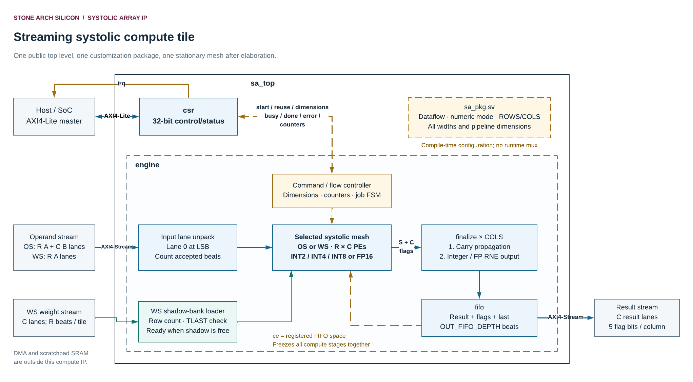

# Stone Arch Silicon Systolic Array IP — Specification

**Document version:** 1.0 · **Date:** 8 November 2026  
**Design owner:** Stone Arch Silicon · **RTL engineer:** Paulo Dietrich  

## Reading map

| Your question | Read |
|---|---|
| What is a systolic array, and what problem does this IP solve? | Sections 1–3 below |
| Which hardware choices and dimensions are legal? | Sections 4–5 |
| What does every external signal mean? | Section 6 |
| How do I pack matrices and program registers? | Sections 7–8 |
| What does FP16 mean in this particular implementation? | Section 9 |
| How do completion, errors, and stalls work? | Sections 10–11 |
| What are the contracts of the individual RTL modules? | Section 12 |
| How is the circuit built internally? | [architecture.md](architecture.md) |
| How do I connect it and run my first multiplication? | [integration_guide.md](integration_guide.md) |

### Contents

1. [The IP in plain language](#s1)
2. [Matrix operation and terminology](#s2)
3. [Features and boundaries](#s3)
4. [Compile-time configuration](#s4)
5. [Legal run-time jobs](#s5)
6. [Public ports and clock/reset contract](#s6)
7. [Stream formats and transfer rules](#s7)
8. [Control/status register specification](#s8)
9. [Arithmetic specification](#s9)
10. [Completion, errors, and recovery](#s10)
11. [Timing, throughput, and storage](#s11)
12. [Individual RTL module contracts](#s12)
13. [Verification and source references](#s13)

<a id="s1"></a>
## 1. The IP in plain language

A neural-network layer often needs many dot products. A **dot product** multiplies matching elements of two lists and adds the products. For example:

```text
[1, -2, 3] dot [2, -1, 4] = 1×2 + (-2)×(-1) + 3×4 = 16
```

A matrix multiplication is a collection of these dot products. This IP performs them with a grid of small arithmetic circuits called **processing elements**, or PEs. Each PE multiplies two numbers and contributes the result to a sum. Values move from one neighboring PE to another on clock edges. That regular movement through the grid is the reason for the name **systolic array**.

The IP is a **soft IP**: synthesizable SystemVerilog describing a circuit. Synthesis maps that description to the standard cells of a chosen ASIC process. It is not a preplaced hard macro, and it does not include a technology library or a finished physical layout.

Using the complete block involves three activities:

1. Program the size of one matrix job through control registers.
2. Send the input values on the data streams in the defined order.
3. Accept the result rows from the output stream.

The processor does not write every operand into the control registers. The control interface is deliberately separate from the wider data interfaces.



*Figure 1. Page 1 of the supplied [editable Lucid document](https://lucid.app/lucidchart/3d096fdb-01a2-4301-95d9-660d5201a26d/edit). The OS/WS choice is made when building the hardware. Both meshes are not active alternatives at run time.*

<a id="s2"></a>
## 2. Matrix operation and terminology

### 2.1 The mathematical operation

For one accepted command, the IP computes:

```text
C[M,N] = A[M,K] × B[K,N]
C[m,n] = sum over k = 0 … K-1 of A[m,k] × B[k,n]
```

Indices start at zero. `M` counts output rows, `N` counts output columns, and `K` counts terms in each dot product. The result contains `M × N` useful elements. Every job starts each dot product at zero; the interface does not accept an initial `C` matrix.

For this example:

| Matrix | Row 0 | Row 1 | Row 2 |
|---|---|---|---|
| A, shape 2 × 3 | `[1, -2, 3]` | `[4, 0, -1]` | — |
| B, shape 3 × 2 | `[2, 1]` | `[-1, 3]` | `[4, -2]` |
| C, shape 2 × 2 | `[16, -11]` | `[4, 6]` | — |

The integration guide sends this exact operation through OS and WS hardware. The math remains the same; the location of values inside the array and their input order change.

### 2.2 Essential vocabulary

| Term | Meaning in this IP |
|---|---|
| PE | One processing element in the physical `ROWS × COLS` mesh. |
| MAC | A multiplication and accumulation of its product. One MAC is often counted as two arithmetic operations. |
| Reduction | Adding the `K` products belonging to one output element. |
| Tile | The portion of a larger matrix multiplication handled by one command. |
| Dataflow | The arrangement of moving and retained operands/results. |
| Output stationary, OS | Each PE retains one output element's running sum while A and B move through the grid. |
| Weight stationary, WS | Each PE retains a B value while A values and partial sums move through the grid. |
| Activation | An A operand. The name comes from neural networks; the circuit also accepts general matrices. |
| Weight | A B operand. In OS it streams with A; in WS it is loaded into PE registers. |
| Beat | One transfer of an entire stream data bus on a rising clock edge with both VALID and READY high. |
| Lane | One operand or result field within a packed data bus. Lane zero occupies the least-significant bits. |
| Backpressure | A receiver lowering READY to pause transfers. |
| Enabled cycle | A clock edge on which the internal compute enable `ce` is high. |
| Elaboration | The build step that resolves package constants and generates the selected circuit. |
| CSR | Control/status register, accessed here through AXI4-Lite. |
| Carry-save sum | A number represented by two vectors, S and C, whose ordinary sum is the value. |
| Shadow weight bank | The inactive set of WS weight registers available for loading the next tile. |

**Weight stationary is not input stationary.** This implementation has OS and WS specializations. It does not implement a third, input-stationary dataflow.

<a id="s3"></a>
## 3. Features and boundaries

### 3.1 Implemented behavior

| Feature | Delivered behavior |
|---|---|
| Physical shape | Positive rectangular `ROWS × COLS`; 1-row and 1-column builds are supported by the width formulas. |
| Arithmetic | Signed INT2, INT4, or INT8; alternatively binary16 inputs with binary16 or binary32 outputs. |
| Selection | Dataflow, arithmetic, dimensions, and widths are compile-time choices in `sa_pkg.sv`. |
| Run-time dimensions | Active dimensions and job length can vary within the compiled limits. |
| Control | 32-bit AXI4-Lite register interface with independent address/data capture. |
| Data | Ready/valid streams for operands, WS weights, and results. |
| Results | One full physical row of result lanes per output beat; inactive columns are zero. |
| WS weight reuse | Reuse the active tile across multiple jobs or swap in a complete shadow tile. |
| WS overlap | Shadow loading can proceed while the active bank computes or compute is stalled. |
| Stalls | The compute pipeline freezes coherently when the output FIFO is full. |
| Interrupt | Level interrupt for sticky completion or sticky error, gated by one enable bit. |
| Counters | Busy clocks, accepted operand beats, and accepted output beats, each 32 bits. |

### 3.2 What the surrounding accelerator supplies

The integrator supplies input/output storage, address generation, data movement, and scheduling. This RTL contains no memory-mapped AXI full DMA master, scratchpad SRAM, matrix transposer, external-memory controller, command queue, cache coherence, or clock-domain bridge. A stream does not contain a memory address.

There is no bias addition, activation function, softmax, attention scheduler, sparse-index decoder, zero-point correction, saturation, or integer requantization. Those can be placed before or after this compute tile in the larger accelerator. A convolution can use the IP after an external block arranges its inputs as matrix products.

There is no run-time OS/WS switch or run-time INT/FP switch. Smaller integer widths reduce the selected multiplier width; they do not create multiple packed MACs inside one PE. One PE still accepts at most one operand pair per enabled cycle.

There is one active matrix command. OS computation and result drain use the same accumulator state and do not overlap consecutive jobs. WS can overlap next-tile weight loading with a current job, but it cannot run two independent commands simultaneously.

<a id="s4"></a>
## 4. Compile-time configuration

### 4.1 The only user customization file

Edit the **USER CONFIGURATION** section of [rtl/sa_pkg.sv](../rtl/sa_pkg.sv), then regenerate vectors, recompile simulation, and rerun synthesis for that configuration. The package contains `localparam` constants, not software-writable registers. Writing a CSR never changes the number of PEs or the width of a multiplier.

Keep symbolic choices as the supplied names and numeric choices as plain integer literals if using the supplied Python generators. Their package reader accepts these forms; it is not a general SystemVerilog expression evaluator.

| Parameter | Default | Legal setting | Hardware or interface consequence |
|---|---:|---|---|
| `DATAFLOW` | `OUTPUT_STATIONARY` | `OUTPUT_STATIONARY` or `WEIGHT_STATIONARY` | Generates one of the two meshes and selects input layout/controller behavior. |
| `NUMERIC_MODE` | `INTEGER_MODE` | `INTEGER_MODE` or `FP16_MODE` | Selects integer or binary16 product formation and output conversion. |
| `ROWS` | 8 | Integer ≥ 1 | Physical row count. In OS bounds M; in WS bounds K. |
| `COLS` | 8 | Integer ≥ 1 | Physical column count and number of result lanes per beat. Bounds N. |
| `INT_W` | 8 | 2, 4, or 8 | Signed integer operand width. Keep legal even in an FP build. |
| `MAX_K` | 1024 | Integer ≥ 1 | Maximum OS reduction length. Determines OS accumulator growth. |
| `MAX_M` | 1024 | Integer ≥ 1 | Maximum WS activation/output rows per job. |
| `INT_ACC_OVERRIDE` | 0 | 0, or at least `INT_MIN_ACC_W` | Zero derives a safe width of at least 32. A nonzero value selects the integer accumulator/result width. |
| `FP_RESULT_W` | 32 | 16 or 32 | Output floating format; FP operands remain 16 bits. Keep legal even in integer mode. |
| `EXTRA_PRODUCT_REGS` | 0 | Integer ≥ 0 | Adds enabled transport stages after product formation. Does not split the multiplier logic. |
| `OUT_FIFO_DEPTH` | 4 | Integer ≥ 2 | Number of complete output beats buffered by the engine. Need not be a power of two. |

`MAX_K` and `MAX_M` both participate in counter sizing even though only one bounds job length for a selected dataflow. Keep both positive. The simulation checks also require a safe integer accumulator setting even if FP mode is selected.

“Parameterized” means the RTL generates a circuit for the chosen constants. It is not a promise that an arbitrarily large physical array will fit an ASIC, meet a clock target, or fit within SystemVerilog integer arithmetic. Package expressions use implementation-sized integer arithmetic, and the CSR interface uses 32-bit values. Avoid arithmetic overflow in derived expressions and qualify each intended build with elaboration, simulation, synthesis, and physical implementation.

### 4.2 Derived constants: do not edit

Let `ceil_log2(x)` mean the smallest integer `b` with `2^b ≥ x`. `idx_width(x)` is `max(1, ceil_log2(x))`, so a single-element case never creates a zero-width index.

| Constant | Definition / purpose |
|---|---|
| `OUTPUT_STATIONARY`, `WEIGHT_STATIONARY` | Encoded as 0 and 1. |
| `INTEGER_MODE`, `FP16_MODE` | Encoded as 0 and 1. |
| `OPERAND_W` | 16 in FP mode; otherwise `INT_W`. |
| `MAX_TERMS` | `MAX_K` in OS; `ROWS` in WS. Maximum products in one output sum. |
| `INT_MIN_ACC_W` | `2*INT_W + ceil_log2(max(MAX_TERMS,1))`. Conservative signed-sum bound. |
| `INT_ACC_W` | `max(32,INT_MIN_ACC_W)` when override is zero; otherwise the override. |
| `FP_ACC_W` | `81 + ceil_log2(max(MAX_TERMS,1))`. Width of each exact FP carry-save vector. |
| `ACC_W` | Selected integer or FP accumulator width. |
| `RESULT_W` | `INT_ACC_W` in integer mode; `FP_RESULT_W` in FP mode. |
| `PRODUCT_LATENCY` | `(integer ? 1 : 3) + EXTRA_PRODUCT_REGS`, measured in enabled pipeline stages. |
| `WS_HOP` | 1. Enabled-cycle delay of one downward WS compression step. |
| `INPUT_LANES` | `ROWS + COLS` in OS; `ROWS` in WS. |
| `INPUT_W` | `8*ceil(INPUT_LANES*OPERAND_W/8)`. Operand stream width. |
| `WEIGHT_W` | `8*ceil(COLS*OPERAND_W/8)`. Weight stream width. |
| `OUTPUT_W` | `8*ceil(COLS*RESULT_W/8)`. Result stream width. |
| `USER_W` | `5*COLS`. Arithmetic status bits on the result stream. |
| `CSR_ADDR_W` | 12. Width of local byte addresses for AXI4-Lite registers. |
| `LENGTH_W` | `idx_width(max(MAX_K,MAX_M)+1)`. Holds the maximum legal length as a count. |
| `ROW_COUNT_W` | `idx_width(ROWS+1)`. Holds a count from zero through `ROWS`. |
| `COL_COUNT_W` | `idx_width(COLS+1)`. Holds a count from zero through `COLS`. |

### 4.3 Shared types

| Type / helper | Definition and interpretation |
|---|---|
| `operand_t` | `logic [OPERAND_W-1:0]`; raw operand bits. Interpret as signed two's complement in integer mode or binary16 in FP mode. |
| `accum_t` | `logic [ACC_W-1:0]`; one carry-save vector or a resolved total. Numeric interpretation depends on mode. |
| `result_t` | `logic [RESULT_W-1:0]`; one external result lane. |
| `special_t` | Packed 4-bit structure `{nan, invalid, pos_inf, neg_inf}`, bits 3 through 0. Internal exceptional-value metadata, not the public five flags. |
| `imax(a,b)` | Returns the greater integer. Used in derived sizing. |
| `idx_width(n)` | Returns `$clog2(n)` for n > 1, otherwise 1. |

The packed numeric types themselves are not declared `signed`. The integer multiplier explicitly casts operands to signed values. Testbenches and adapters must similarly sign-extend integer result lanes when converting them to larger host types.

### 4.4 Example widths

All rows below use default 32-bit integer results or `FP_RESULT_W=32`, no extra product registers, and `MAX_K=1024`.

| Build | `OPERAND_W` | `ACC_W` | `INPUT_W` | `WEIGHT_W` | `OUTPUT_W` | `USER_W` |
|---|---:|---:|---:|---:|---:|---:|
| OS 8 × 8 INT8 | 8 | 32 | 128 | 64 | 256 | 40 |
| WS 8 × 8 INT8 | 8 | 32 | 64 | 64 | 256 | 40 |
| OS 8 × 8 FP16 → FP32 | 16 | 91 | 256 | 128 | 256 | 40 |
| WS 8 × 8 FP16 → FP32 | 16 | 84 | 128 | 128 | 256 | 40 |
| OS 3 × 2 INT4 | 4 | 32 | 24 | 8 | 64 | 10 |

In the last row, five 4-bit operands occupy 20 meaningful bits; the 24-bit bus has four unused high bits. Integer results remain 32 bits per column.

<a id="s5"></a>
## 5. Legal run-time jobs

### 5.1 Map mathematics to the three dimension registers

| Property | Output stationary | Weight stationary |
|---|---|---|
| `LENGTH` | K, the reduction length | M, the number of activation/output rows |
| `ACTIVE_ROWS` | M, the number of output rows | K, the number of active reduction rows |
| `ACTIVE_COLS` | N, the number of output columns | N, the number of output columns |
| Legal M | `1 ≤ M ≤ ROWS` | `1 ≤ M ≤ MAX_M` |
| Legal N | `1 ≤ N ≤ COLS` | `1 ≤ N ≤ COLS` |
| Legal K | `1 ≤ K ≤ MAX_K` | `1 ≤ K ≤ ROWS` |
| Operand stream transfers | K | M |
| Weight stream transfers before first use | None | Exactly `ROWS` per loaded bank |
| Result stream transfers | M | M |

**The same register does not have the same matrix meaning in both flows.** In particular, do not program `ACTIVE_ROWS=M` in WS. WS physical rows represent reduction terms, so that register receives K.

All active regions start at index zero. There are no row/column offsets in the command. To process an offset tile, the external scheduler selects and repacks the appropriate matrix entries.

### 5.2 START acceptance

A START request succeeds only if the engine is idle, a previous start pulse is not pending, all three dimensions are nonzero, active row/column counts fit the physical array, and the selected flow's length limit is satisfied.

WS has an additional condition:

| Requested WS command | Required status | Action on acceptance |
|---|---|---|
| New weights: `START=1`, `REUSE=0` | `SHADOW_READY=1` | Swap the complete shadow bank into use; clear shadow-ready; mark active weights valid. |
| Reuse: `START=1`, `REUSE=1` | `ACTIVE_WEIGHTS=1` | Keep the active bank. A complete or partial shadow load remains available for later. |

OS ignores the reuse choice for computation. Software should write `COMMAND=1` for OS.

An invalid START receives `SLVERR` and sets sticky ERROR; no new job is launched. Dimension register writes themselves are allowed to contain invalid values. Validation happens at START. Configuration writes while busy update the values for a later command; the running job uses captured copies.

### 5.3 Partial tiles

PEs outside `ACTIVE_ROWS × ACTIVE_COLS` use zero for **both** multiplier operands. This avoids accidental NaN/invalid behavior from an inactive FP lane containing infinity. The physical pipeline still advances through every row and column.

OS emits only M active result rows. Both flows emit every physical output column in each beat; columns `N … COLS-1` contain zero result bits and zero flags. Input interfaces retain their compiled widths. Set unused operand lanes and high byte padding to zero in the producer even though the inactive arithmetic lanes are masked.

<a id="s6"></a>
## 6. Public ports and clock/reset contract

### 6.1 Naming convention

`s_axi_` identifies the receiving AXI4-Lite interface, traditionally called the slave interface. It does **not** mean every named signal is an input: for example, `s_axi_awready` is driven by the IP. `s_axis_` and `s_weight_` receive stream data; `m_axis_` sends results. Internal `_i` and `_o` suffixes indicate direction relative to that module.

The complete public port table appears in the [`sa_top` contract](#module-sa-top). Directions are relative to the IP, and widths are bits unless an unpacked array is shown. Every public signal is synchronous to `clk`.

### 6.2 Clock

`clk` is the only clock and uses its rising edge. There are no internally generated clocks. `ce` is an internal clock **enable**, not another clock input. The `timescale 1ns / 1ps` directives define simulation time units; they do not prescribe the ASIC clock frequency.

### 6.3 Reset

`rst_n` is an **active-low synchronous reset**. Drive it low across at least one rising edge. The supplied testbench holds it low for several cycles. Coordinate reset with the connected bus masters and stream adapters; do not attempt meaningful transfers until reset has been sampled and released.

Reset returns the controller to idle, invalidates pending arithmetic/output data, empties the output FIFO, invalidates WS weight-bank status, resets counters, and restores the CSR defaults. Wide arithmetic payload and weight storage registers are deliberately not reset. Their old bit patterns are not valid data after reset.

READY outputs are not all combinationally forced low by reset. An apparent READY level during reset is not permission to send a job. Drive input VALID signals low as part of system reset sequencing.

Reset aborts a job and drops pending protocol transactions and output data. There is no separate software ABORT or flush register. After reset, WS weights must be loaded again before reuse is legal.

<a id="s7"></a>
## 7. Stream formats and transfer rules

### 7.1 Handshake rule

A stream transfer occurs only on a rising edge with `TVALID=1` **and** `TREADY=1`. Once a producer presents a valid beat, it must retain VALID and that beat's data and sidebands until transfer. A producer must be able to assert VALID independently of READY; waiting for READY before offering each beat can deadlock a larger system. These are the ready/valid rules of [Arm AMBA AXI-Stream, IHI 0051B, §2.2](https://documentation-service.arm.com/static/64819f1516f0f201aa6b963c).

| VALID | READY | Action at the rising edge |
|---:|---:|---|
| 0 | 0 or 1 | No transfer; payload is ignored. |
| 1 | 0 | No transfer; producer retains the current beat. |
| 1 | 1 | Exactly one transfer; producer may advance afterward. |

The public data interfaces have no `TKEEP`, `TSTRB`, `TID`, or `TDEST` ports. Every accepted beat is a complete logical vector. High padding bits round the bus up to bytes, not to a configurable number of valid lanes. A width converter must preserve the logical beat and TLAST semantics described here.

### 7.2 Lane ordering

For a field width W, lane i occupies `[i*W +: W]`, or bits `i*W + W-1` down to `i*W`. Lane zero is on the right of a conventional hexadecimal number. Adjacent INT2 and INT4 lanes are packed next to one another at bit granularity, not padded individually to bytes.

Input high padding bits are ignored by the RTL. Result high padding bits are driven zero. Packing is a bit-level contract; a host/DMA adapter separately defines how those bits are serialized into memory bytes.

### 7.3 OS operand stream: `s_axis_*`

At accepted input beat k:

| Field | Bit slice | Matrix value |
|---|---|---|
| Activation lane r | `[r*OPERAND_W +: OPERAND_W]` | `A[r,k]`, r = 0 … `ROWS-1` |
| B lane c | `[(ROWS+c)*OPERAND_W +: OPERAND_W]` | `B[k,c]`, c = 0 … `COLS-1` |
| High padding | Above `(ROWS+COLS)*OPERAND_W-1` | Ignored; drive zero. |

Send K beats in increasing k order. Assert `s_axis_tlast` only on accepted beat K−1. The engine creates its internal FIRST/LAST tags from the accepted-beat count; external TLAST is checked as an agreement check, not used to determine the reduction length.

The separate weight stream is unused in OS; `s_weight_tready` remains low. Tie its VALID low and payload/last to zero in an OS-only wrapper.

### 7.4 WS weight stream: `s_weight_*`

A load contains exactly `ROWS` beats, including physically present but currently inactive reduction rows. Beat r contains `B[r,0] … B[r,COLS-1]`, with column c in slice `[c*OPERAND_W +: OPERAND_W]`. Assert TLAST only on beat `ROWS-1`.

All loads target the inactive bank. There is no bank number in the public interface. On accepting the final physical row, the loader sets `SHADOW_READY` and stops accepting more weight beats. A successful non-reuse START swaps that bank into use and opens the other bank for another load.

Loading is independent of the compute `ce` signal and may continue during output backpressure. The weight interface pauses while `start_i` is asserted so a write cannot coincide with a bank swap. There is no weight-load completion interrupt separate from STATUS, and weight transfers are not included in `INPUT_BEATS`.

### 7.5 WS activation stream: `s_axis_*`

At accepted input beat m, lane r is `A[m,r]`. Send M beats, one complete activation row at a time. Assert TLAST only on beat M−1. Lanes r ≥ K are inactive and should be zero-filled. B values are supplied through the weight stream, not appended to WS activation beats.

### 7.6 Result stream: `m_axis_*`

Accepted output beat m corresponds to output row m. Column c occupies `[c*RESULT_W +: RESULT_W]` of `m_axis_tdata`. Output rows appear in increasing m order. The last row has `m_axis_tlast=1`.

`m_axis_tuser[c*5 +: 5]` carries the five arithmetic flags for column c:

| Lane-relative bit | Name | Meaning |
|---:|---|---|
| 4 | NV | Invalid floating operation, such as signaling NaN, zero × infinity, or conflicting infinities in a sum. |
| 3 | DZ | Division by zero. Always zero because the IP performs no division. |
| 2 | OF | Floating result overflow. |
| 1 | UF | Tiny and inexact floating result, with tininess evaluated after rounding. |
| 0 | NX | Inexact floating rounding. |

Integer flags are all zero. TUSER is a separate wire bundle and is not appended to TDATA. An output adapter must explicitly preserve these flags or intentionally discard them according to the accelerator's arithmetic-status policy.

### 7.7 Stall behavior

When the output FIFO fills, its input-ready signal becomes zero. The engine uses that signal as `ce` for operand skew, PE transport, product stages, accumulators, result deskew, finalizers, and the result-last delay. Input readiness falls and the current arithmetic state remains aligned.

The FIFO can still send stored results while compute is paused. When a full FIFO loses one beat, compute resumes on the following cycle. The FIFO does not accept a new beat on the same edge that frees space from a previously full state. This deliberate recovery bubble removes a combinational path from external output READY through the array.

The output may begin while WS inputs are still being sent. The system must service input and output concurrently, or provide enough intermediate storage to avoid circular waiting. START does not guarantee that an entire input job can be submitted before any result is drained.

<a id="s8"></a>
## 8. Control/status register specification

### 8.1 Address and response conventions

Offsets below are **byte offsets** relative to the IP's system-assigned base address. The IP receives the local 12-bit address. The SoC interconnect supplies system address decoding. Registers have 32-bit data and 4-byte aligned offsets.

The write address, write data, write response, read address, and read data use independent AXI4-Lite channels. AW and W may arrive in either order. The CSR module stores them independently and commits only when both are available. It allows one outstanding write and one outstanding read; the two directions can progress independently. Responses remain stable while stalled. These channel roles follow [Arm AMBA AXI and ACE, IHI 0022H, Parts A/B](https://community.arm.com/cfs-file/__key/communityserver-discussions-components-files/476/IHI0022H_5F00_amba_5F00_axi_5F00_protocol_5F00_spec.pdf).

`BRESP/RRESP=2'b00` means OKAY. `2'b10` means SLVERR. EXOKAY and DECERR are not generated internally. Protection inputs are accepted but do not enforce privilege or security policy; an external interconnect/firewall must enforce such policy if required by the system.

### 8.2 Complete register map

Register names in this document are descriptive software names; they are offsets decoded by `csr.sv`, not separate RTL modules.

| Offset | Name | Access | Reset / value | Definition |
|---|---|---|---|---|
| `0x000` | COMMAND | Write command; read as 0 | 0 on read | Bit 0 START; bit 1 REUSE_WEIGHTS when START is requested. |
| `0x004` | STATUS | Read; bits 1/2 W1C | 0 | Busy, sticky done/error, and WS bank validity. |
| `0x008` | LENGTH | Read/write | 1 | OS: K. WS: M. |
| `0x00C` | ACTIVE_ROWS | Read/write | `ROWS` | OS: M. WS: K. |
| `0x010` | ACTIVE_COLS | Read/write | `COLS` | N in either dataflow. |
| `0x014` | IRQ_ENABLE | Read/write bit 0 | 0 | Enables the completion/error interrupt. |
| `0x018` | BUILD_ID | Read only | Constant | `0x53410000 \| (NUMERIC_MODE<<8) \| DATAFLOW`. |
| `0x01C` | PHYSICAL_ROWS | Read only | `ROWS` | Physical row count. |
| `0x020` | PHYSICAL_COLS | Read only | `COLS` | Physical column count. |
| `0x024` | OPERAND_BITS | Read only | `OPERAND_W` | Bits per input operand. |
| `0x028` | ACCUMULATOR_BITS | Read only | `ACC_W` | Bits in each internal S or C vector. |
| `0x02C` | RESULT_BITS | Read only | `RESULT_W` | Bits per output column. |
| `0x030` | MAX_OS_K | Read only | `MAX_K` | Compiled OS reduction limit. |
| `0x034` | MAX_WS_M | Read only | `MAX_M` | Compiled WS output-row limit. |
| `0x038` | BUSY_CYCLES | Read only | 0 | Rising edges spent busy since the most recent accepted command. |
| `0x03C` | INPUT_BEATS | Read only | 0 | Accepted `s_axis` beats since the most recent accepted command. |
| `0x040` | OUTPUT_BEATS | Read only | 0 | Accepted `m_axis` beats since the most recent accepted command. |

`BUILD_ID` values are `0x53410000` for OS integer, `0x53410001` for WS integer, `0x53410100` for OS FP, and `0x53410101` for WS FP. This value identifies the selected modes, **not a unique source revision**. It does not encode FIFO depth, product-stage count, or every package setting. Retain a build manifest with the accelerator firmware.

### 8.3 COMMAND, offset 0x000

| Bit | Name | Meaning |
|---:|---|---|
| 0 | START | Writing 1 requests one job using the configured dimensions. Does not remain set. |
| 1 | REUSE_WEIGHTS | With a WS START: 0 swaps in shadow weights; 1 retains active weights. |
| 31:2 | Reserved | Ignored; write zero. |

Write `0x1` for OS or new-weight WS; write `0x3` for WS reuse. The command takes effect only if `WSTRB[0]=1` and START is 1. A write with START=0 or the low byte disabled is an OKAY no-op. Writing bit 1 alone does not set a persistent reuse mode.

A successful START clears sticky DONE. It does **not** clear sticky ERROR. Clear old status intentionally before starting the next job so a prior error cannot be confused with a new one.

### 8.4 STATUS, offset 0x004

| Bit | Name | Read meaning | Write behavior |
|---:|---|---|---|
| 0 | BUSY | A command is active, including waiting for input or final output acceptance. | Ignored. |
| 1 | DONE | Sticky indication that the last output transfer of a job occurred. | Write 1 to clear. |
| 2 | ERROR | Sticky command/write/framing error indication. | Write 1 to clear. |
| 3 | SHADOW_READY | A complete physical WS weight tile has been loaded into the inactive bank. | Ignored. |
| 4 | ACTIVE_WEIGHTS | WS active bank contains a previously activated complete tile. | Ignored. |
| 31:5 | Reserved | Zero. | Ignored. |

“W1C” means **write one to clear**. Writing `0x6` clears DONE and ERROR if `WSTRB[0]` is high. Writing zero leaves them unchanged. These writes do not abort work, alter bank validity, or erase weight data. A hardware completion/error event on the same edge wins over a software clear.

In OS, SHADOW_READY and ACTIVE_WEIGHTS stay zero. In WS, a fully loaded shadow tile is not active until a non-reuse START succeeds. Conversely, after a swap, ACTIVE_WEIGHTS is set and SHADOW_READY is clear even though useful weights are present.

### 8.5 Byte strobes and invalid accesses

Each `WSTRB[i]` enables byte i of LENGTH, ACTIVE_ROWS, and ACTIVE_COLS. For example, old `0x12345678`, write data `0x00AB00CD`, and strobe `4'b0101` produce `0x12AB56CD`.

COMMAND, STATUS clears, and IRQ_ENABLE use only strobe bit 0. IRQ_ENABLE only retains data bit 0. Unimplemented bits are ignored. A zero-strobe write to an implemented writable register has no effect and returns OKAY.

An unaligned or unmapped read returns zero with SLVERR. **That read error does not set sticky ERROR.** An unaligned/unmapped write, or a write to a read-only offset, returns SLVERR and sets sticky ERROR. The default invalid-write path applies even if all strobes are zero.

### 8.6 Interrupt and counters

```text
irq = IRQ_ENABLE[0] AND (DONE OR ERROR)
```

The interrupt is a level, not a one-cycle pulse. Software reads status to determine the cause and clears the appropriate sticky bits. If both are set, clearing only DONE leaves the interrupt asserted. Arithmetic exception bits in TUSER do not set CSR ERROR or independently assert IRQ.

Counters reset on each accepted start and on reset. BUSY_CYCLES advances even during input starvation or output backpressure. The beat counters advance only on their respective accepted transfers. Weight loading is not counted. Counters wrap modulo 2^32 and can be read while running, so separate reads are not an atomic multi-counter snapshot. Read them after completion for a stable per-job report.

<a id="s9"></a>
## 9. Arithmetic specification

### 9.1 Integer mode

Operands are signed two's-complement integers:

| Width | Range | Example encoding of −1 |
|---:|---|---|
| 2 | −2 to +1 | `2'b11` |
| 4 | −8 to +7 | `4'hF` |
| 8 | −128 to +127 | `8'hFF` |

Each multiplication produces a signed `2*INT_W`-bit result, which is sign-extended to `ACC_W`. Legal jobs and a legal accumulator setting preserve the complete integer sum. The internal carry-save representation is modulo `2^ACC_W`, but the width bound ensures the final signed result fits for the supported number of terms.

There is no saturation or automatic truncation to the operand width. With default settings, INT2/4/8 inputs all produce signed 32-bit results. An explicit smaller accumulator override changes the result width as well and is legal only if it satisfies the bound.

The core applies no binary-point shift. If a system interprets A and B as fixed-point numbers with `F_A` and `F_B` fractional bits, the raw output has `F_A+F_B` fractional bits. Scaling, rounding, clipping, bias, and conversion back to a narrower tensor format are external operations. Unsigned input values beyond the signed range are not directly supported.

### 9.2 FP16 inputs and exact accumulation

FP16 mode accepts IEEE binary16 **encodings**: one sign bit, five exponent bits, and ten fraction bits. FP32 output means binary32 result encoding, not binary32 inputs and not a conventional FP32 accumulator in each PE.

For a finite binary16 operand with sign s, stored exponent e, and fraction f:

```text
m = f + (e != 0 ? 1024 : 0)
x = (-1)^s × m × 2^(max(e,1) - 25)
```

Every finite product can be represented exactly as an integer times `2^-48`. The product pipeline forms that integer. The mesh adds these integers exactly in wide carry-save vectors. At the output, S and C are added and the total is rounded **once** to the selected result format.

This has a useful consequence: the order of finite additions within one legal dot product does not introduce intermediate rounding loss. It also means a software model based on repeated FP32 additions or FMAs is not necessarily a bit-exact reference for this IP.

For example, the three products `65504×65504`, `1×1`, and `(-65504)×65504` have exact total 1. This IP returns FP32 `0x3F800000`. A sequence of FP32 accumulations can discard the middle +1 and produce zero. Use the supplied exact reference model for verification.

### 9.3 Rounding and finite results

The only rounding mode is **round to nearest, ties to even**. At an exact halfway point, choose the output whose retained least-significant significand bit is even. There is no run-time rounding control.

Subnormal inputs are retained; the product pipeline does not flush them to zero. The output quantizer supports subnormal results. Underflow is reported only for a result that is tiny **after rounding** and inexact. An exact subnormal has UF=0. A result that rounds up to the smallest normal number does not set UF.

Finite overflow returns signed infinity and sets OF and NX. Inexact finite rounding sets NX. Exact zero, including cancellation and negative-zero products, is returned as canonical positive zero. The IP does not preserve a negative-zero output sign.

### 9.4 Exceptional inputs

| Dot-product condition | Output | Flags |
|---|---|---|
| Quiet NaN, without another invalid condition | Canonical quiet NaN | NV=0 |
| Signaling NaN | Canonical quiet NaN | NV=1 |
| Zero multiplied by infinity | Canonical quiet NaN | NV=1 |
| Both positive-infinity and negative-infinity product contributions | Canonical quiet NaN | NV=1 |
| Infinity contributions of only one sign, without NaN | That signed infinity | No arithmetic flags from infinity alone |
| Finite exact cancellation to zero | Positive zero | No flags |

Other invalid conditions in the same dot product still set NV even if a quiet NaN is also present. NaN payloads are not propagated: binary16 canonical quiet NaN is `0x7E00`; binary32 is `0x7FC00000`. Infinity encodings are `0x7C00`/`0xFC00` for binary16 and `0x7F800000`/`0xFF800000` for binary32.

The documented arithmetic contract is precise, but this IP is not presented as a fully certified general-purpose IEEE 754 unit: it has fixed rounding, an exact dot-product accumulation rule, canonical NaNs/zero, no trapping exceptions, and no operations other than multiplication/reduction.

### 9.5 Small numerical checks

| Input dot product, binary16 bit patterns | Result format | Expected result | Five-bit flags |
|---|---|---|---|
| `[0x3C00] · [0x4000]` = 1×2 | FP32 | `0x40000000` | `0x00` |
| `[0x0001] · [0x3800]` = smallest half subnormal × 0.5 | FP16 | `0x0000` | `0x03` (UF, NX) |
| Same product | FP32 | `0x33000000` | `0x00` |
| `[0x7BFF] · [0x4000]` = 65504×2 | FP16 | `0x7C00` | `0x05` (OF, NX) |
| `[0x7C01] · [0x3C00]` = signaling NaN × 1 | FP16 | `0x7E00` | `0x10` (NV) |
| `[0x0000] · [0x7C00]` = 0×infinity | FP32 | `0x7FC00000` | `0x10` (NV) |

<a id="s10"></a>
## 10. Completion, errors, and recovery

### 10.1 What completion means

The final external output handshake is the completion event. Merely computing the last result or placing it in the FIFO is not enough. If the receiver holds READY low on the last result, BUSY remains set.

At the final accepted output edge, the engine returns to IDLE and raises its one-cycle `done_o` pulse. The CSR block observes that registered pulse on the next clock edge and sets sticky DONE. Thus BUSY can become zero one clock before sticky DONE appears. Software should poll DONE or use IRQ, not assume BUSY=0 alone proves completion of a just-issued command.

### 10.2 Error cases and their effects

| Event | Report | Does computation/load stop automatically? | Recovery / responsibility |
|---|---|---|---|
| START while busy or with invalid dimensions | Write SLVERR + sticky ERROR | Existing job continues; rejected job does not start. | Correct scheduling/dimensions, clear ERROR, retry when legal. |
| WS non-reuse START without complete shadow weights | Write SLVERR + sticky ERROR | No new job. | Finish exactly `ROWS` weight transfers, then retry. |
| WS reuse START without active weights | Write SLVERR + sticky ERROR | No new job. | Load a bank and start once without reuse. |
| Input TLAST at an unexpected beat, including missing final TLAST | Sticky ERROR | No; length counter still controls the job. | Discard results if framing cannot be trusted; finish or reset. |
| Weight TLAST at an unexpected beat | Sticky ERROR | No; physical-row count still controls loading. | Do not assume the tile is trustworthy merely because SHADOW_READY later sets. |
| Too few accepted operand beats | No immediate timeout error | Job waits indefinitely. | Supply remaining beats or perform coordinated reset. |
| Extra operand beats | READY goes low after the configured count | Extra data is not part of the completed job. | Stop the producer; otherwise stale data may become the next job's first beat. |
| Output sink never accepts results | No timeout error | Job remains busy. | Restore sink service or perform coordinated reset. |
| Invalid/read-only CSR write | Write SLVERR + sticky ERROR | No automatic abort. | Fix access; clear ERROR. |
| Invalid CSR read | Read SLVERR, zero data | No effect on job or sticky ERROR. | Fix address and handle bus error. |
| Floating arithmetic exceptional result | Per-column TUSER flags | No; result is delivered normally. | Apply the system's numeric-status policy. |

The hardware checks TLAST against a known count. It does not search for packet boundaries, discard an entire malformed frame, or provide a hardware watchdog. A malformed weight frame can still set SHADOW_READY after `ROWS` accepted beats. If the contents or row alignment are uncertain, coordinated reset and reload is the simple deterministic recovery path; clearing ERROR alone does not remove the loaded bank.

<a id="s11"></a>
## 11. Timing, throughput, and storage

### 11.1 Timing assumptions

Use R=`ROWS`, C=`COLS`, and P=`PRODUCT_LATENCY`. Assume legal dimensions, consecutive accepted operand beats, output READY continuously high, and no initial FIFO occupancy. Measure edge distance L from the first accepted input beat at edge 0 to the last accepted output beat.

| Mode | First accepted result | Last accepted result L |
|---|---|---|
| OS | `K + R + C + P + 2` | `K + R + C + P + M + 1` |
| WS | `R + C + P + 2` | `M + R + C + P + 1` |

These expressions include the two finalizer stages and FIFO interface. They exclude AXI-Lite setup, WS weight loading, and time between START and the first input. The interval from first input through last output contains L+1 clock edges. Real input bubbles and stalls extend it. BUSY_CYCLES includes additional command-to-input waiting and is not interchangeable with L.

Active dimensions do not shorten physical propagation distances. A partial tile in an 8-row array still uses that array's physical fill/drain path. The architecture guide derives the formulas with an edge-by-edge example.

### 11.2 Arithmetic capacity versus sustained performance

The mesh has a peak capacity of `R*C` MACs per enabled cycle, or `2*R*C` arithmetic operations if a multiply and an add are counted separately. At an achieved clock f, the corresponding ideal capacity is `R*C*f` MAC/s. This is a capacity formula, not a measured ASIC result.

Useful work in one job is `M*N*K` MACs. Finite-tile fill/drain, unused rows/columns, command overhead, weight loading, and memory stalls lower application throughput. OS primarily produces outputs after computation; WS can produce one row per enabled cycle after fill while inputs continue. Compare flows on the same workload and memory system, rather than interpreting different legal shapes as a direct speedup claim.

No target standard-cell library, placed-and-routed frequency, power, or area is established by these documents. Select a production configuration using actual synthesis and physical measurements in the intended ASIC flow.

### 11.3 Interface bandwidth

| Transfer | Meaningful bits per accepted beat | Number of beats |
|---|---|---|
| OS operand input | `(R+C)*OPERAND_W` | K per job |
| WS activation input | `R*OPERAND_W` | M per job |
| WS weight input | `C*OPERAND_W` | R per load |
| Result output | `C*RESULT_W` plus `5*C` sideband flag bits | M per job |

Use the byte-rounded `INPUT_W`, `WEIGHT_W`, and `OUTPUT_W` for actual data-bus and DMA byte counts. In a default 8 × 8 INT8 build, OS input is 16 bytes per accepted beat; WS input is 8 bytes; WS weights are 8 bytes; each result is 32 data bytes plus 40 TUSER bits. A narrow memory system can still work through an adapter, but it will reduce the accepted beat rate.

### 11.4 Storage and timing implications

Both meshes instantiate `R*C` PEs. Both use two `ACC_W`-wide vectors for carry-save state per PE. OS retains output sums in that state; WS registers downward partial sums. WS adds two `OPERAND_W` weight registers per PE, totaling `2*R*C*OPERAND_W` bits of weight payload.

The output FIFO stores `OUT_FIFO_DEPTH*(OUTPUT_W+USER_W+1)` payload bits, in addition to pointers and occupancy. Other registers hold operand transport, tags, multiplier stages, alignment, finalizers, and control state. These counts are structural ingredients, not a complete area estimate. The supplied storage is flop-based RTL; no SRAM macro is instantiated.

A larger FIFO can absorb a longer output stall before compute pauses. It does not eliminate the need for sufficient long-term output bandwidth. Extra product transport registers increase latency; they do not guarantee a higher maximum clock because they do not divide the existing multiplier or finalizer logic.

<a id="s12"></a>
## 12. Individual RTL module contracts

The tables below are the complete port reference for all 11 RTL modules. The package, the twelfth RTL source file, is specified in section 4. Array dimensions shown after a type are **unpacked arrays**, not extra packed bits. All one-bit ports have type `logic` unless stated otherwise.

Internal modules are not independent public accelerators. Their caller must honor the described enable, clear, valid, and alignment contracts. In particular, `engine` relies on `csr` to validate commands, and the array modules rely on the engine for stream framing and completion handling. See the matching [architecture module sections](architecture.md#a5) for internal registers, generated instances, and datapath operation.

<a id="module-sa-pkg"></a>
### 12.1 `sa_pkg` — configuration and common types

Source: [sa_pkg.sv](../rtl/sa_pkg.sv). This package has no ports and creates no hardware by itself. Its constants select the generated hardware, and its packed types keep all module connections consistent. Section 4 lists every configurable/derived constant, both helper functions, and every shared type and metadata field.

<a id="module-sa-top"></a>
### 12.2 `sa_top` — Public accelerator boundary

Source: [sa_top.sv](../rtl/sa_top.sv).

Connects the AXI4-Lite CSR module to the job engine and exposes the three data streams plus interrupt. It has no top-level instance parameters; widths come from sa_pkg.

**Contract.** Instantiate this module for the complete IP. Reset and protocol requirements are specified in sections 6–10. Unused WS ports remain present in an OS build.

| Signal | Direction | Type / extent | Purpose and qualification |
|---|---|---|---|
| `clk` | In | `logic` | Rising-edge clock; all state in this module belongs to this clock domain. |
| `rst_n` | In | `logic` | Active-low synchronous reset. Reset behavior and unreset payload state are described in the module contract. |
| `s_axi_awaddr` | In | `logic [CSR_ADDR_W-1:0]` | Local byte address for a write. Retain with AWVALID until AWREADY handshake. |
| `s_axi_awprot` | In | `logic [2:0]` | Write protection attributes; ignored by this implementation. Tie to zero if unused. |
| `s_axi_awvalid` | In | `logic` | Host offers a valid write address. Independent of the write-data channel. |
| `s_axi_awready` | Out | `logic` | IP can accept a write address on this edge. Does not imply that write data has also arrived. |
| `s_axi_wdata` | In | `logic [31:0]` | 32-bit register write value; captured on the write-data handshake. |
| `s_axi_wstrb` | In | `logic [3:0]` | One enable per write-data byte, bit 0 for bits 7:0. COMMAND/STATUS/IRQ use only strobe 0. |
| `s_axi_wvalid` | In | `logic` | Host offers valid write data and strobes. Retain until WREADY handshake. |
| `s_axi_wready` | Out | `logic` | IP can accept write data on this edge, independently of AWREADY. |
| `s_axi_bresp` | Out | `logic [1:0]` | Write response: 00 OKAY or 10 SLVERR. Meaningful while BVALID is high. |
| `s_axi_bvalid` | Out | `logic` | IP offers a write response after address and data are captured and the write is committed. |
| `s_axi_bready` | In | `logic` | Host accepts the pending write response. Low keeps BVALID/BRESP retained. |
| `s_axi_araddr` | In | `logic [CSR_ADDR_W-1:0]` | Local byte address for a read; sampled with ARVALID and ARREADY. |
| `s_axi_arprot` | In | `logic [2:0]` | Read protection attributes; ignored by this implementation. Tie to zero if unused. |
| `s_axi_arvalid` | In | `logic` | Host offers a valid read address; retain it until ARREADY handshake. |
| `s_axi_arready` | Out | `logic` | IP can capture one read address on this edge. |
| `s_axi_rdata` | Out | `logic [31:0]` | Latched 32-bit register read value. Invalid addresses return zero with SLVERR. |
| `s_axi_rresp` | Out | `logic [1:0]` | Read response: 00 OKAY or 10 SLVERR. Meaningful while RVALID is high. |
| `s_axi_rvalid` | Out | `logic` | IP offers read data and response. Remains high until accepted. |
| `s_axi_rready` | In | `logic` | Host accepts pending read data/response. Low retains the response payload. |
| `s_axis_tdata` | In | `logic [INPUT_W-1:0]` | Packed operand vector: OS combines A column and B row; WS carries one A row. Lane zero is least significant. |
| `s_axis_tvalid` | In | `logic` | Producer offers a valid operand beat. Retain beat and TLAST until accepted. |
| `s_axis_tlast` | In | `logic` | Marks the final configured operand beat. Checked against LENGTH; does not override the count. |
| `s_axis_tready` | Out | `logic` | Operand acceptance. High only in RUN with compute enable high. |
| `s_weight_tdata` | In | `logic [WEIGHT_W-1:0]` | Packed B row, one OPERAND_W-bit lane per physical column. Used only by WS. |
| `s_weight_tvalid` | In | `logic` | Producer offers one WS shadow-bank row; keep payload/last stable until accepted. |
| `s_weight_tlast` | In | `logic` | Expected only on weight beat ROWS−1, including when ACTIVE_ROWS is smaller. |
| `s_weight_tready` | Out | `logic` | WS shadow loader can accept a row. Low in OS, for a complete shadow bank, or during start pulse. |
| `m_axis_tdata` | Out | `logic [OUTPUT_W-1:0]` | Packed output row, one RESULT_W-bit lane per physical column. Inactive columns/high padding are zero. |
| `m_axis_tuser` | Out | `logic [USER_W-1:0]` | Five flags per column, lane order matching TDATA: {NV,DZ,OF,UF,NX}. Zero in integer mode. |
| `m_axis_tvalid` | Out | `logic` | IP offers one buffered result row. Data, flags, and last remain stable while stalled. |
| `m_axis_tlast` | Out | `logic` | Final output row of the command. Completion requires its accepted handshake. |
| `m_axis_tready` | In | `logic` | Receiver can accept the offered result row. The receiver must service results during WS input streaming. |
| `irq` | Out | `logic` | Level interrupt: IRQ_ENABLE AND (sticky DONE OR sticky ERROR). |

<a id="module-csr"></a>
### 12.3 `csr` — Control and status interface

Source: [csr.sv](../rtl/csr.sv).

Accepts bus reads/writes, retains responses, validates START, and converts engine events to sticky status and a level interrupt.

**Contract.** One outstanding write and one outstanding read are supported. AW/W capture is independent. Reset clears channel state and sticky flags, sets length to 1 and dimensions to physical sizes. Configuration is not a matrix-data buffer.

| Signal | Direction | Type / extent | Purpose and qualification |
|---|---|---|---|
| `clk` | In | `logic` | Rising-edge clock; all state in this module belongs to this clock domain. |
| `rst_n` | In | `logic` | Active-low synchronous reset. Reset behavior and unreset payload state are described in the module contract. |
| `s_axi_awaddr` | In | `logic [CSR_ADDR_W-1:0]` | Local byte address for a write. Retain with AWVALID until AWREADY handshake. |
| `s_axi_awprot` | In | `logic [2:0]` | Write protection attributes; ignored by this implementation. Tie to zero if unused. |
| `s_axi_awvalid` | In | `logic` | Host offers a valid write address. Independent of the write-data channel. |
| `s_axi_awready` | Out | `logic` | IP can accept a write address on this edge. Does not imply that write data has also arrived. |
| `s_axi_wdata` | In | `logic [31:0]` | 32-bit register write value; captured on the write-data handshake. |
| `s_axi_wstrb` | In | `logic [3:0]` | One enable per write-data byte, bit 0 for bits 7:0. COMMAND/STATUS/IRQ use only strobe 0. |
| `s_axi_wvalid` | In | `logic` | Host offers valid write data and strobes. Retain until WREADY handshake. |
| `s_axi_wready` | Out | `logic` | IP can accept write data on this edge, independently of AWREADY. |
| `s_axi_bresp` | Out | `logic [1:0]` | Write response: 00 OKAY or 10 SLVERR. Meaningful while BVALID is high. |
| `s_axi_bvalid` | Out | `logic` | IP offers a write response after address and data are captured and the write is committed. |
| `s_axi_bready` | In | `logic` | Host accepts the pending write response. Low keeps BVALID/BRESP retained. |
| `s_axi_araddr` | In | `logic [CSR_ADDR_W-1:0]` | Local byte address for a read; sampled with ARVALID and ARREADY. |
| `s_axi_arprot` | In | `logic [2:0]` | Read protection attributes; ignored by this implementation. Tie to zero if unused. |
| `s_axi_arvalid` | In | `logic` | Host offers a valid read address; retain it until ARREADY handshake. |
| `s_axi_arready` | Out | `logic` | IP can capture one read address on this edge. |
| `s_axi_rdata` | Out | `logic [31:0]` | Latched 32-bit register read value. Invalid addresses return zero with SLVERR. |
| `s_axi_rresp` | Out | `logic [1:0]` | Read response: 00 OKAY or 10 SLVERR. Meaningful while RVALID is high. |
| `s_axi_rvalid` | Out | `logic` | IP offers read data and response. Remains high until accepted. |
| `s_axi_rready` | In | `logic` | Host accepts pending read data/response. Low retains the response payload. |
| `busy_i` | In | `logic` | Engine is processing a command, including input waits and pending final output delivery. |
| `done_i` | In | `logic` | One-clock engine pulse acknowledging the final output handshake; sets sticky DONE. |
| `error_i` | In | `logic` | One-clock engine framing-error event; sets sticky ERROR. |
| `shadow_ready_i` | In | `logic` | WS inactive bank has received all physical rows and can be swapped into use. |
| `active_weights_i` | In | `logic` | WS active bank is valid; a reuse command is permitted if the other command checks pass. |
| `cycles_i` | In | `logic [31:0]` | 32-bit count of busy clock edges for the most recent job. |
| `input_beats_i` | In | `logic [31:0]` | 32-bit count of accepted operand-stream beats; excludes weight loads. |
| `output_beats_i` | In | `logic [31:0]` | 32-bit count of accepted result-stream beats. |
| `start_o` | Out | `logic` | One-clock pulse to engine after accepting a valid START. Captured dimensions are stable for this pulse. |
| `reuse_weights_o` | Out | `logic` | Reuse choice associated with start_o. Meaningful to engine when start_o is high. |
| `length_o` | Out | `logic [31:0]` | Software configuration value: K in OS, M in WS. Engine captures it at start. |
| `rows_o` | Out | `logic [31:0]` | Software active-row count: M in OS, K in WS. Engine captures it at start. |
| `cols_o` | Out | `logic [31:0]` | Software active-column count N. Engine captures it at start. |
| `irq_o` | Out | `logic` | Level interrupt from enabled sticky DONE or ERROR; connected to public irq. |

<a id="module-engine"></a>
### 12.4 `engine` — Single-job controller and stream datapath

Source: [engine.sv](../rtl/engine.sv).

Captures a validated job, unpacks inputs, controls one selected array, manages WS banks, finalizes columns, and queues complete output rows.

**Contract.** Direct users must provide only legal start_i commands; command validation belongs to csr. Reset empties the FIFO and invalidates weights. Start flushes arithmetic validity but does not reset the FIFO. A legal previous job has already drained it.

| Signal | Direction | Type / extent | Purpose and qualification |
|---|---|---|---|
| `clk` | In | `logic` | Rising-edge clock; all state in this module belongs to this clock domain. |
| `rst_n` | In | `logic` | Active-low synchronous reset. Reset behavior and unreset payload state are described in the module contract. |
| `start_i` | In | `logic` | One-clock accepted-command pulse. Must occur only when idle with legal dimensions and valid WS bank conditions. |
| `reuse_weights_i` | In | `logic` | On WS start: 1 keeps the active bank; 0 swaps the complete shadow bank. Ignored for OS computation. |
| `length_i` | In | `logic [31:0]` | 32-bit requested length, K in OS or M in WS; captured on start_i. |
| `rows_i` | In | `logic [31:0]` | 32-bit requested active rows, M in OS or K in WS; captured on start_i. |
| `cols_i` | In | `logic [31:0]` | 32-bit requested active columns N; captured on start_i. |
| `busy_o` | Out | `logic` | High in every non-IDLE job state, including waiting for final result acceptance. |
| `done_o` | Out | `logic` | Engine: one-clock pulse after final output acceptance. See array_os override for the internal completion tag. |
| `error_o` | Out | `logic` | One-clock event on an accepted operand/weight beat with incorrect TLAST; does not abort. |
| `shadow_ready_o` | Out | `logic` | WS shadow tile complete. Cleared by reset or successful non-reuse start. |
| `active_weights_o` | Out | `logic` | WS active tile valid. Set by first successful non-reuse start and retained until reset. |
| `cycles_o` | Out | `logic [31:0]` | Busy-clock counter, including stalls; reset per accepted start and modulo 2^32. |
| `input_beats_o` | Out | `logic [31:0]` | Accepted operand-beat counter; reset per start and modulo 2^32. |
| `output_beats_o` | Out | `logic [31:0]` | Accepted result-beat counter; reset per start and modulo 2^32. |
| `s_axis_tdata` | In | `logic [INPUT_W-1:0]` | Packed operand vector: OS combines A column and B row; WS carries one A row. Lane zero is least significant. |
| `s_axis_tvalid` | In | `logic` | Producer offers a valid operand beat. Retain beat and TLAST until accepted. |
| `s_axis_tlast` | In | `logic` | Marks the final configured operand beat. Checked against LENGTH; does not override the count. |
| `s_axis_tready` | Out | `logic` | Operand acceptance. High only in RUN with compute enable high. |
| `s_weight_tdata` | In | `logic [WEIGHT_W-1:0]` | Packed B row, one OPERAND_W-bit lane per physical column. Used only by WS. |
| `s_weight_tvalid` | In | `logic` | Producer offers one WS shadow-bank row; keep payload/last stable until accepted. |
| `s_weight_tlast` | In | `logic` | Expected only on weight beat ROWS−1, including when ACTIVE_ROWS is smaller. |
| `s_weight_tready` | Out | `logic` | WS shadow loader can accept a row. Low in OS, for a complete shadow bank, or during start pulse. |
| `m_axis_tdata` | Out | `logic [OUTPUT_W-1:0]` | Packed output row, one RESULT_W-bit lane per physical column. Inactive columns/high padding are zero. |
| `m_axis_tuser` | Out | `logic [USER_W-1:0]` | Five flags per column, lane order matching TDATA: {NV,DZ,OF,UF,NX}. Zero in integer mode. |
| `m_axis_tvalid` | Out | `logic` | IP offers one buffered result row. Data, flags, and last remain stable while stalled. |
| `m_axis_tlast` | Out | `logic` | Final output row of the command. Completion requires its accepted handshake. |
| `m_axis_tready` | In | `logic` | Receiver can accept the offered result row. The receiver must service results during WS input streaming. |

<a id="module-array-os"></a>
### 12.5 `array_os` — Output-stationary mesh

Source: [array_os.sv](../rtl/array_os.sv).

Skews operands, generates ROWS*COLS OS PEs, exports top-row carry-save results, and reports physical bottom-right completion.

**Contract.** Operand pairs/first/last must be aligned at entry. Drain only after the final product wave finishes; capture one top row per enabled drain edge. The caller supplies output validity and decides how many active rows to emit.

| Signal | Direction | Type / extent | Purpose and qualification |
|---|---|---|---|
| `clk` | In | `logic` | Rising-edge clock; all state in this module belongs to this clock domain. |
| `rst_n` | In | `logic` | Active-low synchronous reset. Reset behavior and unreset payload state are described in the module contract. |
| `clear` | In | `logic` | Synchronous flush of pipeline validity, independent of ce. Does not zero wide payload registers. |
| `ce` | In | `logic` | Compute clock enable. One enabled edge advances transport/arithmetic; zero holds the pipeline, except reset/clear and explicitly independent weight writes. |
| `valid_i` | In | `logic` | A complete paired A/B vector enters on an enabled edge. Corresponds to one accepted OS input beat. |
| `first_i` | In | `logic` | This input beat is reduction term zero; delayed with A to initialize every PE accumulator. |
| `last_i` | In | `logic` | This input beat is the final reduction term; delayed with A to generate per-PE completion. |
| `drain` | In | `logic` | Shift retained S/C/metadata upward one row on each enabled edge, after all products finish. |
| `active_rows` | In | `logic [ROW_COUNT_W-1:0]` | Count of enabled physical rows. OS: output M. WS: reduction K. Captured by the calling engine. |
| `active_cols` | In | `logic [COL_COUNT_W-1:0]` | Count of enabled physical columns, equal to output N. |
| `a_i` | In | `operand_t [ROWS]` | ROWS A operands; element r is A[r,k] before row-r skew. |
| `b_i` | In | `operand_t [COLS]` | COLS B operands; element c is B[k,c] before column-c skew. |
| `sum_o` | Out | `accum_t [COLS]` | Top physical row S vectors, one per column. Current drain row when the controller asserts drain. |
| `carry_o` | Out | `accum_t [COLS]` | Top physical row C vectors, paired with sum_o. Add S+C in finalize. |
| `special_o` | Out | `special_t [COLS]` | Top-row exceptional-value metadata, aligned with the retained S/C state. |
| `done_o` | Out | `logic` | LAST completion from the physical bottom-right PE. Enabled-cycle event; may remain high while ce is low. Not public job completion. |

<a id="module-pe-os"></a>
### 12.6 `pe_os` — One output-stationary PE

Source: [pe_os.sv](../rtl/pe_os.sv).

Forwards A right and B down, pipelines their product, retains one carry-save dot product, and reuses that state for upward result drain.

**Contract.** A FIRST-tagged product initializes state before accumulation. Reset/clear invalidates transport and completion but does not reset S/C payload. A valid product update has priority over drain; the engine avoids any overlap.

| Signal | Direction | Type / extent | Purpose and qualification |
|---|---|---|---|
| `clk` | In | `logic` | Rising-edge clock; all state in this module belongs to this clock domain. |
| `rst_n` | In | `logic` | Active-low synchronous reset. Reset behavior and unreset payload state are described in the module contract. |
| `clear` | In | `logic` | Synchronous flush of pipeline validity, independent of ce. Does not zero wide payload registers. |
| `ce` | In | `logic` | Compute clock enable. One enabled edge advances transport/arithmetic; zero holds the pipeline, except reset/clear and explicitly independent weight writes. |
| `active` | In | `logic` | This PE lies inside both active dimensions. If false, both multiplier operands are replaced with zero. |
| `a_i` | In | `operand_t` | Activation arriving from the left boundary or left neighbor. |
| `b_i` | In | `operand_t` | B operand arriving from the top boundary or PE above. |
| `av_i` | In | `logic` | a_i and tag_i are valid on this enabled edge. |
| `bv_i` | In | `logic` | b_i is valid on this enabled edge. Product request uses av_i AND bv_i. |
| `tag_i` | In | `logic [1:0]` | Two-bit product metadata {first,last}: FIRST bit 1, LAST bit 0. Meaningful with the associated valid operand. |
| `a_o` | Out | `operand_t` | a_i forwarded right through one enabled register stage. |
| `b_o` | Out | `operand_t` | b_i forwarded down through one enabled register stage. |
| `av_o` | Out | `logic` | Validity for a_o and tag_o; cleared by reset or clear. |
| `bv_o` | Out | `logic` | Validity for b_o; cleared by reset or clear. |
| `tag_o` | Out | `logic [1:0]` | {first,last} forwarded right with a_o, one enabled stage after tag_i. |
| `drain` | In | `logic` | If no product is being accumulated, copy drain inputs into local result state on an enabled edge. |
| `drain_sum_i` | In | `accum_t` | S vector from the PE below, or zero at the bottom boundary. |
| `drain_carry_i` | In | `accum_t` | C vector from the PE below, or zero at the bottom boundary. |
| `drain_special_i` | In | `special_t` | Four exceptional-value bits from below, or zero at the bottom. |
| `result_sum_o` | Out | `accum_t` | Retained local S vector. Initialized by first valid product rather than wide reset. |
| `result_carry_o` | Out | `accum_t` | Retained local C vector, paired with result_sum_o. |
| `result_special_o` | Out | `special_t` | Retained OR of exceptional-value metadata for this output element. |
| `last_done` | Out | `logic` | Registered indication that a LAST-tagged product was accumulated. Cleared by reset/clear; holds while ce=0. |

<a id="module-array-ws"></a>
### 12.7 `array_ws` — Weight-stationary mesh

Source: [array_ws.sv](../rtl/array_ws.sv).

Decodes weight-row writes, skews activations and sum tags, generates WS PEs, and deskews completed columns into output rows.

**Contract.** Weight loading is independent of ce and must target only the inactive bank. During compute, active bank and dimensions remain stable. Product and sum waves must stay aligned; assertions check the generated alignment.

| Signal | Direction | Type / extent | Purpose and qualification |
|---|---|---|---|
| `clk` | In | `logic` | Rising-edge clock; all state in this module belongs to this clock domain. |
| `rst_n` | In | `logic` | Active-low synchronous reset. Reset behavior and unreset payload state are described in the module contract. |
| `clear` | In | `logic` | Synchronous flush of pipeline validity, independent of ce. Does not zero wide payload registers. |
| `ce` | In | `logic` | Compute clock enable. One enabled edge advances transport/arithmetic; zero holds the pipeline, except reset/clear and explicitly independent weight writes. |
| `valid_i` | In | `logic` | One complete A activation row enters on an enabled edge; corresponds to one accepted WS operand beat. |
| `last_i` | In | `logic` | This activation vector is the final output row of the job; delayed down the sum wavefront. |
| `active_rows` | In | `logic [ROW_COUNT_W-1:0]` | Count of enabled physical rows. OS: output M. WS: reduction K. Captured by the calling engine. |
| `active_cols` | In | `logic [COL_COUNT_W-1:0]` | Count of enabled physical columns, equal to output N. |
| `a_i` | In | `operand_t [ROWS]` | ROWS activation operands; element r is A[m,r] before row skew. |
| `weight_i` | In | `operand_t [COLS]` | COLS B values for the selected physical weight_row. Each column broadcasts to its selected PE. |
| `weight_we` | In | `logic` | Synchronous weight write enable. Independent of ce; caller must select only the inactive bank. |
| `weight_write_bank` | In | `logic` | Index 0 or 1 of the bank to write when weight_we is high. |
| `weight_active_bank` | In | `logic` | Index 0 or 1 read by the product pipeline. Must remain stable throughout a job. |
| `weight_row` | In | `logic [ROW_COUNT_W-1:0]` | Physical row index receiving the current weight vector; valid range 0 through ROWS−1. |
| `sum_o` | Out | `accum_t [COLS]` | Deskewed bottom-boundary S vectors, one per output column, qualified by valid_o. |
| `carry_o` | Out | `accum_t [COLS]` | Deskewed C vectors aligned with sum_o. |
| `special_o` | Out | `special_t [COLS]` | Deskewed four-bit exceptional-value metadata for each output column. |
| `valid_o` | Out | `logic` | One complete aligned output row is available. Propagates/stalls with ce; not a ready/valid public port. |
| `last_o` | Out | `logic` | Aligned final-output-row tag; meaningful with valid_o. |

<a id="module-pe-ws"></a>
### 12.8 `pe_ws` — One weight-stationary PE

Source: [pe_ws.sv](../rtl/pe_ws.sv).

Holds two B values, forwards A right, forms a pipelined product, and adds it to a downward carry-save partial sum in one enabled hop.

**Contract.** weight_we writes regardless of ce and is not suppressed by local reset/clear. The controller governs safe writes. Reset/clear removes compute validity, but weight payload is retained and externally marked invalid after engine reset.

| Signal | Direction | Type / extent | Purpose and qualification |
|---|---|---|---|
| `clk` | In | `logic` | Rising-edge clock; all state in this module belongs to this clock domain. |
| `rst_n` | In | `logic` | Active-low synchronous reset. Reset behavior and unreset payload state are described in the module contract. |
| `clear` | In | `logic` | Synchronous flush of pipeline validity, independent of ce. Does not zero wide payload registers. |
| `ce` | In | `logic` | Compute clock enable. One enabled edge advances transport/arithmetic; zero holds the pipeline, except reset/clear and explicitly independent weight writes. |
| `active` | In | `logic` | This PE lies inside both active dimensions. If false, both multiplier operands are replaced with zero. |
| `weight_we` | In | `logic` | Synchronous weight write enable. Independent of ce; caller must select only the inactive bank. |
| `weight_write_bank` | In | `logic` | Index 0 or 1 of the bank to write when weight_we is high. |
| `weight_active_bank` | In | `logic` | Index 0 or 1 read by the product pipeline. Must remain stable throughout a job. |
| `weight_i` | In | `operand_t` | One B operand written into weights[weight_write_bank] when weight_we is high. |
| `a_i` | In | `operand_t` | Activation from the left boundary or neighboring PE. |
| `av_i` | In | `logic` | Activation valid; also requests one product from the selected stationary weight. |
| `a_o` | Out | `operand_t` | Activation forwarded right after one enabled stage. |
| `av_o` | Out | `logic` | One-stage forwarded activation validity. |
| `sum_i` | In | `accum_t` | S vector arriving from the PE above, or zero at the top boundary. |
| `carry_i` | In | `accum_t` | C vector arriving with sum_i. |
| `special_i` | In | `special_t` | Upstream exceptional-value metadata to OR with this PE product metadata. |
| `pv_i` | In | `logic` | Upstream partial sum is valid. Must match the local pipelined product validity on enabled edges. |
| `last_i` | In | `logic` | Final output-row tag associated with the upstream partial sum. |
| `sum_o` | Out | `accum_t` | Registered compressed S vector sent downward after one enabled reduction stage. |
| `carry_o` | Out | `accum_t` | Registered compressed C vector sent downward with sum_o. |
| `special_o` | Out | `special_t` | Registered OR of upstream and local product metadata. |
| `pv_o` | Out | `logic` | Registered pv_i AND product_valid; qualifies the downward result. |
| `last_o` | Out | `logic` | Registered last_i associated with the valid downward result. |

<a id="module-product"></a>
### 12.9 `product` — Shared multiplication pipeline

Source: [product.sv](../rtl/product.sv).

Forms signed integer products in one stage or exact binary16 products in three stages, then optionally delays product/metadata/tags together.

**Contract.** Throughput is one request per enabled cycle; latency is PRODUCT_LATENCY. Reset/clear invalidates the result pipeline. Payload registers may contain old/unknown values whenever their validity is low.

| Signal | Direction | Type / extent | Purpose and qualification |
|---|---|---|---|
| `clk` | In | `logic` | Rising-edge clock; all state in this module belongs to this clock domain. |
| `rst_n` | In | `logic` | Active-low synchronous reset. Reset behavior and unreset payload state are described in the module contract. |
| `clear` | In | `logic` | Synchronous flush of pipeline validity, independent of ce. Does not zero wide payload registers. |
| `ce` | In | `logic` | Compute clock enable. One enabled edge advances transport/arithmetic; zero holds the pipeline, except reset/clear and explicitly independent weight writes. |
| `valid_i` | In | `logic` | a_i, b_i, and tag_i form one valid multiplication request on an enabled edge. |
| `a_i` | In | `operand_t` | First raw integer or binary16 operand. |
| `b_i` | In | `operand_t` | Second raw integer or binary16 operand. |
| `tag_i` | In | `logic [1:0]` | Two-bit product metadata {first,last}: FIRST bit 1, LAST bit 0. Meaningful with the associated valid operand. |
| `valid_o` | Out | `logic` | Product and metadata valid after PRODUCT_LATENCY enabled stages. |
| `product_o` | Out | `accum_t` | Sign-extended integer product, or exact signed binary16 product in units of 2^-48. Zero for exceptional FP products. |
| `special_o` | Out | `special_t` | Four-bit classification metadata {nan,invalid,pos_inf,neg_inf}, aligned with product_o. |
| `tag_o` | Out | `logic [1:0]` | {first,last} delayed through all product/extra stages, aligned with valid_o. |

<a id="module-finalize"></a>
### 12.10 `finalize` — Shared output conversion pipeline

Source: [finalize.sv](../rtl/finalize.sv).

Adds S+C in stage one; in stage two registers the integer result or performs one binary16/binary32 rounding and special-value conversion.

**Contract.** Latency is two enabled stages and throughput is one result per enabled cycle. clear/reset flushes validity. FP rounding is fixed to nearest-even and flags are exactly those in section 9.

| Signal | Direction | Type / extent | Purpose and qualification |
|---|---|---|---|
| `clk` | In | `logic` | Rising-edge clock; all state in this module belongs to this clock domain. |
| `rst_n` | In | `logic` | Active-low synchronous reset. Reset behavior and unreset payload state are described in the module contract. |
| `clear` | In | `logic` | Synchronous flush of pipeline validity, independent of ce. Does not zero wide payload registers. |
| `ce` | In | `logic` | Compute clock enable. One enabled edge advances transport/arithmetic; zero holds the pipeline, except reset/clear and explicitly independent weight writes. |
| `valid_i` | In | `logic` | S/C/metadata input is a complete dot-product result on this enabled edge. |
| `sum_i` | In | `accum_t` | Input S vector, one part of the carry-save total. |
| `carry_i` | In | `accum_t` | Input C vector; stage one computes sum_i + carry_i. |
| `special_i` | In | `special_t` | Accumulated four-bit exceptional-value metadata for this result. |
| `valid_o` | Out | `logic` | Output data/flags valid after two enabled stages. |
| `data_o` | Out | `result_t` | Resolved signed integer bits or once-rounded binary16/binary32 result. |
| `flags_o` | Out | `logic [4:0]` | Public five-bit result flags {NV,DZ,OF,UF,NX}, aligned with valid_o and data_o. |

<a id="module-delay"></a>
### 12.11 `delay` — Enabled transport and zero-depth bypass

Source: [delay.sv](../rtl/delay.sv).

Provides a configurable data/valid delay for skew, deskew, tags, and optional product stages.

**Contract.** Generic parameters are W=1 and DEPTH=1. W must be positive and DEPTH nonnegative. DEPTH=0 is a combinational wire and ignores reset/clear/ce; positive depth resets validity only. STORAGE_DEPTH=max(1,DEPTH) keeps declarations legal even when bypassing.

| Signal | Direction | Type / extent | Purpose and qualification |
|---|---|---|---|
| `clk` | In | `logic` | Rising-edge clock; all state in this module belongs to this clock domain. |
| `rst_n` | In | `logic` | For DEPTH>0, active-low synchronous valid reset. Does not mask the DEPTH=0 bypass. |
| `clear` | In | `logic` | For DEPTH>0, synchronously clears valid bits. No effect on the DEPTH=0 combinational bypass. |
| `ce` | In | `logic` | For DEPTH>0, advances the register chain. No effect on the DEPTH=0 combinational bypass. |
| `valid_i` | In | `logic` | Validity accompanying data_i; bubbles propagate like data through the enabled stages. |
| `data_i` | In | `logic [W-1:0]` | W-bit transport payload. Captured on every enabled edge for DEPTH>0, whether valid or not. |
| `valid_o` | Out | `logic` | Input validity delayed by DEPTH enabled stages; direct valid_i for DEPTH=0. |
| `data_o` | Out | `logic [W-1:0]` | Payload after DEPTH enabled stages; direct data_i for DEPTH=0. Ignore when valid_o=0. |

<a id="module-fifo"></a>
### 12.12 `fifo` — Elastic output-row queue

Source: [fifo.sv](../rtl/fifo.sv).

Stores complete data/flag/last packets and decouples external output service from global compute enable.

**Contract.** Generic defaults: W=32, DEPTH=4, PW=max(1,ceil_log2(DEPTH)), CW=ceil_log2(DEPTH+1). Keep derived pointer/count widths consistent and DEPTH positive; engine requires depth ≥2. No fall-through: an item pushed into an empty FIFO is offered after that edge.

| Signal | Direction | Type / extent | Purpose and qualification |
|---|---|---|---|
| `clk` | In | `logic` | Rising-edge clock; all state in this module belongs to this clock domain. |
| `rst_n` | In | `logic` | Active-low synchronous pointer/count reset; invalidates all items without resetting memory payload. |
| `s_valid` | In | `logic` | Producer offers a FIFO input item. A write occurs only with s_ready. |
| `s_ready` | Out | `logic` | FIFO is not full, based solely on registered count. Independent of current m_ready. |
| `s_data` | In | `logic [W-1:0]` | Complete W-bit FIFO input payload; retain while s_valid is high and s_ready is low. |
| `m_valid` | Out | `logic` | FIFO contains at least one item and offers the oldest one. |
| `m_ready` | In | `logic` | Consumer accepts the oldest item when m_valid is also high. |
| `m_data` | Out | `logic [W-1:0]` | Oldest W-bit FIFO item. Meaningful only with m_valid; retained while stalled. |


<a id="s13"></a>
## 13. Verification and source references

### 13.1 What constitutes a passing integration

A successful RTL compile alone is insufficient. Simulate the selected package configuration, compare result bits and TUSER against the matching model, and check ordering/TLAST under stalls. Exercise partial dimensions, repeated jobs, reset, and the relevant WS bank paths. Then repeat at the system boundary with the actual memory/stream adapters.

The supplied verification components are `sa_tb.sv` for the complete IP, `csr_tb.sv` for control traffic, `arithmetic_tb.sv` for FP arithmetic, and `delay_tb.sv` for enabled pipelines and the zero-depth bypass. The integration guide supplies the matching Python generation and VCS compile/run commands. Python creates expected vectors; it does not synthesize or simulate the RTL.

This documentation review checks the delivered RTL and examples. It does not add a VCS execution result or an ASIC timing/power signoff claim. VCS was not available in the documentation environment; the university installation must run its own compile and simulation.

### 13.2 Source of truth

| Topic | Primary implementation / reference |
|---|---|
| User configuration and types | [sa_pkg.sv](../rtl/sa_pkg.sv) |
| Public port wiring | [sa_top.sv](../rtl/sa_top.sv) |
| Registers and AXI4-Lite behavior | [csr.sv](../rtl/csr.sv) |
| Jobs, framing, banks, counters, packing | [engine.sv](../rtl/engine.sv) |
| OS operation | [array_os.sv](../rtl/array_os.sv), [pe_os.sv](../rtl/pe_os.sv) |
| WS operation | [array_ws.sv](../rtl/array_ws.sv), [pe_ws.sv](../rtl/pe_ws.sv) |
| Numeric formation/conversion | [product.sv](../rtl/product.sv), [finalize.sv](../rtl/finalize.sv) |
| Transport and buffering | [delay.sv](../rtl/delay.sv), [fifo.sv](../rtl/fifo.sv) |
| Independent expected results | [reference.py](../tools/reference.py), [generate_arithmetic.py](../tools/generate_arithmetic.py) |
| User-supplied diagram | [Lucid architecture document, three pages](https://lucid.app/lucidchart/3d096fdb-01a2-4301-95d9-660d5201a26d/edit) |

The Lucid mesh drawings use an illustrative 2 × 3 grid. The supplied package defaults to 8 × 8. The WS page's footer still says RTL revision 0.02; use the source baseline identified at the beginning of this document for current names, controller behavior, and the delay fix. The diagram is retained as supplied, with this difference called out rather than silently changing it.

For protocol background, consult Arm **IHI 0022H** for AXI4-Lite and **IHI 0051B** for AXI-Stream, linked in sections 7–8. The register map, numeric policy, lane layout, and limits in this document are properties of this IP, not requirements imposed by those bus standards.
